# 01. INFORMATION ARCHITECTURE & SITEMAP – RETRO MARKET (izithrift)

- **Document ID:** `DOC-P201-SITEMAP`
- **Version:** `2.1.0 (COMPLETE UNTRUNCATED SPECIFICATION)`
- **Status:** `DONE`
- **Project Codename:** `RETRO MARKET`
- **Application Brand Name:** `izithrift`
- **Phase:** `Phase 02 – System Flow & UX Planning`

---

## Chương 1. Nguyên Tắc Kiến Trúc Thông Tin (Information Architecture Principles)

Kiến trúc thông tin (IA) của ứng dụng di động **`izithrift`** (Flutter) và trang quản trị **Admin Dashboard** (Laravel Blade) được thiết kế dựa trên 6 nguyên tắc cốt lõi, ánh xạ trực tiếp từ bộ tài liệu Phase 01:

1. **Tài khoản Hợp nhất – Chuyển ngữ cảnh Không ma sát (`Unified Account, Zero-Friction Context Switching – BR-AC-01`):**
   - Một tài khoản `Registered User` (`ACT-02`) sở hữu đồng thời quyền Người mua (Buyer) và Người bán (Seller).
   - Luồng mua sắm (`Home`, `Discover`, `Auction Hub`, `Cart`) và luồng bán hàng (`Seller Center`) nằm trên cùng một thanh điều hướng chính nhưng tách biệt hoàn toàn về mặt không gian quản lý đơn hàng: **Đơn mua (`My Purchases`)** đặt tại Tab 5 (`Cá nhân`), còn **Đơn bán (`Seller Orders`)** đặt tại Tab 4 (`Kênh Bán`) (`NAV-DEC-02`).
2. **Phân tầng Độ sâu & Tối ưu Thanh điều hướng (`Progressive Disclosure – NAV-DEC-01`):**
   - Cố định **5 Tab trên Bottom Navigation Bar** (`Trang chủ`, `Khám phá`, `Đấu giá`, `Kênh Bán`, `Cá nhân`) và **4 Tiện ích Toàn cục trên Top App Bar** (`Thanh Tìm kiếm`, `Icon Giỏ hàng`, `Icon Chat`, `Icon Thông báo`).
   - Không tạo quá 3 cấp màn hình chồng nhau (Max Depth = 3) trước khi người dùng chạm tới hành động cốt lõi (Mua hàng, Đặt giá thầu, Đăng sản phẩm).
3. **Khám phá Mở – Tương tác Có bảo vệ (`Open Discovery, Guarded Interaction – DEC-01 & NAV-DEC-03`):**
   - `Guest` (`ACT-01`) được phép truy cập tự do toàn bộ các màn hình khám phá công khai (`Home`, `Discover`, `Search`, `Product Detail`, `Public Seller Profile`, `Auction Hub`, `Auction Detail`).
   - Khi `Guest` nhấn vào Tab 4 (`Kênh Bán`) hoặc Tab 5 (`Cá nhân`), ứng dụng giữ nguyên khung Bottom Navigation và hiển thị **Guest Welcome Card** mang phong cách Vintage Christmas kèm 2 nút `Đăng nhập` / `Đăng ký`.
   - Khi `Guest` nhấn vào nút hành động yêu cầu xác thực (`Thêm giỏ hàng`, `Mua ngay`, `Đặt giá thầu`, `Yêu thích`, `Theo dõi`, `Chat`), hệ thống kích hoạt `Auth Guard` chuyển tới `/login?redirect=<encoded_current_route>` để tự động đưa người dùng quay lại đúng màn hình và ngữ cảnh sau khi đăng nhập thành công.
4. **Đồng bộ Trạng thái Thực từ Backend (`Zero Client-Side State Guessing`):**
   - Cấu trúc điều hướng phản ánh đúng **4 Vòng đời Trạng thái Độc lập** (`order_status`, `payment_status`, `escrow_status`, `dispute_status` – `ADR-03`). Mọi màn hình chi tiết giao dịch phải hiển thị rõ cả trạng thái đơn hàng lẫn trạng thái giữ tiền trung gian (`ESCROW_HELD` / `RELEASED` / `REFUNDED`).
5. **Tách biệt Giao diện theo Loại hình Bán (`Listing Type Context Switching – BR-PR-01`):**
   - Sản phẩm `FIXED_PRICE` dẫn tới màn hình Chi tiết Sản phẩm Giá cố định (`M-PR-01` – có Giỏ hàng & Mua ngay).
   - Sản phẩm `AUCTION` dẫn tới màn hình Chi tiết Phiên Đấu giá (`M-AC-03` – có Đồng hồ đếm ngược, Lịch sử trả giá, Đặt giá thầu và Chốt phiên sớm).
6. **Phân quyền Điều hướng Động trên Admin (`Role-Aware Admin Sidebar`):**
   - Giao diện Laravel Blade Admin lọc menu Sidebar theo đúng vai trò `Administrator` (`ACT-05`), `Moderator` (`ACT-03`), `Support Staff` (`ACT-04`) và biến môi trường `DEMO_MODE=true`.

---

## Chương 2. Cấu Trúc Điều Hướng Ứng Dụng Di Động (`izithrift` Mobile Navigation Structure)

### 2.1. Cấu Trúc 5 Tab Bottom Navigation Bar (`go_router` ShellRoute – `NAV-DEC-01`)

| Thứ tự | Tên Tab (UI Label) | Route Gốc (`go_router`) | Quyền Mặc Định | Chức năng Trọng tâm & Nhóm Màn hình Con |
| :---: | :--- | :--- | :---: | :--- |
| **Tab 1** | **Trang chủ** (`Home`) | `/home` | `PUBLIC` (`ACT-01`, `ACT-02`) | Hero Banner Giáng sinh, Bộ sưu tập Vintage (`M-HM-02`), Đấu giá đang `LIVE` / `ENDING_SOON`, Sản phẩm mới duyệt (`APPROVED`), Tiệm uy tín. |
| **Tab 2** | **Khám phá** (`Discover`) | `/discover` | `PUBLIC` (`ACT-01`, `ACT-02`) | Cây Danh mục (`Categories`), Danh bạ Thương hiệu (`Brands`), Tìm kiếm từ khóa (`M-DS-02`), Bộ lọc đa tiêu chí (`M-DS-03`), Chi tiết sản phẩm (`M-PR-01`), Hồ sơ công khai Người bán (`M-US-03`). |
| **Tab 3** | **Đấu giá** (`Auction Hub`) | `/auctions` | `PUBLIC` *(Xem)* / `AUTH` *(Đặt giá)* | Sàn đấu giá theo khung giờ hàng ngày (`Upcoming`, `Live`, `Ending Soon`, `Completed`), Tab Đấu giá của tôi (`Participating`, `Watchlist`, `Won Auctions` – `M-AC-02`), Phòng đặt giá thầu (`M-AC-03`). |
| **Tab 4** | **Kênh Bán** (`Seller Center`) | `/seller` | `GUEST_CARD` / `AUTH` (`ACT-02`) | Dashboard người bán (`M-SL-01`), Quản lý sản phẩm 7 tab trạng thái (`M-SL-02`), Đăng/Sửa sản phẩm Fixed & Auction (`M-SL-03`), Xem lý do từ chối & Gửi duyệt lại (`M-SL-04`), Quản lý đơn khách mua & Duyệt hủy đơn (`M-SL-05`, `M-SL-06`), Cập nhật vận chuyển (`M-SL-07`), Sổ cái Ví & Escrow (`M-SL-08`). |
| **Tab 5** | **Cá nhân** (`Profile Hub`) | `/profile` | `GUEST_CARD` / `AUTH` (`ACT-02`) | Trung tâm tài khoản (`M-PF-01`), Đơn mua của tôi (`M-OR-02`, `M-OR-03`), Hủy đơn / Yêu cầu hủy (`M-OR-04`), Đánh giá 1–5 sao (`M-RV-01`), Khiếu nại của tôi (`M-DP-01`..`M-DP-03`), Yêu thích & Đang theo dõi (`M-PF-05`), Sổ địa chỉ (`M-PF-03`, `M-PF-04`), Hồ sơ & Cài đặt (`M-PF-02`, `M-PF-06`). |

### 2.2. Cấu Trúc Thanh Công Cụ Toàn Cục (Global Top App Bar Utilities)

| Vị trí | Thành phần UI | Route Đích | Cơ chế Badge & Quyền Truy cập |
| :--- | :--- | :--- | :--- |
| **Trái / Giữa** | **Logo `izithrift` + Thanh Tìm kiếm nhanh** | `/discover/search` | `PUBLIC`: Nhấn vào mở ngay giao diện nhập từ khóa, gợi ý danh mục/thương hiệu. |
| **Phải (Icon 1)** | **Giỏ hàng (`Shopping Cart`)** | `/cart` (`M-CR-01`) | `AUTH_REQUIRED`: Hiển thị số lượng sản phẩm `FIXED_PRICE` trong giỏ. Nếu là `Guest`, nhấn vào sẽ chuyển hướng `/login?redirect=/cart`. |
| **Phải (Icon 2)** | **Tin nhắn (`Chat Inbox`)** | `/chat` (`M-CM-01`) | `AUTH_REQUIRED`: Hiển thị tổng số cuộc hội thoại có tin nhắn chưa đọc (`unread_conversations_count`). |
| **Phải (Icon 3)** | **Thông báo (`Notifications`)** | `/notifications` (`M-NT-01`) | `AUTH_REQUIRED`: Hiển thị tổng số thông báo hệ thống chưa đọc (`unread_notifications_count`). |

---

## Chương 3. Sơ Đồ Phân Cấp Sitemap Toàn Diện Trên Mobile (Mermaid Hierarchy Diagram)

```mermaid
flowchart TD
    AppStart(["📱 Khởi động ứng dụng izithrift"]) --> Splash["M-AU-01: Splash Screen (/splash)<br/>Kiểm tra Sanctum Token & Tải cấu hình"]
    Splash --> FirstCheck{"Mở lần đầu?"}
    FirstCheck -- "Có" --> Onboard["M-AU-02: Onboarding (/onboarding)<br/>Chủ đề Vintage Editorial + Cozy Christmas"]
    FirstCheck -- "Không" --> Shell["🧭 Main Navigation Shell (5 Bottom Tabs + Top Utility Bar)"]
    Onboard --> Shell

    %% NHÁNH AUTHENTICATION
    Shell -. "Auth Guard Redirect (?redirect=...)" .-> Login["M-AU-03: Login (/login)"]
    Login <--> Register["M-AU-04: Register (/register)"]
    Login --> Forgot["M-AU-05: Forgot & Reset Password (/forgot-password)"]
    Login -- "Đăng nhập thành công" --> Shell

    %% TOP HEADER GLOBAL UTILITIES
    Shell --> TopUtils["🔔 Top Utility Bar (Global Access)"]
    TopUtils --> Cart["M-CR-01: Shopping Cart (/cart)<br/>Gom nhóm theo từng Seller"]
    Cart --> Checkout["M-OR-01: Checkout Preview (/checkout)<br/>Tính Buyer Protection Fee + Ship 0đ"]
    Checkout --> QRPay["M-PM-01: Mock QR Payment (/payments/:id)<br/>Mã QR + Đếm ngược + Nút Simulate"]
    QRPay --> PayReceipt["M-PM-02: Payment & Escrow Receipt (/payments/:id/receipt)"]

    TopUtils --> ChatList["M-CM-01: Conversation List (/chat)"]
    ChatList --> ChatRoom["M-CM-02: Chat Room (/chat/:id)<br/>HTTP Polling + Thẻ Sản phẩm/Đơn hàng"]
    ChatRoom --> BlockModal["M-CM-03: Report / Block User Modal"]

    TopUtils --> NotiCenter["M-NT-01: Notification Center (/notifications)<br/>Deep-link tới Sản phẩm / Đấu giá / Đơn hàng / Khiếu nại"]

    %% TAB 1: TRANG CHỦ
    Shell --> TabHome["🎄 Tab 1: Trang chủ (/home)"]
    TabHome --> HomeMain["M-HM-01: Home Screen"]
    HomeMain --> CuratedCol["M-HM-02: Vintage / Christmas Collection (/home/collections/:slug)"]

    %% TAB 2: KHÁM PHÁ & SẢN PHẨM
    Shell --> TabDiscover["🔍 Tab 2: Khám phá (/discover)"]
    TabDiscover --> CatDir["M-DS-01: Category & Brand Directory"]
    CatDir --> SearchRes["M-DS-02: Search & Browse Results (/discover/search)"]
    SearchRes --> FilterSheet["M-DS-03: Filter & Sort Bottom Sheet"]
    SearchRes --> ProdDetail["M-PR-01: Product Detail - Fixed Price (/products/:id)"]
    ProdDetail --> ImageZoom["M-PR-02: Fullscreen Image & Defect Inspector"]
    ProdDetail --> SellerPublic["M-US-03: Public Seller Profile & Reviews (/sellers/:id)"]
    ProdDetail --> ReportProd["M-CM-03: Report Violation Bottom Sheet"]

    %% TAB 3: ĐẤU GIÁ
    Shell --> TabAuction["🔨 Tab 3: Đấu giá (/auctions)"]
    TabAuction --> AucHub["M-AC-01: Auction Hub (Upcoming / Live / Ending Soon / Completed)"]
    TabAuction --> MyAuc["M-AC-02: My Auctions (/auctions/mine - Participating / Watchlist / Won)"]
    AucHub --> AucDetail["M-AC-03: Auction Detail & Live Bid Room (/auctions/:id)"]
    AucDetail --> BidSheet["M-AC-04: Place Bid & Bid History Bottom Sheet"]
    AucDetail --> EarlyCloseDlg["M-AC-05: Seller Early Close Confirmation Modal"]
    MyAuc --> WinnerPay["Chuyển tới M-OR-03 / M-PM-01 (Hạn thanh toán 30 phút)"]

    %% TAB 4: KÊNH BÁN (SELLER CENTER)
    Shell --> TabSeller["🏷️ Tab 4: Kênh Bán (/seller)"]
    TabSeller --> SellerDash["M-SL-01: Seller Dashboard (Hoặc Guest Welcome Card)"]
    SellerDash --> MyListings["M-SL-02: My Listings (/seller/products - 7 Status Tabs)"]
    SellerDash --> ProdForm["M-SL-03: Create / Edit Product (/seller/products/create | :id/edit)"]
    ProdForm --> ProdPreview["M-SL-03B: Listing Preview Screen"]
    MyListings --> ModReason["M-SL-04: Moderation Rejection Detail & Resubmit (/seller/products/:id/moderation)"]
    SellerDash --> SellerOrders["M-SL-05: Seller Orders List (/seller/orders)"]
    SellerOrders --> SellerOrdDetail["M-SL-06: Seller Order Detail & Cancel Request Approval (/seller/orders/:id)"]
    SellerOrdDetail --> ShipForm["M-SL-07: Manual Shipment & Tracking Update Modal"]
    SellerDash --> WalletLedger["M-SL-08: Seller Wallet & Immutable Escrow Ledger (/seller/wallet)"]

    %% TAB 5: CÁ NHÂN (PROFILE HUB)
    Shell --> TabProfile["👤 Tab 5: Cá nhân (/profile)"]
    TabProfile --> ProfHub["M-PF-01: Profile Hub (Hoặc Guest Welcome Card)"]
    ProfHub --> EditProf["M-PF-02: Edit Personal & Shop Profile (/profile/edit)"]
    ProfHub --> AddrList["M-PF-03: Address Book (/profile/addresses)"]
    AddrList --> AddrForm["M-PF-04: Add / Edit Address (/profile/addresses/form)"]
    ProfHub --> FavFollow["M-PF-05: Favorites & Followed Sellers (/profile/favorites)"]
    ProfHub --> AppSettings["M-PF-06: Settings & Seasonal Christmas Toggle (/profile/settings)"]

    ProfHub --> BuyerOrders["M-OR-02: My Purchases (/profile/orders - 7 Status Tabs)"]
    BuyerOrders --> BuyerOrdDetail["M-OR-03: Buyer Order Detail & Tracking (/profile/orders/:id)"]
    BuyerOrdDetail --> CancelOrdModal["M-OR-04: Cancel Order / Request Cancellation Modal"]
    BuyerOrdDetail --> ConfirmDelivModal["M-OR-05: Confirm Delivery & Escrow Release Dialog"]
    BuyerOrdDetail --> WriteReview["M-RV-01: Rate & Review Seller (/profile/orders/:id/review)"]
    BuyerOrdDetail --> CreateDispute["M-DP-01: Submit Complaint & Evidence (/profile/orders/:id/dispute)"]

    ProfHub --> DisputeList["M-DP-02: My Disputes List (/profile/disputes)"]
    DisputeList --> DisputeDetail["M-DP-03: Dispute Case Detail & Upload Extra Evidence (/profile/disputes/:id)"]
```

---

## Chương 4. Danh Mục Đầy Đủ 22 Phân Hệ & Bảng Ánh Xạ Màn Hình Mobile (`Mobile Master Route & Screen Table`)

Bảng dưới đây đối chiếu toàn bộ **22 phân hệ yêu cầu trên Mobile** thành **39 màn hình & modal định danh (`M-*`)**, quy định rõ Route `go_router`, loại hiển thị, quyền truy cập và liên kết FR/BR:

| STT Module (Theo Đề Bài) | Mã Màn Hình | Tên Màn Hình / Thành Phần | Route (`go_router`) | Loại Hiển Thị | Quyền Truy Cập | Liên Kết FR / BR Chính |
| :--- | :--- | :--- | :--- | :---: | :---: | :--- |
| **22. Authentication** | `M-AU-01` | Splash & Token Bootstrap | `/splash` | Full Screen | `PUBLIC` | `FR-AU-02`, `NFR-SEC-01` |
| | `M-AU-02` | Vintage Christmas Onboarding | `/onboarding` | Full Screen | `PUBLIC` | `FR-AU-05`, `DEC-01` |
| | `M-AU-03` | Login Screen (with `redirect` support) | `/login` | Full Screen | `PUBLIC` | `FR-AU-02`, `FR-AU-05` |
| | `M-AU-04` | Register Unified C2C Account | `/register` | Full Screen | `PUBLIC` | `FR-AU-01`, `BR-AC-01` |
| | `M-AU-05` | Forgot & Reset Password | `/forgot-password` | Full Screen | `PUBLIC` | `FR-AU-04`, `ASM-04` |
| **1. Home** | `M-HM-01` | Home Screen (Seasonal Banner, Live Auctions, Featured) | `/home` | Tab 1 Root | `PUBLIC` | `FR-DS-01`, `BR-PR-02` |
| | `M-HM-02` | Curated Vintage / Christmas Collection | `/home/collections/:slug` | Push Screen | `PUBLIC` | `FR-DS-01`, `NFR-UX-02` |
| **2. Discovery & Search** **3. Categories** | `M-DS-01` | Category & Brand Directory | `/discover` | Tab 2 Root | `PUBLIC` | `FR-CT-01`, `FR-DS-02` |
| | `M-DS-02` | Search Results & Product Listing Grid | `/discover/search` | Push Screen | `PUBLIC` | `FR-DS-02`, `NFR-PER-02` |
| | `M-DS-03` | Multi-Criteria Filter & Sort Sheet | *(Bottom Sheet)* | Modal Sheet | `PUBLIC` | `FR-DS-02`, `BR-PR-02` |
| **4. Product Detail** | `M-PR-01` | Product Detail (Fixed Price View) | `/products/:id` | Push Screen | `PUBLIC` | `FR-DS-03`, `BR-PR-03`, `BR-AC-02` |
| | `M-PR-02` | Fullscreen Image & Defect Zoom Viewer | `/products/:id/gallery` | Full Modal | `PUBLIC` | `FR-DS-03`, `BR-PR-03` |
| **19. Seller Profile & Reviews** | `M-US-03` | Public Seller Profile, Trust Score & Reviews | `/sellers/:id` | Push Screen | `PUBLIC` | `FR-US-03`, `FR-RV-01`, `FR-CM-02` |
| **5. Auction** | `M-AC-01` | Auction Hub (`Upcoming`, `Live`, `Ending Soon`, `Completed`) | `/auctions` | Tab 3 Root | `PUBLIC` | `FR-AC-01`, `BR-AU-01` |
| | `M-AC-02` | My Participating, Watchlist & Won Auctions | `/auctions/mine` | Push / Sub-tab | `AUTH_REQUIRED` | `FR-AC-01`, `FR-AC-05`, `FR-AC-06` |
| | `M-AC-03` | Auction Detail & Real-Time Countdown Room | `/auctions/:id` | Push Screen | `PUBLIC` *(Xem)* / `AUTH` *(Bid)* | `FR-AC-02`..`05`, `BR-AU-01`..`06` |
| | `M-AC-04` | Place Bid & Full Bid History Sheet | *(Bottom Sheet)* | Modal Sheet | `AUTH_REQUIRED` | `FR-AC-02`, `BR-AU-02`, `BR-AU-03` |
| | `M-AC-05` | Seller Early Close Confirmation Dialog | *(Dialog)* | Alert Dialog | `AUTH (OWN SELLER)` | `FR-AC-04`, `BR-AU-05` |
| **6. Shopping Cart** | `M-CR-01` | Shopping Cart (Grouped by Seller) | `/cart` | Push Screen | `AUTH_REQUIRED` | `FR-CR-01`, `BR-OR-01`, `BR-AC-02` |
| **7. Checkout** | `M-OR-01` | Checkout Preview & Buyer Protection Fee Breakdown | `/checkout` | Push Screen | `AUTH_REQUIRED` | `FR-OR-01`, `FR-OR-02`, `BR-FN-02`, `DEC-04` |
| | `M-PM-01` | Mock QR Payment Gateway & Expiration Timer | `/payments/:id` | Push Screen | `AUTH (OWN BUYER)` | `FR-PM-01`, `FR-PM-02`, `BR-FN-03` |
| | `M-PM-02` | Payment Result & Escrow Hold Receipt | `/payments/:id/receipt` | Push Screen | `AUTH (OWN BUYER)` | `FR-ES-01`, `ADR-03` |
| **12. Selling Center** **13. My Listings** **14. Create/Edit Product** **15. Seller Auction Mgmt** **16. Wallet / Escrow** | `M-SL-01` | Seller Center Dashboard (or Guest Welcome Card) | `/seller` | Tab 4 Root | `GUEST_CARD` / `AUTH` | `FR-SL-04`, `FR-SL-06`, `NAV-DEC-03` |
| | `M-SL-02` | My Product Listings (7 Status Tabs) | `/seller/products` | Push Screen | `AUTH_REQUIRED` | `FR-SL-04`, `BR-PR-05` |
| | `M-SL-03` | Create / Edit Product Form (Fixed Price & Auction) | `/seller/products/form` | Push Screen | `AUTH_REQUIRED` | `FR-SL-01`..`03`, `BR-PR-01` |
| | `M-SL-03B` | Product Listing Preview Screen | `/seller/products/preview` | Modal Screen | `AUTH_REQUIRED` | `FR-SL-03` |
| | `M-SL-04` | Moderation Rejection Feedback & Resubmit | `/seller/products/:id/moderation` | Push Screen | `AUTH (OWN SELLER)` | `FR-SL-05`, `BR-PR-04`, `DEC-05` |
| | `M-SL-05` | Seller Order Management List (Status Tabs) | `/seller/orders` | Push Screen | `AUTH_REQUIRED` | `FR-SH-01`, `NAV-DEC-02` |
| | `M-SL-06` | Seller Order Detail & Buyer Cancel Request Approval | `/seller/orders/:id` | Push Screen | `AUTH (OWN SELLER)` | `FR-OR-03`, `FR-SH-01`, `DEC-06` |
| | `M-SL-07` | Manual Shipment & Tracking Code Update Modal | *(Bottom Sheet)* | Modal Sheet | `AUTH (OWN SELLER)` | `FR-SH-01`, `BR-OR-05` |
| | `M-SL-08` | Seller Wallet & Immutable Escrow Ledger History | `/seller/wallet` | Push Screen | `AUTH_REQUIRED` | `FR-SL-06`, `BR-FN-04`, `BR-FN-07` |
| **17. User Profile** **18. Address Mgmt** **11. Favorites** **21. Settings** | `M-PF-01` | User Profile Hub (or Guest Welcome Card) | `/profile` | Tab 5 Root | `GUEST_CARD` / `AUTH` | `FR-US-01`, `NAV-DEC-03` |
| | `M-PF-02` | Edit Personal & Seller Profile | `/profile/edit` | Push Screen | `AUTH_REQUIRED` | `FR-US-01`, `NFR-SEC-05` |
| | `M-PF-03` | Shipping Address Book List | `/profile/addresses` | Push Screen | `AUTH_REQUIRED` | `FR-US-02` |
| | `M-PF-04` | Add / Edit Shipping Address Form | `/profile/addresses/form` | Push Screen | `AUTH_REQUIRED` | `FR-US-02` |
| | `M-PF-05` | Favorites & Followed Sellers (2 Tabs) | `/profile/favorites` | Push Screen | `AUTH_REQUIRED` | `FR-DS-04`, `FR-US-04` |
| | `M-PF-06` | App Settings, Password Change & Seasonal Theme Toggle | `/profile/settings` | Push Screen | `AUTH_REQUIRED` | `FR-AU-03`, `NFR-UX-02` |
| **8. Orders & History** | `M-OR-02` | My Purchases History (7 Status Tabs) | `/profile/orders` | Push Screen | `AUTH_REQUIRED` | `FR-SH-02`, `NAV-DEC-02` |
| | `M-OR-03` | Buyer Order Detail, Snapshot & Shipment Timeline | `/profile/orders/:id` | Push Screen | `AUTH (OWN BUYER)` | `FR-OR-03`, `FR-SH-02`, `BR-OR-02` |
| | `M-OR-04` | Cancel Order / Request Cancellation Modal | *(Bottom Sheet)* | Modal Sheet | `AUTH (OWN BUYER)` | `FR-OR-03`, `BR-OR-04`, `DEC-06` |
| | `M-OR-05` | Confirm Delivery & Release Escrow Dialog | *(Dialog)* | Alert Dialog | `AUTH (OWN BUYER)` | `FR-SH-02`, `FR-ES-02`, `BR-FN-04` |
| | `M-RV-01` | Rate & Review Seller (1–5 Stars) | `/profile/orders/:id/review` | Push / Modal | `AUTH (OWN BUYER)` | `FR-RV-01`, `BR-RV-01` |
| **20. Complaint Mgmt** | `M-DP-01` | Submit Complaint / Dispute + Evidence Upload | `/profile/orders/:id/dispute` | Push Screen | `AUTH (OWN BUYER)` | `FR-DP-01`, `BR-DP-01`, `DEC-03` |
| | `M-DP-02` | My Disputes & Complaints List | `/profile/disputes` | Push Screen | `AUTH_REQUIRED` | `FR-DP-01`, `FR-DP-02` |
| | `M-DP-03` | Dispute Detail, Counter-Evidence & Admin Verdict | `/profile/disputes/:id` | Push Screen | `AUTH (PARTICIPANT)` | `FR-DP-02`, `FR-DP-03`, `DEC-07` |
| **9. Chat** **10. Notifications** | `M-CM-01` | Conversation List (1-on-1 Chat Inbox) | `/chat` | Push Screen | `AUTH_REQUIRED` | `FR-CM-01` |
| | `M-CM-02` | 1-on-1 Chat Room (HTTP Polling + Product Card) | `/chat/:id` | Push Screen | `AUTH (PARTICIPANT)` | `FR-CM-01`, `NFR-PER-03`, `ADR-08` |
| | `M-CM-03` | Report Product / User / Conversation Modal | *(Bottom Sheet)* | Modal Sheet | `AUTH_REQUIRED` | `FR-CM-02` |
| | `M-NT-01` | In-App Notifications Center | `/notifications` | Push Screen | `AUTH_REQUIRED` | `FR-NT-01` |

---

## Chương 5. Giải Thích Chi Tiết Mục Đích Từng Nhóm Màn Hình Trên Mobile

1. **Nhóm Xác thực (`M-AU-01`..`05`):** Khởi tạo ứng dụng, giới thiệu concept tiệm đồ si ấm áp đêm Giáng sinh, cho phép người dùng chọn *"Khám phá ngay (Guest)"* hoặc đăng nhập/đăng ký tài khoản hợp nhất Buyer/Seller.
2. **Nhóm Trang chủ (`M-HM-01`..`02`):** Đóng vai trò mặt tiền cảm xúc (**Vintage Editorial + Cozy Christmas**), làm nổi bật các phiên đấu giá đang `LIVE`/`ENDING SOON`, các bộ sưu tập tuyển chọn và sản phẩm vừa được duyệt.
3. **Nhóm Khám phá & Chi tiết sản phẩm (`M-DS-01`..`03`, `M-PR-01`..`02`, `M-US-03`):** Cung cấp công cụ tìm kiếm đa tiêu chí (lọc theo tình trạng `condition`, khoảng giá, loại bán), phóng to kiểm tra lỗi/vết xước (`defect_info`), xem nhãn xác minh (`verification_level`) và kiểm tra uy tín/đánh giá của người bán trước khi mua.
4. **Nhóm Đấu giá (`M-AC-01`..`05`):** Tách biệt hoàn toàn thành một trung tâm săn đồ đấu giá theo khung giờ hàng ngày, hiển thị đồng hồ đếm ngược thời gian thực, lịch sử trả giá minh bạch, hỗ trợ gia hạn Anti-sniping 2 phút cuối và cho phép Seller chốt phiên sớm khi đạt giá sàn.
5. **Nhóm Giỏ hàng, Checkout & Thanh toán QR (`M-CR-01`, `M-OR-01`, `M-PM-01`..`02`):** Gom nhóm giỏ hàng theo từng Tiệm bán (`1 Seller / 1 Order`), hiển thị minh bạch bảng tính **`Tiền hàng + Phí bảo vệ người mua (Buyer Protection Fee) + Ship 0đ = Tổng thanh toán`**, sinh mã QR nội bộ kèm nút mô phỏng thanh toán phục vụ bảo vệ đồ án và ghi nhận tức thì trạng thái giữ tiền `ESCROW_HELD`.
6. **Nhóm Kênh Bán – Seller Center (`M-SL-01`..`08`):** Giúp người dùng đăng bán sản phẩm (Fixed Price hoặc Auction), xem lý do bị Moderator từ chối để sửa và gửi duyệt lại (`Resubmit`), xác nhận chuẩn bị hàng, duyệt yêu cầu hủy đơn của khách khi đang `PREPARING`, nhập mã vận đơn thủ công và đối soát sổ cái ví (`wallet_transactions`).
7. **Nhóm Cá nhân, Đơn mua & Khiếu nại (`M-PF-01`..`06`, `M-OR-02`..`05`, `M-RV-01`, `M-DP-01`..`03`):** Quản lý toàn bộ đơn mua, thực hiện hủy đơn theo 3 cấp trạng thái (`DEC-06`), xác nhận đã nhận hàng để giải ngân cho Seller, đánh giá 1–5 sao hoặc mở khiếu nại ngay từ trạng thái `SHIPPED`/`DELIVERED` để đóng băng khoản tiền trong Escrow.

---

## Chương 6. Kiến Trúc Điều Hướng Trang Quản Trị Web (Laravel Blade Admin Dashboard IA)

### 6.1. Sơ Đồ Trực Quan Sitemap Admin Dashboard (Mermaid Diagram)

```mermaid
flowchart TD
    AdminEntry(["💻 Truy cập Admin Web (/admin)"]) --> AdminAuthCheck{"Đã đăng nhập &<br/>Có Role Nội bộ?"}
    AdminAuthCheck -- "Chưa / Không có quyền" --> AdminLogin["A-AU-01: Admin Login (/admin/login)"]
    AdminAuthCheck -- "Hợp lệ (Admin / Mod / Support)" --> AdminShell["🏛️ Laravel Blade Admin Layout Shell (Sidebar + Topbar + Breadcrumb)"]

    %% 1. DASHBOARD
    AdminShell --> S_Dash["📊 1. Dashboard"]
    S_Dash --> A_DB01["A-DB-01: Overview KPI & Live Database Metrics (/admin/dashboard)"]

    %% 2. MODERATION & CATALOG
    AdminShell --> S_Mod["🛡️ 2. Kiểm duyệt & Danh mục (Admin + Moderator)"]
    S_Mod --> A_MD01["A-MD-01: Product Moderation Queue (/admin/moderation/products)"]
    A_MD01 --> A_MD02["A-MD-02: Product Inspection & Approve/Reject (/admin/moderation/products/:id)"]
    S_Mod --> A_PR01["A-PR-01: Product Management (/admin/products)"]
    S_Mod --> A_CT01["A-CT-01: Category & Brand Management (/admin/catalog)"]
    S_Mod --> A_CM01["A-CM-01: Review & Violation Report Moderation (/admin/moderation/reports)"]

    %% 3. AUCTIONS
    AdminShell --> S_Auc["🔨 3. Quản lý Đấu giá (Admin)"]
    S_Auc --> A_AC01["A-AC-01: Daily Auction Sessions Config (/admin/auctions/sessions)"]
    S_Auc --> A_AC02["A-AC-02: Auctions Monitor (/admin/auctions)"]
    A_AC02 --> A_AC03["A-AC-03: Auction Bid Inspector & Anti-Fraud Cancel (/admin/auctions/:id)"]

    %% 4. ORDERS, PAYMENTS, ESCROW & DISPUTES
    AdminShell --> S_Fin["💳 4. Giao dịch, Escrow & Khiếu nại (Admin + Support)"]
    S_Fin --> A_OR01["A-OR-01: Order Management (/admin/orders)"]
    A_OR01 --> A_OR02["A-OR-02: Order Snapshot & Timeline Detail (/admin/orders/:id)"]
    S_Fin --> A_PM01["A-PM-01: Payment Sessions Monitor (/admin/payments)"]
    S_Fin --> A_ES01["A-ES-01: Immutable Escrow & Wallet Ledger Monitor (/admin/escrow)"]
    S_Fin --> A_DP01["A-DP-01: Dispute & Complaint Queue (/admin/disputes)"]
    A_DP01 --> A_DP02["A-DP-02: Dispute Resolution Room (/admin/disputes/:id)"]

    %% 5. USERS, SETTINGS & AUDIT
    AdminShell --> S_Gov["⚙️ 5. Người dùng & Hệ thống (Admin Only)"]
    S_Gov --> A_US01["A-US-01: User Management & Role Assignment (/admin/users)"]
    A_US01 --> A_US02["A-US-02: User Detail, Trust Score & Fraud Signals (/admin/users/:id)"]
    S_Gov --> A_ST01["A-ST-01: Platform Settings - Buyer Protection Fee & Timers (/admin/settings)"]
    S_Gov --> A_AD01["A-AD-01: Admin Activity Audit Logs (/admin/audit-logs)"]

    %% 6. DEVELOPER TOOLS (DEMO MODE)
    AdminShell --> S_Dev["🧪 6. Developer Tools (Admin + DEMO_MODE=true)"]
    S_Dev --> A_DT01["A-DT-01: Demo Mode Control Panel & Manual Job Triggers (/admin/dev-tools)"]
```

### 6.2. Bảng Phân Quyền Truy Cập Menu & Màn Hình Trên Admin Dashboard (`RBAC Navigation Matrix`)

| Mã Màn Hình | Tên Màn Hình Quản Trị | Route Laravel Blade | Admin (`ACT-05`) | Moderator (`ACT-03`) | Support Staff (`ACT-04`) | Mã Quyền & Ràng Buộc Nghiệp Vụ |
| :--- | :--- | :--- | :---: | :---: | :---: | :--- |
| `A-AU-01` | Admin Login | `GET/POST /admin/login` | `YES` | `YES` | `YES` | `PERM-AU-01` (Chặn Regular User không có role nội bộ). |
| `A-DB-01` | Dashboard Overview | `GET /admin/dashboard` | **Full KPI** | **Moderation KPI** | **Dispute KPI** | `PERM-AD-01`, `FR-AD-01` (Truy vấn trực tiếp PostgreSQL). |
| `A-MD-01` | Product Moderation Queue | `GET /admin/moderation/products` | `YES` | `YES` | `—` | `PERM-PR-06`, `FR-MD-01` (Danh sách `PENDING_REVIEW`). |
| `A-MD-02` | Product Moderation Detail | `GET/POST /admin/moderation/products/{id}` | `YES` | `YES` | `—` | `PERM-PR-07`, `BR-PR-04`, `DEC-05` (Ghi `product_moderation_logs` + `audit_logs`). |
| `A-PR-01` | All Products Management | `GET /admin/products` | `YES` | `YES` | `—` | `PERM-PR-08` (Lọc, ẩn sản phẩm vi phạm `HIDDEN`). |
| `A-CT-01` | Category & Brand Management | `GET/POST /admin/catalog` | `YES` | `READ_ONLY` | `—` | `PERM-PR-09`, `FR-CT-01`. |
| `A-CM-01` | Review & Report Moderation | `GET/POST /admin/moderation/reports` | `YES` | `YES` | `—` | `PERM-CM-04`, `PERM-CM-11`, `FR-CM-02`. |
| `A-AC-01` | Auction Sessions Config | `GET/POST /admin/auctions/sessions` | `YES` | `—` | `—` | `PERM-AC-08`, `FR-AC-01`. |
| `A-AC-02` | Auctions Monitor List | `GET /admin/auctions` | `YES` | `READ_ONLY` | `—` | `PERM-AC-01`, `PERM-AC-09`. |
| `A-AC-03` | Auction Detail & Bid Audit | `GET/POST /admin/auctions/{id}` | `YES` | `READ_ONLY` | `—` | `PERM-AC-09` (Hủy phiên bất thường kèm Audit Log). |
| `A-OR-01` | Order Management List | `GET /admin/orders` | `YES` | `—` | `ASSIGNED` | `PERM-OR-04`, `FR-AD-03`. |
| `A-OR-02` | Order Detail & Snapshot View | `GET /admin/orders/{id}` | `YES` | `—` | `ASSIGNED` | `PERM-OR-04`, `BR-OR-02`. |
| `A-PM-01` | Payment Management | `GET /admin/payments` | `YES` | `—` | `—` | `PERM-FN-06`, `FR-AD-03`. |
| `A-ES-01` | Escrow & Wallet Ledger Monitor | `GET /admin/escrow` | `YES (Read-Only)` | `—` | `—` | `PERM-FN-06`, `PERM-FN-07`, `BR-FN-07` (**Cấm sửa trực tiếp số dư**). |
| `A-DP-01` | Dispute Queue | `GET /admin/disputes` | `YES` | `—` | `ASSIGNED` | `PERM-CM-08`, `FR-DP-02`. |
| `A-DP-02` | Dispute Case Resolution Room | `GET/POST /admin/disputes/{id}` | **Full Verdict** (`PERM-CM-09`) | `—` | **Request Evidence Only** (`PERM-CM-08`) | `BR-FN-05`, `BR-FN-06`, `DEC-07` (Support Staff bị khóa cụm nút hoàn tiền/giải ngân). |
| `A-US-01` | User Management List | `GET /admin/users` | `YES` | `—` | `—` | `PERM-US-05`..`07`, `FR-AD-02`. |
| `A-US-02` | User Profile & Fraud Inspector | `GET/POST /admin/users/{id}` | `YES` | `—` | `—` | `PERM-US-06`, `BR-AC-04` (Khóa tài khoản thu hồi Sanctum token). |
| `A-ST-01` | Platform Settings | `GET/POST /admin/settings` | `YES` | `—` | `—` | `PERM-AD-02`, `FR-AD-04`, `DEC-04` (Cấu hình **Buyer Protection Fee** & Timers). |
| `A-AD-01` | Admin Audit Logs | `GET /admin/audit-logs` | `YES` | `—` | `—` | `PERM-AD-03`, `FR-AD-06`, `BR-AD-02`. |
| `A-DT-01` | Developer Tools (Demo Mode) | `GET/POST /admin/dev-tools` | `DEMO_ONLY` | `—` | `—` | `PERM-AD-04`, `FR-AD-05`, `BR-AD-01`, `ADR-05` (`DEMO_MODE=true`). |

---

## Chương 7. Ma Trận Điều Hướng Chéo & Deep-Linking Nội Bộ (Cross-Module Navigation)

| Sự kiện / Điểm Xuất Phát | Đích Điều Hướng (`Target Screen & Route`) | Tham số Truyền Theo | Quy tắc Kiểm soát Ngữ cảnh |
| :--- | :--- | :--- | :--- |
| Nhấn vào `Product Card` có `listing_type = FIXED_PRICE` | `M-PR-01` (`/products/:id`) | `product_id` | Hiển thị thanh hành động Mua ngay / Thêm giỏ hàng (nếu không phải chủ sản phẩm). |
| Nhấn vào `Product Card` có `listing_type = AUCTION` | `M-AC-03` (`/auctions/:id`) | `auction_id` | Chuyển thẳng vào phòng đấu giá có đồng hồ đếm ngược và lịch sử trả giá. |
| Nhấn vào thông báo *"Sản phẩm bị từ chối kiểm duyệt"* | `M-SL-04` (`/seller/products/:id/moderation`) | `product_id` | Hiển thị lý do Moderator từ chối (`DEC-05`) kèm nút **[Chỉnh sửa & Gửi duyệt lại]**. |
| Nhấn vào thông báo *"Bạn đã bị vượt giá (Outbid)"* | `M-AC-03` (`/auctions/:id`) | `auction_id` | Mở ngay phòng đấu giá để người mua đặt mức giá mới cao hơn. |
| Nhấn vào thông báo *"Chúc mừng bạn đã thắng đấu giá"* | `M-OR-03` (`/profile/orders/:id`) $\rightarrow$ `M-PM-01` | `order_id` | Hiển thị đơn hàng thắng đấu giá kèm đồng hồ đếm ngược hạn thanh toán 30 phút (`BR-AU-07`). |
| Nhấn vào thông báo *"Người mua gửi yêu cầu hủy đơn"* (khi đơn ở `PREPARING`) | `M-SL-06` (`/seller/orders/:id`) | `order_id` | Hiển thị hộp duyệt yêu cầu hủy đơn cho Seller: **[Đồng ý hủy (Hoàn tiền 100%)]** hoặc **[Từ chối & Giao hàng]** (`DEC-06`). |
| Nhấn vào thông báo *"Đơn hàng có khiếu nại mới"* | `M-DP-03` (`/profile/disputes/:id`) | `dispute_id` | Hiển thị trạng thái tiền đang bị khóa trong Escrow và form tải bằng chứng đối chứng. |

---

## Chương 8. Quy Tắc Bảo Vệ Route & Xác Thực (`Authentication & Guard Rules`)

1. **Public Routes trên Flutter (`go_router`):**
   - `/splash`, `/onboarding`, `/login`, `/register`, `/forgot-password`
   - `/home`, `/home/collections/:slug`
   - `/discover`, `/discover/search`
   - `/products/:id`, `/products/:id/gallery`, `/sellers/:id`
   - `/auctions`, `/auctions/:id` *(Cho phép Guest xem chi tiết và lịch sử bid; chặn nút `Place Bid` và tab `My Auctions`)*.
2. **Protected Routes trên Flutter (Bắt buộc có `Sanctum Token` hợp lệ):**
   - `/cart`, `/checkout`, `/payments/:id`, `/payments/:id/receipt`
   - `/seller/*` *(Toàn bộ Kênh Bán)*
   - `/profile/*` *(Trừ màn hình gốc `/seller` và `/profile` hiển thị Guest Welcome Card khi chưa đăng nhập)*
   - `/chat/*`, `/notifications`
3. **Cơ chế Redirect giữ ngữ cảnh (`Auth Redirect with Return URL`):**
   - Khi `Guest` đang ở `/products/42` và nhấn `Mua ngay`, `go_router` chuyển hướng sang `/login?redirect=/products/42`. Sau khi đăng nhập thành công, ứng dụng tự động đưa người dùng về lại `/products/42`.

---

## Chương 9. Các Quyết Định Điều Hướng Đã Chốt Cùng Product Owner (`CONFIRMED & LOCKED`)

1. **`[NAV-DEC-01]` Cấu trúc 5 Tab Bottom Navigation + Top Header Utilities (`LOCKED`):**
   - 5 Tab dưới: `Trang chủ` (`/home`), `Khám phá` (`/discover`), `Đấu giá` (`/auctions`), `Kênh Bán` (`/seller`), `Cá nhân` (`/profile`).
   - Top App Bar: `Search`, `Cart` (`/cart`), `Chat` (`/chat`), `Notifications` (`/notifications`).
2. **`[NAV-DEC-02]` Phân tách Không gian Đơn Mua và Đơn Bán (`LOCKED`):**
   - **Đơn mua (`My Purchases`):** Đặt tại **Tab 5 – Cá nhân** (`/profile/orders`).
   - **Đơn bán (`Seller Orders`):** Đặt tại **Tab 4 – Kênh Bán** (`/seller/orders`).
3. **`[NAV-DEC-03]` Trải nghiệm Guest trên Tab Kênh Bán & Cá nhân (`LOCKED`):**
   - Hiển thị **Guest Welcome Card** theo chủ đề Vintage Christmas ngay bên trong khung Tab 4 và Tab 5 (giữ nguyên thanh Bottom Navigation bên dưới) thay vì ép văng sang màn hình Login toàn màn hình.

---

## Chương 10. Kết Quả Tự Động Kiểm Tra & Nghiệm Thu (`Self-Verified Quality Gate Checklist`)

- [x] **1. Độ phủ 22 phân hệ Mobile:** Đã ánh xạ đầy đủ 100% (22/22 phân hệ) thành 39 màn hình/modal (`M-*`) có Route `go_router` rõ ràng.
- [x] **2. Độ phủ 14 phân hệ Admin + Developer Tools:** Đã ánh xạ đầy đủ 100% thành 17 màn hình quản trị (`A-*`) trên Laravel Blade.
- [x] **3. Tuân thủ `DEC-01`..`DEC-07` & `NAV-DEC-01`..`03`:** Đã tích hợp đầy đủ Guest Mode, Buyer Protection Fee (`ship = 0đ`), hủy đơn 3 cấp trạng thái, mở khiếu nại ở `SHIPPED`/`DELIVERED` và Demo Mode.
- [x] **4. Phân quyền RBAC trên Admin:** Đã tách biệt rõ quyền của `Administrator`, `Moderator` và `Support Staff` (khóa quyền phán quyết tài chính đối với Support Staff và khóa sửa trực tiếp sổ cái Escrow đối với mọi role).