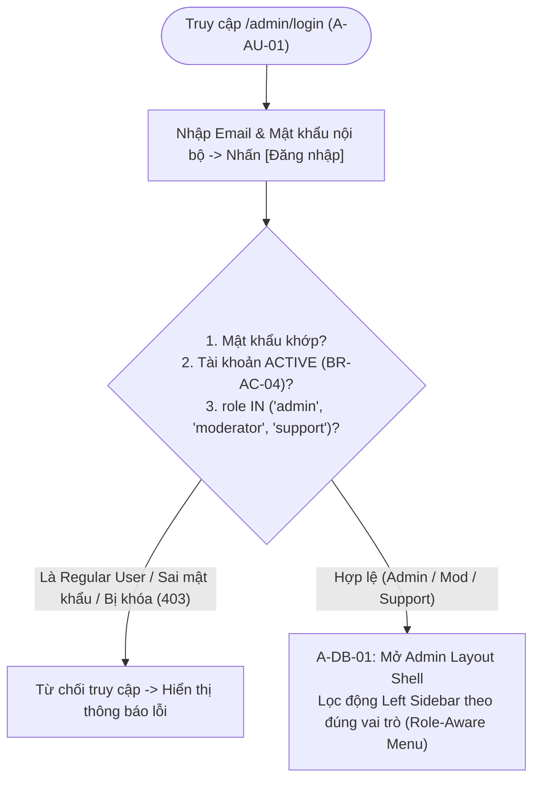
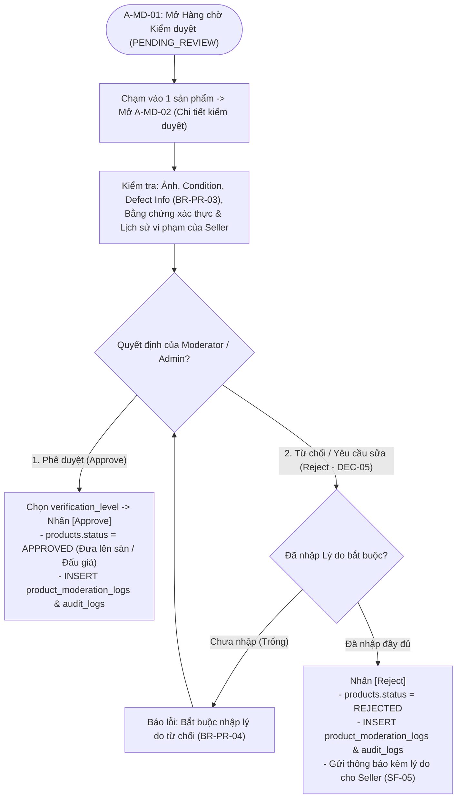
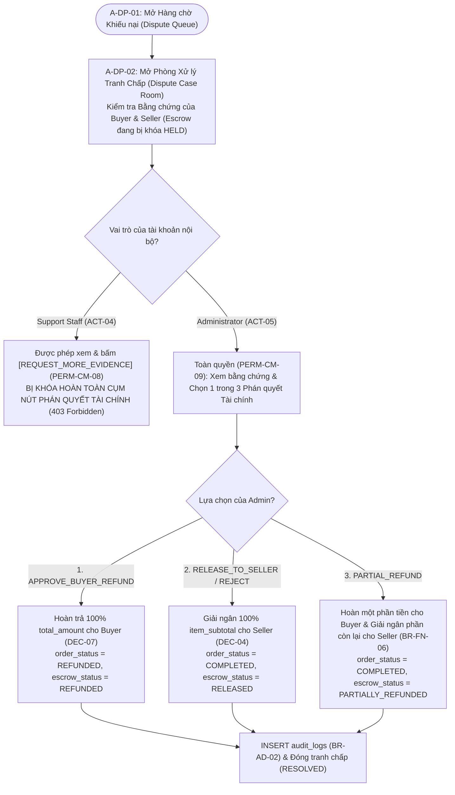
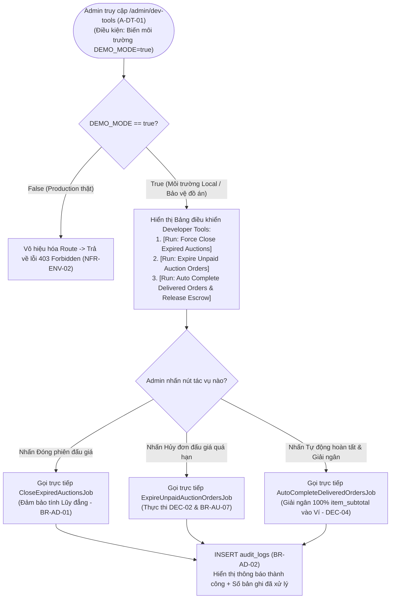

# 06. ADMIN DASHBOARD & MODERATION FLOW SPECIFICATION – RETRO MARKET (izithrift)

- **Document ID:** `DOC-P206-ADMIN-FLOW`
- **Version:** `2.1.0 (COMPLETE UNTRUNCATED SPECIFICATION)`
- **Status:** `SELF-VERIFIED & READY FOR FINAL LOCK`
- **Project Codename:** `RETRO MARKET`
- **Application Brand Name:** `izithrift`
- **Phase:** `Phase 02 – System Flow & UX Planning`

---

## Chương 1. Tổng Quan Kiến Trúc Quản Trị & Phân Quyền Laravel Blade Admin (`RBAC & Segregation of Duties`)

Trang quản trị **Admin Dashboard** (`/admin/*`) được xây dựng trên nền tảng **Laravel Blade** dùng chung Service Layer với REST API di động (`ADR-02`), tuân thủ nghiêm ngặt nguyên tắc **Phân tách nhiệm vụ nội bộ (`Segregation of Duties`)** đã thiết lập ở Phase 01 (`03_ACTOR_PERMISSION_MATRIX.md`):
1. **Administrator (`ACT-05`):** Quyền cao nhất, quản lý toàn bộ 14 phân hệ, cấu hình Buyer Protection Fee, ra phán quyết tài chính cuối cùng cho khiếu nại, phân quyền và vận hành **Developer Tools (Demo Mode)**.
2. **Moderator (`ACT-03`):** Chuyên trách kiểm duyệt sản phẩm (`PENDING_REVIEW` $\rightarrow$ `APPROVED` / `REJECTED`), kiểm duyệt danh mục/thương hiệu và xử lý báo cáo vi phạm (`Reports`); tuyệt đối không có quyền can thiệp vào dòng tiền Escrow.
3. **Support Staff (`ACT-04`):** Chuyên trách tiếp nhận khiếu nại được phân công, xem bằng chứng hai bên và yêu cầu bổ sung bằng chứng (`REQUEST_MORE_EVIDENCE`); tuyệt đối **không có quyền bấm nút tài chính cuối cùng** (Hoàn tiền / Giải ngân – `PERM-CM-08` vs `PERM-CM-09`).

### 1.1. Danh Mục Tổng Hợp 10 Luồng Quản Trị & Kiểm Duyệt (`Master Admin Flow Index`)

| Flow ID | Tên Luồng (Flow Name) | Actor Chính | Điểm Bắt Đầu $\rightarrow$ Kết Thúc | Laravel Routes / Controllers Liên Quan | Liên Kết FR / UC / BR / DEC |
| :--- | :--- | :--- | :--- | :--- | :--- |
| `AFW-01` | Admin Authentication & RBAC Shell Routing (Xác thực quản trị & Phân định giao diện theo Role) | `ACT-03`, `ACT-04`, `ACT-05` | `A-AU-01` $\rightarrow$ `A-DB-01` | `GET /admin/login`, `POST /admin/login`, `RoleMiddleware` | `FR-AU-02`, `FR-AD-01` \| `UC-AD-01` \| `PERM-AU-01`, `BR-AC-04`, `NFR-SEC-02` |
| `AFW-02` | Live Dashboard KPI & PostgreSQL Metrics Monitoring (Giám sát chỉ số thời gian thực từ CSDL) | `ACT-03`, `ACT-04`, `ACT-05` | `A-DB-01` | `GET /admin/dashboard`, `DashboardController` | `FR-AD-01` \| `UC-AD-01` \| `PERM-AD-01`, `NFR-PER-01` |
| `AFW-03` | Product Moderation Queue & Inspection (Hàng chờ kiểm duyệt sản phẩm & Phê duyệt / Từ chối kèm lý do) | `ACT-03` (Mod), `ACT-05` (Admin) | `A-MD-01` $\rightarrow$ `A-MD-02` | `GET /admin/moderation/products`, `POST /admin/moderation/products/{id}` | `FR-MD-01`, `FR-MD-02` \| `UC-MD-01` \| `PERM-PR-06`, `PERM-PR-07`, `BR-PR-03`, `BR-PR-04`, `DEC-05` |
| `AFW-04` | Category, Brand & Violation Report Moderation (Quản lý danh mục, thương hiệu & Kiểm duyệt báo cáo) | `ACT-03`, `ACT-05` | `A-CT-01` / `A-CM-01` | `GET/POST /admin/catalog`, `GET/POST /admin/moderation/reports` | `FR-CT-01` \| `UC-AD-01` \| `PERM-PR-09`, `PERM-CM-04`, `PERM-CM-11` |
| `AFW-05` | Scheduled Auction Session Configuration & Fraud Audit (Cấu hình phiên đấu giá & Giám sát gian lận) | `ACT-05` (Admin) | `A-AC-01` $\rightarrow$ `A-AC-02` $\rightarrow$ `A-AC-03` | `GET/POST /admin/auctions/sessions`, `GET /admin/auctions`, `POST /admin/auctions/{id}/cancel` | `FR-AC-01`, `FR-AC-08`, `FR-AC-09` \| `UC-AC-01` \| `PERM-AC-08`, `PERM-AC-09`, `BR-AD-02` |
| `AFW-06` | Order, Shipment & Immutable Escrow Ledger Monitoring (Giám sát đơn hàng, vận chuyển & Sổ cái Escrow) | `ACT-04` (Support), `ACT-05` (Admin) | `A-OR-01` $\rightarrow$ `A-OR-02` / `A-ES-01` | `GET /admin/orders`, `GET /admin/orders/{id}`, `GET /admin/escrow` | `FR-OR-04`, `FR-FN-06` \| `UC-AD-01` \| `PERM-OR-04`, `PERM-FN-06`, `BR-FN-07`, `ADR-04` |
| `AFW-07` | Dispute Queue, Evidence Verification & Financial Verdict (Tiếp nhận khiếu nại, Xác minh bằng chứng & Phán quyết tài chính) | `ACT-04` (Support), `ACT-05` (Admin) | `A-DP-01` $\rightarrow$ `A-DP-02` | `GET /admin/disputes`, `GET/POST /admin/disputes/{id}`, `POST /admin/disputes/{id}/resolve` | `FR-DP-01`..`03` \| `UC-DP-02` \| `PERM-CM-08`, `PERM-CM-09`, `BR-DP-02`, `BR-FN-05`..`07`, `DEC-07` |
| `AFW-08` | User Management, Role Assignment & Fraud Suspension (Quản lý người dùng, Phân quyền & Khóa tài khoản) | `ACT-05` (Admin) | `A-US-01` $\rightarrow$ `A-US-02` | `GET /admin/users`, `PUT /admin/users/{id}/status`, `PUT /admin/users/{id}/role` | `FR-AD-02` \| `UC-AD-01` \| `PERM-US-05`..`07`, `BR-AC-04`, `NFR-SEC-01` |
| `AFW-09` | Platform Settings Configuration: Buyer Protection Fee & Timers (Cấu hình thông số nền tảng: Phí bảo vệ & Hạn thời gian) | `ACT-05` (Admin) | `A-ST-01` | `GET/POST /admin/settings` | `FR-AD-04` \| `UC-AD-02` \| `PERM-AD-02`, `BR-FN-02`, `DEC-04`, `ADR-05` |
| `AFW-10` | Developer Tools (Demo Mode) Control Panel & Manual Job Triggers (Bảng điều khiển Demo Mode & Chạy thủ công Scheduled Jobs) | `ACT-05` (Admin) | `A-DT-01` | `GET/POST /admin/dev-tools`, `DemoModeController` | `FR-AD-05` \| `UC-AD-02` \| `PERM-AD-04`, `BR-AD-01`, `ADR-05`, `NFR-ENV-02` |

---

## Chương 2. Đặc Tả Chi Tiết 10 Luồng Quản Trị & Kiểm Duyệt (`AFW-01` – `AFW-10`)

### 2.1. `AFW-01`: Admin Authentication & RBAC Shell Routing (Xác Thực & Định Tuyến Theo Vai Trò)

- **1. Flow ID & Name:** `AFW-01` – Admin Authentication & Role-Based Layout Shell Routing
- **2. Primary Actor:** `ACT-03` (Moderator), `ACT-04` (Support Staff), `ACT-05` (Administrator)
- **3. Entry Point:** Truy cập đường dẫn **`/admin/login` (`A-AU-01`)**.
- **4. Preconditions:** Tài khoản đã được Admin cấp quyền nội bộ trong CSDL (`role IN ('admin', 'moderator', 'support')`).
- **5. Main Flow (Bảng Tương Tác UX & Bảo Mật):**

| Bước | Màn Hình | Người Dùng Thấy Gì (What Admin Sees) | Thao Tác Của Người Dùng (Admin Action) | Phản Hồi Của Hệ Thống (System Response) | Bước Tiếp Theo (Next State) |
| :-: | :---: | :--- | :--- | :--- | :--- |
| 1 | `A-AU-01` | Màn hình đăng nhập quản trị phong cách tối giản (Admin Login): Form nhập `email` và `password`. | Nhập thông tin tài khoản nội bộ và nhấn **[Đăng nhập quản trị]**. | Gọi `POST /admin/login`. Backend xác thực mật khẩu (`Bcrypt`), kiểm tra tài khoản đang `ACTIVE` (`BR-AC-04`) và kiểm tra cột `role` phải khác `registered_user`. | Điều hướng vào trang Tổng quan `A-DB-01`. |
| 2 | `A-DB-01` | Giao diện **Admin Layout Shell**: Thanh điều hướng trái (**Sidebar Menu**) hiển thị các nhóm danh mục được lọc động (`Role-Aware Sidebar`) khớp đúng với quyền hạn của tài khoản đang đăng nhập (`03_ACTOR_PERMISSION_MATRIX.md`). | Quan sát Sidebar và các chỉ số KPI tổng quan. | Render giao diện Blade tương ứng với quyền (ví dụ: Support Staff không nhìn thấy menu Quản lý Đấu giá hay Cấu hình Phí). | Tiến hành các nghiệp vụ quản trị (`AFW-02` $\rightarrow$ `AFW-10`). |

- **6. Exception Flows:**
  - **E1 (Regular User cố gắng đăng nhập vào `/admin/login`):** Hệ thống xác thực đúng mật khẩu nhưng phát hiện `role == registered_user` $\rightarrow$ Từ chối truy cập với mã `403 Forbidden` (*"Bạn không có quyền truy cập trang quản trị"*).
  - **E2 (Tài khoản nội bộ bị khóa `SUSPENDED`):** Từ chối đăng nhập và thu hồi Sanctum/Session token (`BR-AC-04`).
- **7. Screen Sequence:** `A-AU-01` (Admin Login) $\rightarrow$ `A-DB-01` (Dashboard Shell).
- **8. Exit Condition:** Quản trị viên vào đúng trang quản trị với bộ menu Sidebar giới hạn đúng quyền hạn.
- **9. Related IDs:** `FR-AU-02`, `FR-AD-01` | `UC-AD-01` | `PERM-AU-01`, `BR-AC-04`, `NFR-SEC-02`.

---

### 2.2. `AFW-02`: Live Dashboard KPI & PostgreSQL Metrics Monitoring (Giám Sát Chỉ Số KPI Thời Gian Thực)

- **1. Flow ID & Name:** `AFW-02` – Live Dashboard KPI & PostgreSQL Real-Time Metrics Monitoring
- **2. Primary Actor:** `ACT-03`, `ACT-04`, `ACT-05`
- **3. Entry Point:** Màn hình **`A-DB-01` (`/admin/dashboard`)** ngay sau khi đăng nhập thành công.
- **4. Preconditions:** Admin / Moderator / Support đã xác thực thành công.
- **5. Main Flow:**
  1. Giao diện `A-DB-01` truy vấn trực tiếp từ PostgreSQL để hiển thị các thẻ thống kê tổng quan (`FR-AD-01`):
     - **Tổng số Người dùng:** Đang hoạt động / Bị khóa (`SUSPENDED`).
     - **Hàng chờ Kiểm duyệt:** Số sản phẩm đang ở trạng thái `PENDING_REVIEW` (Hiển thị nổi bật cho Moderator).
     - **Giao dịch & Escrow:** Tổng giá trị giao dịch mô phỏng (GMV), Tổng số tiền đang giữ trong Escrow (`ESCROW_HELD`), và Tổng doanh thu **Buyer Protection Fee** đã kết chuyển.
     - **Khiếu nại chờ xử lý:** Số hồ sơ tranh chấp đang ở trạng thái `OPEN` (Hiển thị nổi bật cho Support Staff và Admin).
  2. Người quản trị nhấn vào bất kỳ thẻ KPI nào để chuyển hướng trực tiếp đến màn hình chi tiết tương ứng (Deep Link điều hướng chéo).
- **6. Screen Sequence:** `A-DB-01` $\rightarrow$ Các màn hình quản lý chi tiết.
- **7. Exit Condition:** Quản trị viên nắm bắt bức tranh toàn cảnh hệ thống để phân bổ công việc.
- **8. Related IDs:** `FR-AD-01` | `UC-AD-01` | `PERM-AD-01`, `NFR-PER-01`.

---

### 2.3. `AFW-03`: Product Moderation Queue & Inspection (Hàng Chờ Kiểm Duyệt Sản Phẩm & Phê Duyệt / Từ Chối Kèm Lý Do – `DEC-05`)

- **1. Flow ID & Name:** `AFW-03` – Product Moderation Queue, Evidence Inspection & Decision Enforcement (`DEC-05`)
- **2. Primary Actor:** `ACT-03` (Moderator) hoặc `ACT-05` (Administrator)
- **3. Entry Point:** Sidebar $\rightarrow$ **Kiểm duyệt & Sản phẩm** $\rightarrow$ **Hàng chờ Kiểm duyệt (`A-MD-01` – `/admin/moderation/products`)**.
- **4. Preconditions:** Có sản phẩm ở trạng thái `PENDING_REVIEW` (`BR-PR-02`).
- **5. Main Flow (Bảng Tương Tác UX & Kiểm Tra Quyết Định):**

| Bước | Màn Hình | Người Dùng Nhìn Thấy Gì (What Moderator Sees) | Thao Tác Của Người Dùng (Admin/Mod Action) | Phản Hồi Của Hệ Thống (System Response) | Bước Tiếp Theo (Next State) |
| :-: | :---: | :--- | :--- | :--- | :--- |
| 1 | `A-MD-01` | Danh sách sản phẩm đang chờ kiểm duyệt (`PENDING_REVIEW`) kèm tên bài đăng, tên Seller, danh mục và thời gian gửi. | Chạm vào một sản phẩm để mở Chi tiết kiểm duyệt `A-MD-02`. | Gọi `GET /admin/moderation/products/{id}` lấy toàn bộ ảnh, mô tả, tình trạng, lỗi (`defect_info`), bằng chứng xác thực và lịch sử duyệt cũ của người bán. | Mở màn hình Chi tiết `A-MD-02`. |
| 2 | `A-MD-02` | Màn hình **Chi tiết Kiểm duyệt** (`/admin/moderation/products/:id`) hiển thị đầy đủ hình ảnh phóng to, thông tin lỗi, lịch sử vi phạm của Seller, và 2 nút hành động: **[Phê duyệt (`Approve`)]** và **[Từ chối / Yêu cầu chỉnh sửa (`Reject` – `DEC-05`)]**. | Moderator kiểm tra tính chân thực của đồ secondhand và chọn một trong hai quyết định: - **Cách A (Approve):** Chọn mức độ xác minh (`verification_level`) và nhấn **[Approve]**. - **Cách B (Reject - `DEC-05`):** Nhấn **[Reject]**, bắt buộc nhập lý do từ chối / hướng dẫn chỉnh sửa (`reason`) và nhấn xác nhận. | Gọi `POST /admin/moderation/products/{id}`. Backend thực thi trong `DB::transaction()`: 1. **Nếu Approve:** Chuyển `product.status = APPROVED`. Nếu là hàng Đấu giá, gán vào phiên đấu giá `SCHEDULED`. 2. **Nếu Reject (`DEC-05`):** Chuyển `product.status = REJECTED`. 3. Ghi bản ghi vào `product_moderation_logs` và `audit_logs` (`BR-PR-04`, `BR-AD-02`). 4. Gửi thông báo `In-App Notification` cho Seller (`SF-05`). | Sản phẩm chính thức hiển thị công khai trên sàn (`APPROVED`) hoặc chuyển về Seller sửa (`REJECTED`). |

- **6. Exception Flows:**
  - **E1 (Bấm `Reject` nhưng để trống trường lý do):** Hệ thống chặn ngay tại Client/Server và yêu cầu nhập lý do từ chối bắt buộc (`BR-PR-04`, `DEC-05`).
  - **E2 (Sản phẩm vừa được Moderator khác duyệt trước đó):** Báo lỗi xung đột trạng thái vì sản phẩm không còn ở `PENDING_REVIEW`.
- **7. Screen Sequence:** `A-MD-01` (Moderation Queue) $\rightarrow$ `A-MD-02` (Inspection Detail) $\rightarrow$ `A-AD-01` (Audit Logs).
- **8. Exit Condition:** Sản phẩm được duyệt (`APPROVED`) hoặc từ chối kèm lý do (`REJECTED`) với đầy đủ Audit Trail.
- **9. Related IDs:** `FR-MD-01`, `FR-MD-02` | `UC-MD-01` | `PERM-PR-06`, `PERM-PR-07`, `BR-PR-03`, `BR-PR-04`, `BR-AD-02`, `DEC-05`.

---

### 2.4. `AFW-04`: Category, Brand & Violation Report Moderation (Quản Lý Danh Mục, Thương Hiệu & Báo Cáo Vi Phạm)

- **1. Flow ID & Name:** `AFW-04` – Category/Brand Management & Community Violation Report Moderation
- **2. Primary Actor:** `ACT-03` (Moderator), `ACT-05` (Administrator)
- **3. Entry Point:** Sidebar $\rightarrow$ **Kiểm duyệt & Danh mục** $\rightarrow$ **Danh mục & Thương hiệu (`A-CT-01`)** hoặc **Kiểm duyệt Báo cáo (`A-CM-01`)**.
- **4. Preconditions:** Quản trị viên đã đăng nhập với quyền `Moderator` hoặc `Admin`.
- **5. Main Flow:**
  1. **Quản lý Danh mục & Thương hiệu (`A-CT-01`):** Cho phép Admin (`ACT-05`) thêm, sửa, ẩn/hiện danh mục đồ si (`Categories`) và thương hiệu (`Brands`) (`PERM-PR-09`). Moderator (`ACT-03`) có quyền xem (`Read-Only`).
  2. **Kiểm duyệt Báo cáo vi phạm (`A-CM-01`):** Moderator hoặc Admin xem danh sách các báo cáo vi phạm do người dùng gửi (`Submit Report` đối với sản phẩm, người dùng hoặc hội thoại chat). Sau khi xác minh, Moderator/Admin có thể chọn: (1) **Ẩn bài đăng vi phạm (`HIDDEN`)**, (2) **Khóa tài khoản vi phạm** (`SUSPENDED` – chuyển tiếp sang `AFW-08`), hoặc (3) **Bác bỏ báo cáo** nếu không có căn cứ. Mọi thao tác đều ghi `audit_logs` (`PERM-CM-04`, `PERM-CM-11`).
- **6. Screen Sequence:** `A-CT-01` / `A-CM-01` $\rightarrow$ `A-AD-01` (Audit Logs).
- **7. Exit Condition:** Danh mục chuẩn hóa và các báo cáo vi phạm được xử lý dứt điểm.
- **8. Related IDs:** `FR-CT-01` | `UC-AD-01` | `PERM-PR-09`, `PERM-CM-04`, `PERM-CM-11`.

---

### 2.5. `AFW-05`: Scheduled Auction Session Configuration & Fraud Audit (Cấu Hình Phiên Đấu Giá & Giám Sát Gian Lận)

- **1. Flow ID & Name:** `AFW-05` – Scheduled Auction Session Management & Anti-Fraud Monitoring
- **2. Primary Actor:** `ACT-05` (Administrator)
- **3. Entry Point:** Sidebar $\rightarrow$ **Quản lý Đấu giá** $\rightarrow$ **Cấu hình Phiên đấu giá (`A-AC-01`)** hoặc **Giám sát Đấu giá (`A-AC-02`)**.
- **4. Preconditions:** Đã đăng nhập với quyền `Administrator`.
- **5. Main Flow:**
  1. **Cấu hình Khung giờ Phiên (`A-AC-01`):** Quản lý các khung giờ phiên đấu giá hàng ngày (`auction_sessions`: thời gian mở, thời gian đóng, trạng thái `ACTIVE`/`INACTIVE`) (`PERM-AC-08`).
  2. **Giám sát & Kiểm tra Bất thường (`A-AC-02`, `A-AC-03`):** Admin theo dõi các phiên đấu giá đang `LIVE` hoặc đã `COMPLETED`. Khi phát hiện dấu hiệu gian lận, thông đồng đẩy giá hoặc tài khoản ảo (`WINNER_DEFAULTED` liên tục), Admin mở `A-AC-03` và nhấn **[Hủy phiên đấu giá bất thường (`Cancel Abnormal Auction`)]** (`PERM-AC-09`). Backend chuyển `auction.status = CANCELLED`, ẩn sản phẩm liên quan (`product.status = HIDDEN`) và ghi nhận `audit_logs` (`BR-AD-02`).
- **6. Screen Sequence:** `A-AC-01` / `A-AC-02` $\rightarrow$ `A-AC-03` (Auction Detail & Cancel) $\rightarrow$ `A-AD-01`.
- **7. Exit Condition:** Khung giờ phiên được quản lý chuẩn xác và các phiên gian lận bị đình chỉ kịp thời.
- **8. Related IDs:** `FR-AC-01`, `FR-AC-08`, `FR-AC-09` | `UC-AC-01` | `PERM-AC-08`, `PERM-AC-09`, `BR-AD-02`.

---

### 2.6. `AFW-06`: Order, Shipment & Immutable Escrow Ledger Monitoring (Giám Sát Đơn Hàng, Vận Chuyển & Sổ Cái Escrow)

- **1. Flow ID & Name:** `AFW-06` – Administrative Order Tracking, Shipment Inspection & Escrow Ledger Monitoring
- **2. Primary Actor:** `ACT-04` (Support Staff) & `ACT-05` (Administrator)
- **3. Entry Point:** Sidebar $\rightarrow$ **Giao dịch, Escrow & Khiếu nại** $\rightarrow$ **Quản lý Đơn hàng (`A-OR-01`)** hoặc **Giám sát Sổ cái Escrow (`A-ES-01`)**.
- **4. Preconditions:** Đã đăng nhập với quyền nội bộ hợp lệ.
- **5. Main Flow:**
  1. **Quản lý Đơn hàng (`A-OR-01`, `A-OR-02`):** Tra cứu toàn bộ đơn hàng trên hệ thống, xem timeline vận chuyển, mã vận đơn `tracking_code`, bản chụp snapshot sản phẩm (`order_items` – `BR-OR-02`) để hỗ trợ giải đáp thắc mắc cho khách hàng (`PERM-OR-04`). Support Staff chỉ thấy các đơn được phân công (`ASSIGNED`), Admin thấy toàn bộ (`YES`).
  2. **Giám sát Sổ cái Escrow (`A-ES-01`):** Theo dõi toàn bộ dòng tiền giữ trung gian (`escrow_transactions`) và biến động ví (`wallet_transactions`). **Quy tắc tuyệt đối:** Giao diện này hoàn toàn ở chế độ **Chỉ đọc (`Read-Only Ledger`)**, không bao giờ tồn tại nút chỉnh sửa số dư thủ công (`BR-FN-07`, `PERM-FN-07`), bảo đảm tính toàn vẹn tài chính 100%.
- **6. Screen Sequence:** `A-OR-01` $\rightarrow$ `A-OR-02` (Order Snapshot) $\rightarrow$ `A-ES-01` (Escrow Ledger Monitor).
- **7. Exit Condition:** Quản trị viên nắm bắt đầy đủ trạng thái giao dịch và sổ cái bất biến.
- **8. Related IDs:** `FR-OR-04`, `FR-FN-06` | `UC-AD-01` | `PERM-OR-04`, `PERM-FN-06`, `BR-FN-07`, `ADR-04`.

---

### 2.7. `AFW-07`: Dispute Queue, Evidence Verification & Financial Verdict (Tiếp Nhận Khiếu Nại, Xác Minh Bằng Chứng & Phán Quyết Tài Chính – `DEC-07`)

- **1. Flow ID & Name:** `AFW-07` – Dispute Resolution Queue, Counter-Evidence Review & Exclusive Admin Financial Verdict (`DEC-07`)
- **2. Primary Actor:** `ACT-04` (Support Staff) & **`ACT-05` (Administrator Only)**
- **3. Entry Point:** Sidebar $\rightarrow$ **Giao dịch, Escrow & Khiếu nại** $\rightarrow$ **Quản lý Khiếu nại (`A-DP-01` – `/admin/disputes`)**.
- **4. Preconditions:** Có hồ sơ khiếu nại ở trạng thái `OPEN` hoặc `NEED_MORE_INFO` (`dispute_status IN ('OPEN', 'NEED_MORE_INFO')`).
- **5. Main Flow (Phân Tách Quyền Hạn Nghiêm Ngặt Giữa Support Staff và Administrator):**

| Bước | Màn Hình | Người Dùng Nhìn Thấy Gì | Thao Tác Thực Hiện (Action) | Phản Hồi Của Hệ Thống (System Response) |
| :-: | :---: | :--- | :--- | :--- | :--- |
| 1 | `A-DP-01` | Danh sách khiếu nại chờ xử lý (`Dispute Queue`) hiển thị mã đơn, thời gian mở khiếu nại, lý do và trạng thái Escrow đang bị khóa (`HELD`). | Click vào một hồ sơ khiếu nại để mở Phòng xử lý tranh chấp `A-DP-02`. | Mở màn hình `A-DP-02` (`/admin/disputes/{id}`). | Hiển thị toàn bộ bằng chứng. |
| 2 | `A-DP-02` | Màn hình **Phòng xử lý Khiếu nại** (`Dispute Case Room`) hiển thị: thông tin đơn hàng, ảnh bằng chứng của Buyer, ảnh giải trình của Seller, lịch sử chat và các nút thao tác. | **- Cả Support Staff (`ACT-04`) lẫn Admin (`ACT-05`)** đều có quyền xem xét bằng chứng và bấm nút **[Yêu cầu bổ sung bằng chứng (`REQUEST_MORE_EVIDENCE`)]** (`PERM-CM-08`). **- CHỈ ADMINISTRATOR (`ACT-05`)** mới nhìn thấy và có quyền bấm **cụm nút phán quyết tài chính độc quyền** (`PERM-CM-09`):   1. `APPROVE_BUYER_REFUND` (Hoàn trả 100% `total_amount` gồm cả `item_subtotal` + `buyer_protection_fee` cho Buyer – `DEC-07`).   2. `RELEASE_TO_SELLER` / `REJECT_DISPUTE` (Giải ngân 100% `item_subtotal` cho Seller).   3. `PARTIAL_REFUND` (Hoàn tiền một phần theo `BR-FN-06`). | Gọi `POST /admin/disputes/{id}/resolve`. Backend thực thi trong `DB::transaction()` + `lockForUpdate()`: 1. Cập nhật `disputes.status = RESOLVED`, `orders.dispute_status = RESOLVED_...`. 2. Sinh bút toán tương ứng trong `escrow_transactions` và `wallet_transactions`. 3. Ghi `audit_logs` (`BR-AD-02`) và gửi thông báo kết quả cho hai bên. | Tranh chấp đóng lại (`RESOLVED`), tiền trong Escrow được phân bổ chính xác và sổ cái cập nhật. |

- **6. Exception Flows:**
  - **E1 (Support Staff cố bấm nút phán quyết tài chính):** Giao diện ẩn cụm nút phán quyết và nếu cố gọi API trực tiếp sẽ bị chặn bởi Policy với mã `403 Forbidden` (`PERM-CM-09` – `Strict Financial Restriction`).
- **7. Screen Sequence:** `A-DP-01` (Dispute Queue) $\rightarrow$ `A-DP-02` (Case Room & Verdict) $\rightarrow$ `A-ES-01` (Escrow Ledger Audit).
- **8. Exit Condition:** Tranh chấp được phân xử minh bạch theo đúng quyền hạn RBAC và ghi vết trong Audit Log.
- **9. Related IDs:** `FR-DP-01`..`03`, `FR-AD-06` | `UC-DP-02` | `PERM-CM-08`, `PERM-CM-09`, `BR-DP-02`, `BR-FN-04`..`07`, `BR-AD-02`, `DEC-07`.

---

### 2.8. `AFW-08`: User Management, Role Assignment & Fraud Suspension (Quản Lý Người Dùng, Phân Quyền & Khóa Tài Khoản)

- **1. Flow ID & Name:** `AFW-08` – Administrative User Account Management, RBAC Role Assignment & Fraud Suspension
- **2. Primary Actor:** `ACT-05` (Administrator Only)
- **3. Entry Point:** Sidebar $\rightarrow$ **Người dùng & Hệ thống** $\rightarrow$ **Quản lý Người dùng (`A-US-01` – `/admin/users`)**.
- **4. Preconditions:** Đã đăng nhập với quyền `Administrator`.
- **5. Main Flow:**
  1. Admin tìm kiếm tài khoản theo email, tên hoặc số điện thoại, lọc theo trạng thái (`ACTIVE`, `SUSPENDED`, `BANNED`) và vai trò (`registered_user`, `moderator`, `support`).
  2. Chạm vào tài khoản để mở Chi tiết Người dùng `A-US-02` (`/admin/users/{id}`) xem lịch sử giao dịch, điểm uy tín (`Trust Score`), tỷ lệ khiếu nại và các tín hiệu gian lận (`Fraud Signals`).
  3. **Hành động quản trị:**
     - **Phân quyền nội bộ (`Role Assignment`):** Nâng/hạ vai trò nội bộ (`PERM-US-07`).
     - **Khóa tài khoản (`Suspend / Ban`):** Chuyển trạng thái tài khoản sang `SUSPENDED` hoặc `BANNED` (`PERM-US-06`). Backend ngay lập tức thu hồi toàn bộ Sanctum Token của tài khoản đó, ẩn tạm thời các sản phẩm `APPROVED` chưa bán và chặn mọi request tiếp theo với mã `403 Forbidden` (`BR-AC-04`). Mọi thao tác đều ghi `audit_logs` (`BR-AD-02`).
- **6. Screen Sequence:** `A-US-01` (User List) $\rightarrow$ `A-US-02` (User Detail & Suspend) $\rightarrow$ `A-AD-01` (Audit Logs).
- **7. Exit Condition:** Tài khoản gian lận bị vô hiệu hóa an toàn và phân quyền nội bộ được cập nhật chính xác.
- **8. Related IDs:** `FR-AD-02` | `UC-AD-01` | `PERM-US-05`..`07`, `BR-AC-04`, `BR-AD-02`, `NFR-SEC-01`.

---

### 2.9. `AFW-09`: Platform Settings Configuration: Buyer Protection Fee & Timers (Cấu Hình Thông Số Nền Tảng: Phí Bảo Vệ & Hạn Thời Gian – `DEC-04`)

- **1. Flow ID & Name:** `AFW-09` – Dynamic Platform Settings Configuration (Buyer Protection Fee & Timers)
- **2. Primary Actor:** `ACT-05` (Administrator Only)
- **3. Entry Point:** Sidebar $\rightarrow$ **Người dùng & Hệ thống** $\rightarrow$ **Cấu hình Nền tảng (`A-ST-01` – `/admin/settings`)**.
- **4. Preconditions:** Đã đăng nhập với quyền `Administrator`.
- **5. Main Flow:**
  1. Màn hình `A-ST-01` hiển thị các tham số cấu hình lưu trong bảng `platform_settings`:
     - **Tỷ lệ % Phí bảo vệ người mua (`protection_fee_rate`):** Mặc định `6%` (cho phép chỉnh sửa trong dải `5% – 8%`).
     - **Phí bảo vệ cố định (`protection_fixed_fee`):** Mặc định `7.000 VNĐ` (cho phép chỉnh sửa trong dải `5.000đ – 10.000đ`).
     - **Thời hạn thanh toán đơn đấu giá:** Mặc định `30 phút` ở Production / `2 phút` ở Demo Mode.
     - **Thời gian tự động hoàn tất đơn sau khi giao:** Mặc định `24 giờ` ở Production / `2 phút` ở Demo Mode.
     - **Thời gian gia hạn Anti-sniping:** Mặc định `2 phút` ở Production / `30 giây` ở Demo Mode.
  2. Admin điều chỉnh các thông số và nhấn **[Lưu cấu hình hệ thống]** $\rightarrow$ Backend lưu vào `platform_settings`, ghi `audit_logs` (`BR-AD-02`). Các đơn hàng hoặc phiên đấu giá tạo mới sau thời điểm lưu sẽ áp dụng cấu hình mới này (`DEC-04`).
- **6. Screen Sequence:** `A-ST-01` (Platform Settings) $\rightarrow$ `A-AD-01` (Audit Logs).
- **7. Exit Condition:** Thông số nền tảng được cập nhật thành công và ghi vết kiểm toán.
- **8. Related IDs:** `FR-AD-04` | `UC-AD-02` | `PERM-AD-02`, `BR-FN-02`, `BR-AD-02`, `DEC-04`, `ADR-05`.

---

### 2.10. `AFW-10`: Developer Tools Control Panel & Manual Idempotent Job Triggers (Bảng Điều Khiển Demo Mode & Chạy Thủ Công Scheduled Jobs – `ADR-05`, `BR-AD-01`)

- **1. Flow ID & Name:** `AFW-10` – Developer Tools Control Panel & Manual Idempotent Job Triggers for Defense Demo (`DEMO_MODE=true`)
- **2. Primary Actor:** `ACT-05` (Administrator Only)
- **3. Entry Point:** Khi biến môi trường `DEMO_MODE=true`, mục **Developer Tools (`A-DT-01` – `/admin/dev-tools`)** xuất hiện ở nhóm cuối cùng trên Sidebar.
- **4. Preconditions:** Biến môi trường `DEMO_MODE=true` được cấu hình tại môi trường chạy local/demo.
- **5. Main Flow (Bảng Tương Tác Công Cụ Trình Diễn Đồ Án):**

| Nút Tác Vụ Trên `A-DT-01` | Mục Đích Khi Bảo Vệ Đồ Án | Hàm Service & Lô-gich Thực Thi (Idempotent Guard – `BR-AD-01`) |
| :--- | :--- | :--- |
| **`[Run: Force Close Expired Auctions]`** | Đóng ngay lập tức các phiên đấu giá đang `LIVE` mà không cần đợi hết giờ thực tế. | Gọi `CloseExpiredAuctionsJob`. Khóa dòng `auctions`, kiểm tra `status == LIVE`, xác định người thắng đạt giá sàn và sinh đơn hàng `PENDING_PAYMENT` (hạn thanh toán 2 phút ở Demo Mode). |
| **`[Run: Expire Unpaid Auction Orders]`** | Xử lý ngay lập tức các đơn đấu giá đã quá hạn 2 phút không thanh toán. | Gọi `ExpireUnpaidAuctionOrdersJob`. Kiểm tra đơn đấu giá có `payment_status == UNPAID` và quá hạn `payment_expires_at`, chuyển đơn sang `CANCELLED`, đánh dấu phiên `WINNER_DEFAULTED` và mở khóa sản phẩm cho Seller đăng lại (`DEC-02`). |
| **`[Run: Auto Complete Delivered Orders & Release Escrow]`** | Giải ngân ngay lập tức các đơn hàng đang ở `DELIVERED` mà không cần đợi đủ 24 giờ. | Gọi `AutoCompleteDeliveredOrdersJob`. Quét các đơn `DELIVERED`, `HELD`, không có Dispute (`dispute_status == NONE`), chuyển sang `COMPLETED`, `RELEASED`, cộng 100% `item_subtotal` vào Ví Seller (`DEC-04`). |

- **6. Alternative & Exception Flows:** Nếu `DEMO_MODE=false` (ở môi trường Production thật), route `/admin/dev-tools` hoàn toàn bị vô hiệu hóa trả về lỗi `403 Forbidden` (`NFR-ENV-02`).
- **7. Screen Sequence:** `A-DT-01` (Developer Tools Panel) $\rightarrow$ Kết quả thực thi phản hồi tức thì trên giao diện kèm thống kê số bản ghi vừa xử lý.
- **8. Exit Condition:** Quản trị viên trình diễn trọn vẹn toàn bộ các luồng nghiệp vụ phụ thuộc thời gian một cách mượt mà, chính xác và lũy đẳng trước hội đồng chấm thi.
- **9. Related IDs:** `FR-AD-05` | `UC-AD-02` | `PERM-AD-04`, `BR-AD-01`, `ADR-05`, `NFR-ENV-02`.

---

## Chương 3. Kết Quả Tự Động Kiểm Tra & Nghiệm Thu (`Self-Verified Quality Gate Checklist`)

- [x] **1. Đầy đủ 10 luồng Quản trị & Kiểm duyệt (`AFW-01`..`AFW-10`):** Phủ kín 100% từ xác thực RBAC, giám sát Dashboard KPI live từ PostgreSQL, hàng chờ kiểm duyệt sản phẩm (`DEC-05`), quản lý danh mục/thương hiệu, cấu hình phiên đấu giá & chống gian lận, giám sát đơn hàng/vận chuyển/sổ cái Escrow, phòng xử lý tranh chấp phân tách quyền tài chính nghiêm ngặt (`DEC-07`), quản lý người dùng, cấu hình thông số nền tảng đến bảng điều khiển **Developer Tools (Demo Mode)** lũy đẳng (`BR-AD-01`, `ADR-05`).
- [x] **2. Tôn trọng tuyệt đối nguyên tắc Phân tách nhiệm vụ (`Segregation of Duties`):** Support Staff được xem bằng chứng và yêu cầu thêm bằng chứng nhưng bị khóa hoàn toàn cụm nút phán quyết tài chính (`PERM-CM-08` vs `PERM-CM-09`); toàn bộ giao diện sổ cái Escrow ở chế độ Read-Only (`BR-FN-07`).
- [x] **3. Đầy đủ Biểu đồ Mermaid (4 Sơ đồ chuyên sâu):** Gồm sơ đồ phân quyền RBAC, sơ đồ quy trình kiểm duyệt sản phẩm (`DEC-05`), sơ đồ phòng xử lý tranh chấp của Admin (`DEC-07`) và sơ đồ bảng điều khiển Developer Tools (`DEMO_MODE`).