# 02. BUYER USER FLOW SPECIFICATION – RETRO MARKET (izithrift)

- **Document ID:** `DOC-P202-BUYER-FLOW`
- **Version:** `2.1.0 (COMPLETE UNTRUNCATED SPECIFICATION)`
- **Status:** `SELF-VERIFIED & READY FOR FINAL LOCK`
- **Project Codename:** `RETRO MARKET`
- **Application Brand Name:** `izithrift`
- **Phase:** `Phase 02 – System Flow & UX Planning`

---

## Chương 1. Danh Mục Tổng Hợp 12 Luồng Người Mua (Master Buyer Flow Index)

Toàn bộ hành trình của Người mua (`Guest` & `Registered Buyer`) trên ứng dụng `izithrift` được chuẩn hóa thành **12 luồng nghiệp vụ khép kín (`BF-01` đến `BF-12`)**, kết nối trực tiếp với mã màn hình trong `SITEMAP.md`, API Endpoints (`/api/v1/*`) và Quy tắc nghiệp vụ (`BR-*`, `DEC-*`):

| Flow ID | Tên Luồng (Flow Name) | Actor Chính | Điểm Bắt Đầu $\rightarrow$ Kết Thúc | API Endpoints Liên Quan (`/api/v1`) | Liên Kết FR / UC / BR / DEC |
| :--- | :--- | :--- | :--- | :--- | :--- |
| `BF-01` | Browse Products (Duyệt khám phá sản phẩm) | `ACT-01`, `ACT-02` | `M-HM-01` $\rightarrow$ `M-PR-01` / `M-AC-03` | `GET /products`, `GET /auctions`, `GET /categories` | `FR-AU-05`, `FR-DS-01` \| `UC-DS-01` \| `BR-AC-03`, `BR-PR-02`, `DEC-01` |
| `BF-02` | Search and Filter (Tìm kiếm, lọc & sắp xếp) | `ACT-01`, `ACT-02` | `M-DS-01` $\rightarrow$ `M-DS-02` / `M-DS-03` | `GET /products?q=&category_id=&condition=&min_price=&max_price=&listing_type=&sort=` | `FR-CT-01`, `FR-DS-02` \| `UC-DS-01` \| `BR-PR-02`, `NFR-PER-02` |
| `BF-03` | View Product Details (Xem chi tiết sản phẩm & Tiệm) | `ACT-01`, `ACT-02` | `M-PR-01` $\leftrightarrow$ `M-US-03` | `GET /products/{id}`, `GET /users/{id}`, `GET /users/{id}/reviews` | `FR-DS-03`, `FR-US-03` \| `UC-DS-01` \| `BR-AC-02`, `BR-PR-01`, `BR-PR-03`, `DEC-01` |
| `BF-04` | Add to Cart & Manage Cart (Quản lý giỏ hàng theo Seller) | `ACT-02` (Buyer) | `M-PR-01` $\rightarrow$ `M-CR-01` | `GET /cart`, `POST /cart/items`, `PUT /cart/items/{id}`, `DELETE /cart/items/{id}` | `FR-CR-01` \| `UC-CR-01` \| `BR-AC-02`, `BR-OR-01`, `DEC-01` |
| `BF-05` | Checkout & Order Snapshot (Xem phí bảo vệ & Đặt hàng) | `ACT-02` (Buyer) | `M-CR-01` $\rightarrow$ `M-OR-01` $\rightarrow$ `M-PM-01` | `GET /users/addresses`, `POST /orders/checkout-preview`, `POST /orders` | `FR-OR-01`, `FR-OR-02` \| `UC-OR-01` \| `BR-OR-01`..`03`, `BR-FN-02`, `DEC-04`, `ADR-06` |
| `BF-06` | QR Mock Payment & Escrow Hold (Thanh toán QR & Giữ tiền) | `ACT-02` (Buyer) | `M-PM-01` $\rightarrow$ `M-PM-02` | `POST /payments/create`, `GET /payments/{id}`, `POST /payments/{id}/simulate-success` | `FR-PM-01`, `FR-PM-02`, `FR-ES-01` \| `UC-PM-01` \| `BR-FN-03`, `BR-FN-07`, `ADR-03`..`05` |
| `BF-07` | Track Order & 3-Tier Cancellation (Theo dõi & Hủy đơn) | `ACT-02` (Buyer) | `M-OR-02` $\rightarrow$ `M-OR-03` $\leftrightarrow$ `M-OR-04` | `GET /orders`, `GET /orders/{id}`, `POST /orders/{id}/cancel`, `POST /orders/{id}/request-cancel` | `FR-OR-03`, `FR-SH-02` \| `UC-OR-02`, `UC-SH-01` \| `BR-OR-04`, `BR-FN-05`, `DEC-06`, `DEC-07` |
| `BF-08` | Confirm Delivery & Escrow Release (Nhận hàng & Giải ngân) | `ACT-02` (Buyer) | `M-OR-03` $\rightarrow$ `M-OR-05` $\rightarrow$ `M-RV-01` | `POST /orders/{id}/confirm-delivery` | `FR-SH-02`, `FR-ES-02` \| `UC-ES-01` \| `BR-OR-05`, `BR-FN-04`, `BR-AD-01`, `DEC-04` |
| `BF-09` | Rate Seller (Đánh giá 1–5 sao sau khi hoàn tất đơn) | `ACT-02` (Buyer) | `M-OR-03` $\rightarrow$ `M-RV-01` | `POST /reviews`, `GET /users/{id}/reviews` | `FR-RV-01` \| `UC-RV-01` \| `BR-RV-01` |
| `BF-10` | Submit Complaint / Dispute (Gửi khiếu nại & Khóa tiền) | `ACT-02` (Buyer) | `M-OR-03` $\rightarrow$ `M-DP-01` $\rightarrow$ `M-DP-03` | `POST /disputes`, `GET /disputes`, `GET /disputes/{id}`, `POST /disputes/{id}/evidence` | `FR-DP-01`..`03` \| `UC-DP-01`, `UC-DP-02` \| `BR-DP-01`, `BR-DP-02`, `BR-FN-05`, `DEC-03`, `DEC-07` |
| `BF-11` | Manage Favorites & Follow Seller (Yêu thích & Theo dõi) | `ACT-02` (Buyer) | `M-PR-01` / `M-US-03` $\leftrightarrow$ `M-PF-05` | `POST /products/{id}/favorite`, `GET /users/favorites`, `POST /users/{id}/follow` | `FR-DS-04`, `FR-US-04` \| `UC-DS-02` \| `BR-AC-02`, `DEC-01` |
| `BF-12` | Chat with Seller (Nhắn tin 1-1 HTTP Polling) | `ACT-02` (Buyer) | `M-PR-01` / `M-OR-03` $\rightarrow$ `M-CM-02` | `GET /conversations`, `POST /conversations`, `GET /conversations/{id}/messages`, `POST /conversations/{id}/messages` | `FR-CM-01`, `FR-CM-02` \| `UC-CM-01` \| `BR-AC-02`, `NFR-PER-03`, `ADR-08` |

---

## Chương 2. Đặc Tả Chi Tiết 12 Luồng Người Mua (`BF-01` – `BF-12`)

### 2.1. `BF-01`: Browse Products (Duyệt Khám Phá Sản Phẩm Trên Trang Chủ & Bộ Sưu Tập)

- **1. Flow ID & Name:** `BF-01` – Browse Products (Duyệt khám phá sản phẩm công khai)
- **2. Primary Actor:** `ACT-01` (Guest) hoặc `ACT-02` (Registered User)
- **3. Entry Point:** Mở ứng dụng `izithrift` (`M-AU-01` $\rightarrow$ `M-HM-01`) hoặc chạm vào **Tab 1: Trang chủ (`/home`)**.
- **4. Preconditions:** Ứng dụng kết nối thành công tới Backend API (`/api/v1`). Không bắt buộc đăng nhập (`DEC-01`).
- **5. Main Flow (Bảng Tương Tác UX Chi Tiết):**

| Bước | Màn Hình | Người Dùng Nhìn Thấy Gì (What User Sees) | Thao Tác Của Người Dùng (User Action) | Phản Hồi Của Hệ Thống (System Response) | Bước Tiếp Theo (Next State) |
| :-: | :---: | :--- | :--- | :--- | :--- |
| 1 | `M-AU-01` $\rightarrow$ `M-HM-01` | Màn hình Splash kiểm tra phiên đăng nhập; chuyển vào Trang chủ hiển thị `Loading Skeleton` phong cách kem ấm (`#F4EBDD`). | Mở ứng dụng hoặc nhấn Tab 1 (`Trang chủ`). | Gọi song song `GET /products?featured=1`, `GET /products?sort=newest`, `GET /auctions?status=live`, `GET /categories`. Chỉ lấy sản phẩm có `status = APPROVED` (`BR-PR-02`). | Hiển thị đầy đủ nội dung Trang chủ `M-HM-01`. |
| 2 | `M-HM-01` | 1. Hero Banner Giáng sinh ấm cúng. 2. Thanh Danh mục ngang. 3. Khối *Đấu giá Đang diễn ra (`LIVE`)* & *Sắp kết thúc* (có đồng hồ đếm ngược). 4. Khối *Đồ si Tuyển chọn (`Featured`)* & *Mới lên kệ*. 5. Khối *Tiệm đồ si Uy tín (`Popular Sellers`)*. | Cuộn dọc khám phá hoặc nhấn vào một Banner Bộ sưu tập chủ đề (ví dụ: *Áo Khoác Dạ Mùa Giáng Sinh*). | Nếu chọn Bộ sưu tập: Điều hướng sang `M-HM-02` (`/home/collections/:slug`) và tải danh sách sản phẩm thuộc bộ sưu tập đó. | Hiển thị lưới sản phẩm trong `M-HM-02` hoặc tại `M-HM-01`. |
| 3 | `M-HM-01` / `M-HM-02` | Các thẻ `Product Card` hiển thị rõ: Ảnh đại diện, Tên sản phẩm, Giá bán (hoặc Giá cao nhất hiện tại), Nhãn tình trạng (`condition`), Tên người bán + Điểm sao, Nhãn loại bán (`Fixed Price` / `Auction`). | Chạm vào một `Product Card` bất kỳ. | Kiểm tra `listing_type` của thẻ sản phẩm được chạm. | - Nếu `FIXED_PRICE` $\rightarrow$ Mở `M-PR-01` (`BF-03`). - Nếu `AUCTION` $\rightarrow$ Mở `M-AC-03` (`P2-04`). |

- **6. Alternative Flows:**
  - **A1 (Guest nhấn vào Tab 4 `Kênh Bán` hoặc Tab 5 `Cá nhân`):** Hệ thống giữ nguyên thanh Bottom Navigation 5 Tab và hiển thị **Guest Welcome Card** (`NAV-DEC-03`) với thông điệp mời đăng nhập/đăng ký, cho phép Guest nhấn quay lại Tab 1 (`Trang chủ`) mà không bị kẹt ở màn hình Login.
  - **A2 (Kéo để làm mới – Pull-to-Refresh):** Người dùng vuốt xuống tại `M-HM-01` $\rightarrow$ Gọi lại API lấy danh sách sản phẩm vừa được Moderator duyệt mới nhất.
- **7. Exception Flows:**
  - **E1 (Mất kết nối mạng hoặc Server lỗi 500):** Hiển thị `Error State Card` ngay trong khung nội dung kèm thông báo tiếng Việt và nút **[Thử lại]**.
  - **E2 (Danh sách trống):** Nếu một khu vực chưa có dữ liệu (ví dụ hiện tại không có phiên đấu giá nào đang `LIVE`), hiển thị `Empty State` gọn gàng (*"Phiên đấu giá tiếp theo sẽ mở lúc 20:00 tối nay – Xem lịch phiên"*).
- **8. Screen Sequence:** `M-AU-01` $\rightarrow$ `M-AU-02` *(lần đầu)* $\rightarrow$ `M-HM-01` $\rightarrow$ `M-HM-02` $\rightarrow$ `M-PR-01` / `M-AC-03`.
- **9. Exit Condition:** Người dùng đi vào chi tiết một sản phẩm (`BF-03`) hoặc chuyển sang tìm kiếm/lọc (`BF-02`).
- **10. Related IDs:** `FR-AU-05`, `FR-DS-01` | `UC-DS-01` | `BR-AC-03`, `BR-PR-02`, `DEC-01`, `NAV-DEC-01`, `NAV-DEC-03`.

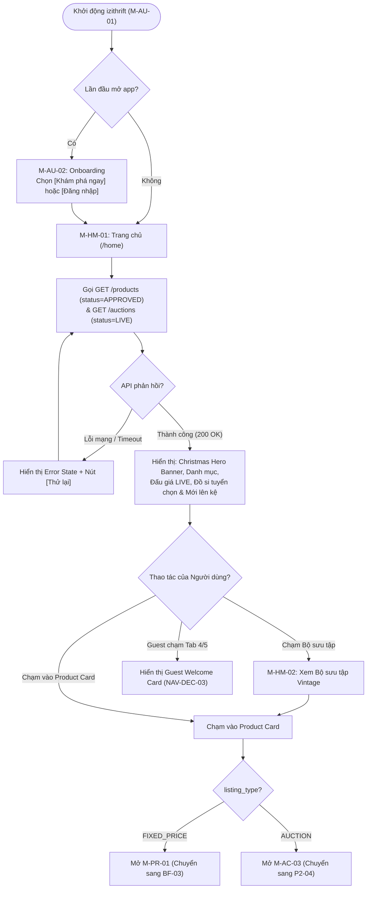

---

### 2.2. `BF-02`: Search and Filter (Tìm Kiếm, Bộ Lọc Đa Tiêu Chí & Sắp Xếp)

- **1. Flow ID & Name:** `BF-02` – Search, Multi-Criteria Filter & Sort Products
- **2. Primary Actor:** `ACT-01` (Guest) hoặc `ACT-02` (Registered User)
- **3. Entry Point:** Nhấn vào thanh tìm kiếm trên Top Header hoặc nhấn **Tab 2: Khám phá (`/discover` – `M-DS-01`)**.
- **4. Preconditions:** Dữ liệu `categories` và `brands` đang hoạt động trong CSDL.
- **5. Main Flow (Bảng Tương Tác UX Chi Tiết):**

| Bước | Màn Hình | Người Dùng Nhìn Thấy Gì (What User Sees) | Thao Tác Của Người Dùng (User Action) | Phản Hồi Của Hệ Thống (System Response) | Bước Tiếp Theo (Next State) |
| :-: | :---: | :--- | :--- | :--- | :--- |
| 1 | `M-DS-01` | Màn hình Khám phá hiển thị ô nhập từ khóa, từ khóa gợi ý, lưới Danh mục đồ si (Áo khoác, Quần Jean, Túi da, Đồng hồ, Decor...) và danh sách Thương hiệu. | Nhập từ khóa tìm kiếm hoặc chạm chọn một Danh mục / Thương hiệu. | Điều hướng sang `M-DS-02` (`/discover/search`) và gọi `GET /products?q=...&category_id=...&page=1`. | Hiển thị kết quả tìm kiếm ban đầu trên `M-DS-02`. |
| 2 | `M-DS-02` $\rightarrow$ `M-DS-03` | Thanh công cụ gồm nút **[Bộ lọc (Filter)]**, menu **[Sắp xếp (Sort)]** và tổng số sản phẩm tìm thấy. | Nhấn **[Bộ lọc]** để mở Bottom Sheet `M-DS-03`. Chọn: Tình trạng (`condition`: Like New, Good, Fair, Vintage Worn), Khoảng giá (`min_price` – `max_price`), Loại bán (`FIXED_PRICE` / `AUCTION`), Khu vực, rồi nhấn **[Áp dụng]**. | Kiểm tra `min_price <= max_price`; đóng Bottom Sheet và gọi lại `GET /products` với đầy đủ query parameters lọc & sắp xếp (`newest`, `price_asc`, `price_desc`, `popular`). | Cập nhật lưới sản phẩm theo kết quả từ PostgreSQL + hiển thị các Filter Chips đang bật. |
| 3 | `M-DS-02` | Lưới sản phẩm khớp bộ lọc (phân trang 20 sản phẩm/lần tải). | Cuộn xem thêm hoặc chạm vào một sản phẩm để xem chi tiết. | Khi cuộn tới cuối trang, tự động tải trang kế tiếp (`page=2...`). Khi chạm vào sản phẩm, mở `M-PR-01`. | Chuyển sang `BF-03` (`M-PR-01`). |

- **6. Alternative Flows:**
  - **A1 (Đặt lại bộ lọc – Reset Filters):** Người dùng nhấn **[Thiết lập lại]** trong `M-DS-03` hoặc nhấn dấu `x` trên từng Filter Chip tại `M-DS-02` $\rightarrow$ Xóa điều kiện lọc và tải lại danh sách.
- **7. Exception Flows:**
  - **E1 (Nhập khoảng giá sai logic `min_price > max_price`):** Hiển thị dòng cảnh báo màu đỏ Burgundy (`#873A43`) ngay dưới ô nhập giá trong `M-DS-03`: *"Giá tối thiểu không được lớn hơn giá tối đa"* và khóa nút **[Áp dụng]**.
  - **E2 (Không có kết quả nào khớp):** Hiển thị `Empty State` kèm hình minh họa vintage và nút **[Xóa bộ lọc để xem thêm]**.
- **8. Screen Sequence:** `M-DS-01` $\rightarrow$ `M-DS-02` $\leftrightarrow$ `M-DS-03` (Filter Sheet) $\rightarrow$ `M-PR-01`.
- **9. Exit Condition:** Người dùng chọn được sản phẩm từ danh sách kết quả tìm kiếm/lọc.
- **10. Related IDs:** `FR-CT-01`, `FR-DS-02` | `UC-DS-01` | `BR-PR-02`, `NFR-PER-02`.

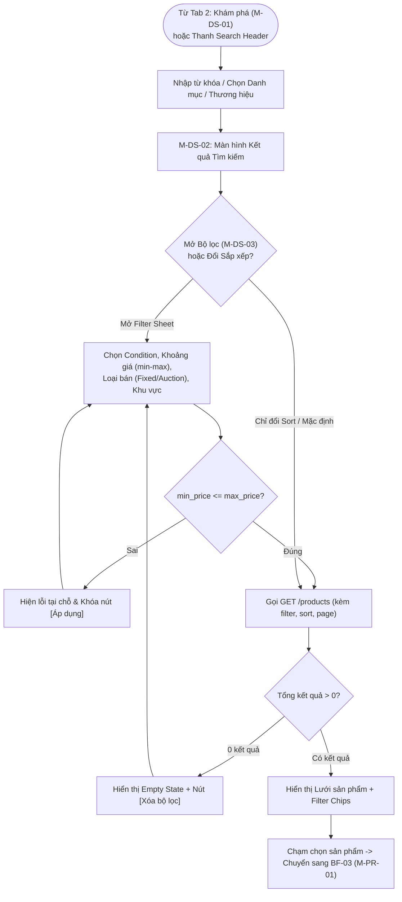

---

### 2.3. `BF-03`: View Product Details (Xem Chi Tiết Sản Phẩm & Hồ Sơ Công Khai Người Bán)

- **1. Flow ID & Name:** `BF-03` – View Product Details & Seller Public Profile
- **2. Primary Actor:** `ACT-01` (Guest) hoặc `ACT-02` (Registered User)
- **3. Entry Point:** Chạm vào `Product Card` từ bất kỳ danh sách nào (`M-HM-01`, `M-DS-02`, `M-PF-05`, `M-US-03`).
- **4. Preconditions:** Sản phẩm có trạng thái `APPROVED` hoặc `SOLD`.
- **5. Main Flow (Bảng Tương Tác UX Chi Tiết):**

| Bước | Màn Hình | Người Dùng Nhìn Thấy Gì (What User Sees) | Thao Tác Của Người Dùng (User Action) | Phản Hồi Của Hệ Thống (System Response) | Bước Tiếp Theo (Next State) |
| :-: | :---: | :--- | :--- | :--- | :--- |
| 1 | `M-PR-01` | 1. Carousel ảnh sản phẩm (chạm vào mở `M-PR-02` phóng to xem vết xước). 2. Tên, Giá bán cố định, Số lượng còn lại. 3. **Thẻ Tình trạng & Kiểm duyệt (`BR-PR-03`):** Tình trạng (`condition`), Mô tả lỗi/khuyết điểm (`defect_info`), Thương hiệu, Danh mục, Nhãn xác minh (`verification_level`: `MODERATOR_REVIEWED` / `EVIDENCE_PROVIDED`). 4. **Thẻ Người bán:** Avatar, Tên tiệm, Điểm sao trung bình, Số lượt đánh giá, Nút **[Xem tiệm]**. 5. Danh sách sản phẩm liên quan. 6. **Bottom Action Bar:** `[Chat]` \| `[Yêu thích]` \| `[Thêm vào giỏ]` \| `[Mua ngay]`. | Xem kỹ ảnh, đọc thông tin `defect_info` hoặc chạm vào **[Xem tiệm]** để kiểm tra uy tín người bán. | Gọi `GET /products/{id}`. Nếu chạm **[Xem tiệm]**, điều hướng sang `M-US-03` (`/sellers/:id`) gọi `GET /users/{id}` và `GET /users/{id}/reviews`. | Hiển thị `M-PR-01` hoặc hồ sơ công khai `M-US-03`. |
| 2 | `M-US-03` | Hồ sơ công khai Người bán gồm: Ảnh đại diện, Mô tả tiệm, Điểm sao trung bình, Tổng số đơn hoàn tất, Nút **[+ Theo dõi]**, Tab *Sản phẩm đang bán* và Tab *Đánh giá từ người mua (`Reviews`)*. | Xem các đánh giá thực tế của người mua trước, sau đó quay lại `M-PR-01` và chọn hành động mua. | Chuyển tới luồng tương ứng theo nút bấm của người dùng. | `BF-04` (Thêm giỏ), `BF-05` (Mua ngay), `BF-11` (Yêu thích/Follow) hoặc `BF-12` (Chat). |

- **6. Alternative Flows:**
  - **A1 (Sản phẩm Đấu giá `listing_type == AUCTION`):** Chuyển sang màn hình `M-AC-03` hiển thị Đồng hồ đếm ngược, Giá cao nhất hiện tại, Bước giá tối thiểu, Lịch sử trả giá và nút **[Đặt giá thầu (`Place Bid`)]** (chi tiết tại `P2-04`).
  - **A2 (Người xem là Chủ sở hữu sản phẩm `auth()->id() == product.seller_id`):** Tuân thủ `BR-AC-02`, hệ thống ẩn toàn bộ nút `Thêm vào giỏ`, `Mua ngay`, `Chat với người bán`, `Yêu thích` và thay bằng thanh thông báo *"Bạn là người đăng bán sản phẩm này"* kèm nút **[Chỉnh sửa / Quản lý bài đăng]** dẫn tới `M-SL-03`.
  - **A3 (Báo cáo vi phạm):** Nhấn nút `(...)` trên góc phải App Bar $\rightarrow$ Mở `M-CM-03` (`Report Bottom Sheet`) để gửi báo cáo sản phẩm nghi ngờ vi phạm cho Moderator.
- **7. Exception Flows:**
  - **E1 (Sản phẩm vừa được bán hết `status == SOLD` hoặc `available_quantity == 0`):** Hiển thị nhãn lớn **`ĐÃ BÁN HẾT (SOLD OUT)`** trên ảnh và làm mờ (Disable) 2 nút `[Thêm vào giỏ]` và `[Mua ngay]`.
  - **E2 (Sản phẩm bị Moderator/Admin ẩn `HIDDEN` hoặc xóa):** API trả về `404` $\rightarrow$ Hiển thị màn hình thông báo sản phẩm không còn tồn tại và nút quay lại.
- **8. Screen Sequence:** `M-PR-01` $\leftrightarrow$ `M-PR-02` (Image Zoom) / `M-US-03` (Public Seller Profile) / `M-CM-03` (Report Sheet).
- **9. Exit Condition:** Người dùng quyết định Thêm vào giỏ (`BF-04`), Mua ngay (`BF-05`), Chat (`BF-12`) hoặc Yêu thích (`BF-11`).
- **10. Related IDs:** `FR-DS-03`, `FR-US-03`, `FR-CM-02` | `UC-DS-01` | `BR-AC-02`, `BR-PR-01`, `BR-PR-03`, `DEC-01`.

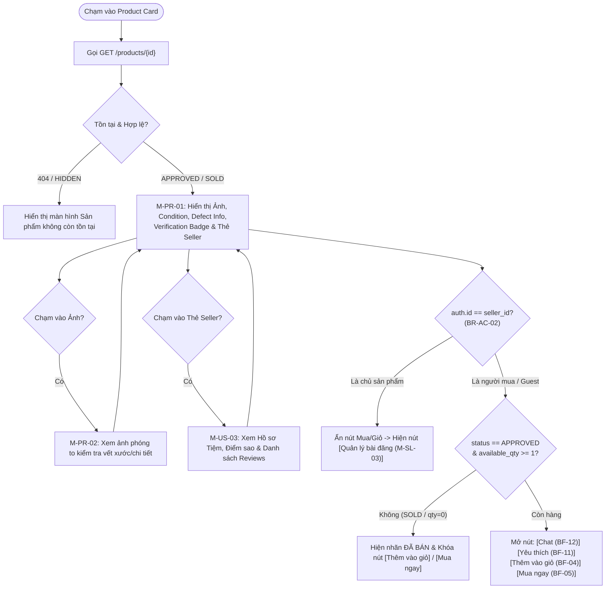

---

### 2.4. `BF-04`: Add to Cart & Manage Shopping Cart (Thêm Vào Giỏ & Quản Lý Giỏ Hàng Nhóm Theo Người Bán)

- **1. Flow ID & Name:** `BF-04` – Add to Cart & Manage Multi-Seller Shopping Cart
- **2. Primary Actor:** `ACT-02` (Buyer)
- **3. Entry Point:** Nhấn **[Thêm vào giỏ]** tại `M-PR-01` hoặc nhấn icon **Giỏ hàng** trên Top Header (`M-CR-01`).
- **4. Preconditions:** Sản phẩm có `listing_type = FIXED_PRICE`, `status = APPROVED`, `available_quantity >= 1`.
- **5. Main Flow (Bảng Tương Tác UX Chi Tiết):**

| Bước | Màn Hình | Người Dùng Nhìn Thấy Gì (What User Sees) | Thao Tác Của Người Dùng (User Action) | Phản Hồi Của Hệ Thống (System Response) | Bước Tiếp Theo (Next State) |
| :-: | :---: | :--- | :--- | :--- | :--- |
| 1 | `M-PR-01` | Thanh hành động dưới đáy với nút **[Thêm vào giỏ]**. | Nhấn **[Thêm vào giỏ]**. | - Nếu là `Guest`: Chuyển hướng `/login?redirect=/products/:id` (`DEC-01`). - Nếu đã đăng nhập: Gọi `POST /cart/items` (`product_id`, `quantity=1`). Kiểm tra `seller_id != auth()->id()` (`BR-AC-02`) và `listing_type == FIXED_PRICE` (`BR-OR-01`). | Hiện Snackbar *"Đã thêm vào giỏ hàng"* + cập nhật số badge trên icon Giỏ hàng. |
| 2 | `M-CR-01` | Màn hình Giỏ hàng (`/cart`) hiển thị các món đồ được **gom nhóm theo từng Tiệm / Người bán (`Seller Group`)** (`BR-OR-01`). Mỗi mục hiển thị ảnh, tên, tình trạng, giá hiện tại, tồn kho tối đa và nút chọn. | Tăng/giảm số lượng (nếu `available_quantity > 1`), xóa món đồ không mua, và **tích chọn các sản phẩm thuộc cùng 1 Người bán**. | Gọi `PUT /cart/items/{id}` hoặc `DELETE /cart/items/{id}`. Khi tích chọn 1 nhóm Seller, tự động tính tổng tiền hàng tạm tính (`item_subtotal`) của nhóm đó ở thanh dưới đáy. | Thanh dưới đáy hiển thị `item_subtotal` và mở nút **[Mua hàng (`Checkout`)]**. |
| 3 | `M-CR-01` | Tóm tắt số món đã chọn của 1 Người bán và nút **[Mua hàng]**. | Nhấn **[Mua hàng]**. | Chuyển danh sách `cart_item_ids` của Seller đó sang màn hình `M-OR-01` (`Checkout Preview`). | Chuyển sang `BF-05` (`M-OR-01`). |

- **6. Alternative Flows:**
  - **A1 (Nhấn nút "Mua ngay (`Buy Now`)" trên `M-PR-01` – `UX-CHECK-01`):** Khi người mua nhấn **[Mua ngay]** tại `M-PR-01`, hệ thống kiểm tra đăng nhập/tồn kho và đưa thẳng sản phẩm đó vào màn hình **`M-OR-01` (`Checkout Preview`)** để chọn địa chỉ và xem bảng tính `Buyer Protection Fee` ngay lập tức mà không cần đi vòng qua bước tích chọn trong Giỏ hàng.
  - **A2 (Xác nhận trước khi xóa khỏi giỏ):** Khi nhấn icon thùng rác xóa sản phẩm, hiển thị hộp thoại xác nhận (`Confirmation Dialog` – `NFR-UX-03`).
- **7. Exception Flows:**
  - **E1 (Tích chọn sản phẩm của Seller thứ 2 trong cùng lần Checkout):** Vì mỗi đơn hàng chỉ thuộc duy nhất 1 Seller (`BR-OR-01`), khi người mua tích chọn một món thuộc Tiệm B, hệ thống tự động bỏ tích chọn ở Tiệm A kèm thông báo nhẹ: *"Mỗi đơn hàng được thanh toán riêng theo từng Tiệm bán để đảm bảo theo dõi vận chuyển và giữ tiền Escrow"*.
  - **E2 (Sản phẩm trong giỏ vừa bị người khác mua mất hoặc bị ẩn):** Dòng sản phẩm đó tự động chuyển sang khu vực *"Sản phẩm không còn khả dụng"* ở cuối giỏ hàng, khóa checkbox chọn mua và cho phép nhấn **[Xóa]**.
- **8. Screen Sequence:** `M-PR-01` $\rightarrow$ *(Login `M-AU-03` nếu là Guest)* $\rightarrow$ `M-CR-01` (Shopping Cart) $\rightarrow$ `M-OR-01` (Checkout Preview).
- **9. Exit Condition:** Các sản phẩm hợp lệ của 1 Người bán được truyền sang bước Checkout (`BF-05`).
- **10. Related IDs:** `FR-AU-05`, `FR-CR-01` | `UC-CR-01` | `BR-AC-02`, `BR-OR-01`, `DEC-01`, `NFR-UX-03`.

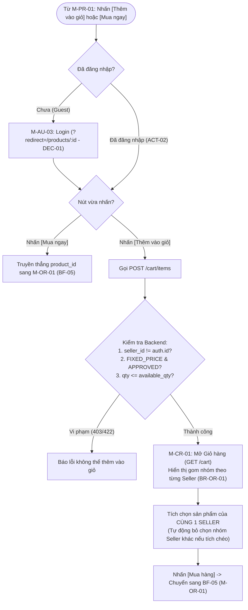

---

### 2.5. `BF-05`: Checkout & Order Snapshot (Xem Trước Phí Bảo Vệ Người Mua & Khởi Tạo Đơn Hàng)

- **1. Flow ID & Name:** `BF-05` – Checkout Preview, Buyer Protection Fee Calculation & Order Creation
- **2. Primary Actor:** `ACT-02` (Buyer)
- **3. Entry Point:** Từ Giỏ hàng (`M-CR-01`) hoặc nhấn **[Mua ngay]** từ `M-PR-01`.
- **4. Preconditions:** Người mua đã đăng nhập; các sản phẩm được chọn thuộc cùng 1 Seller và đang ở trạng thái `APPROVED`, `available_quantity >= requested_quantity`.
- **5. Main Flow (Bảng Tương Tác UX Chi Tiết):**

| Bước | Màn Hình | Người Dùng Nhìn Thấy Gì (What User Sees) | Thao Tác Của Người Dùng (User Action) | Phản Hồi Của Hệ Thống (System Response) | Bước Tiếp Theo (Next State) |
| :-: | :---: | :--- | :--- | :--- | :--- |
| 1 | `M-OR-01` | Màn hình **Checkout Preview** (`/checkout`) hiển thị: 1. **Khối Địa chỉ nhận hàng:** Địa chỉ mặc định (`is_default`) hoặc nút **[Chọn / Thêm địa chỉ]** (`M-PF-03`/`M-PF-04`). 2. **Khối Sản phẩm của Tiệm:** Ảnh, tên, tình trạng, đơn giá và số lượng. 3. **Bảng Kê Chi Phí Minh Bạch (`DEC-04`, `BR-FN-02`):**    - Tổng tiền hàng (`item_subtotal`).    - Phí vận chuyển (`shipping_fee`): **`0 VNĐ`** *(Không thu phí vận chuyển trên app)*.    - **Phí bảo vệ người mua (`buyer_protection_fee`):** `ROUND(item_subtotal * rate, 0) + fixed_fee` *(kèm nhãn giải thích: "Giữ tiền trung gian Escrow – Hoàn lại 100% tiền hàng & phí bảo vệ nếu đồ bị rách, sai mô tả hoặc người bán không gửi hàng")*.    - **Tổng thanh toán (`total_amount`):** `item_subtotal + buyer_protection_fee`. | Kiểm tra địa chỉ nhận hàng, xem chi tiết phí bảo vệ người mua và nhấn nút **[Đặt hàng (`Place Order`)]**. | Gọi `POST /orders/checkout-preview` khi mở màn hình để lấy số liệu tính sẵn từ Backend (`NFR-SEC-03`). Khi nhấn **[Đặt hàng]**, hiển thị hộp thoại xác nhận đặt đơn. | Người mua xác nhận tạo đơn hàng. |
| 2 | `M-OR-01` $\rightarrow$ `M-PM-01` | Trạng thái đang xử lý tạo đơn hàng (`Loading Button`). | Nhấn **[Xác nhận Đặt hàng]**. | Gọi `POST /orders`. Backend thực thi trong `DB::transaction()` kèm `lockForUpdate()` trên bảng `products`: 1. Kiểm tra lại `status == APPROVED` và `available_quantity >= requested_quantity`. 2. Trừ `available_quantity` (nếu về `0`, khóa sản phẩm không cho người khác đặt tiếp – `BR-OR-03`). 3. Tạo bản ghi `orders` (`order_status = PENDING_PAYMENT`, `payment_status = UNPAID`, `escrow_status = NONE`, `dispute_status = NONE`, lưu `item_subtotal`, `buyer_protection_fee`, `shipping_fee = 0`, `total_amount` và tính cứng `payment_expires_at`). 4. Tạo bản ghi `order_items` lưu cứng **snapshot** tên, giá, tình trạng, lỗi và ảnh sản phẩm (`BR-OR-02`). 5. Xóa các mục vừa đặt khỏi giỏ hàng. | Điều hướng tự động sang màn hình Thanh toán QR Mô phỏng (`M-PM-01` – `BF-06`). |

- **6. Alternative Flows:**
  - **A1 (Người mua chưa có địa chỉ nhận hàng nào):** Màn hình `M-OR-01` hiển thị thẻ nhắc **[+ Thêm địa chỉ nhận hàng đầu tiên]** dẫn tới `M-PF-04`; sau khi lưu địa chỉ xong sẽ tự động quay về `M-OR-01` và điền sẵn địa chỉ vừa tạo.
- **7. Exception Flows:**
  - **E1 (Xung đột mua món hàng cuối cùng – Race Condition `RSK-01`):** Nếu 2 người cùng bấm **[Đặt hàng]** cho món đồ si duy nhất (`quantity = 1`) tại cùng một thời điểm: nhờ `SELECT ... FOR UPDATE` (`lockForUpdate()`), người đầu tiên trừ `available_quantity` về `0`; transaction của người thứ hai thấy `available_quantity == 0` sẽ rollback ngay lập tức và trả lỗi `409 Conflict` (*"Rất tiếc, món đồ này vừa được người mua khác đặt trước vài giây"*).
  - **E2 (Giá hoặc trạng thái sản phẩm vừa thay đổi):** Backend trả mã `409/422` yêu cầu tải lại `Checkout Preview`.
- **8. Screen Sequence:** `M-CR-01` / `M-PR-01` $\rightarrow$ `M-OR-01` (Checkout Preview) $\leftrightarrow$ `M-PF-03`/`M-PF-04` (Address Book) $\rightarrow$ `M-PM-01` (Mock QR Payment).
- **9. Exit Condition:** Bản ghi `orders` và `order_items` (snapshot) được tạo thành công ở trạng thái `PENDING_PAYMENT`.
- **10. Related IDs:** `FR-US-02`, `FR-OR-01`, `FR-OR-02` | `UC-OR-01` | `BR-OR-01`..`03`, `BR-FN-01`, `BR-FN-02`, `DEC-04`, `ADR-06`, `NFR-SEC-03`.

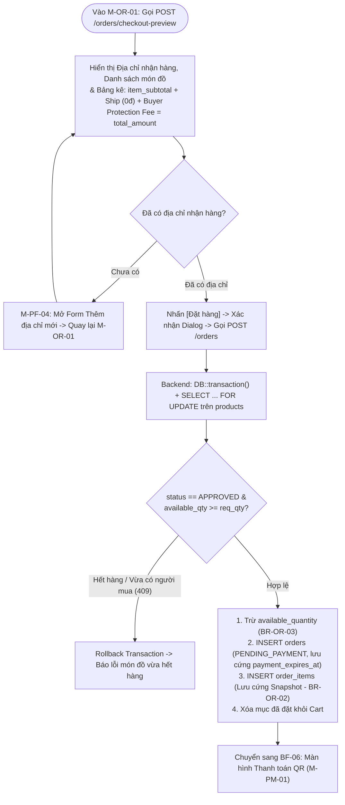

---

### 2.6. `BF-06`: QR Mock Payment & Escrow Hold (Thanh Toán QR Mô Phỏng & Khởi Tạo Khoản Giữ Tiền Trung Gian)

- **1. Flow ID & Name:** `BF-06` – QR Mock Payment & Escrow Hold Ledger Creation
- **2. Primary Actor:** `ACT-02` (Buyer)
- **3. Entry Point:** Chuyển tự động từ `BF-05` (`M-OR-01`), hoặc nhấn **[Thanh toán ngay]** từ Chi tiết đơn mua (`M-OR-03`) / Đơn thắng đấu giá (`M-AC-02`).
- **4. Preconditions:** Đơn hàng có `order_status = PENDING_PAYMENT`, `payment_status = UNPAID` và `now() < payment_expires_at`.
- **5. Main Flow (Bảng Tương Tác UX Chi Tiết):**

| Bước | Màn Hình | Người Dùng Nhìn Thấy Gì (What User Sees) | Thao Tác Của Người Dùng (User Action) | Phản Hồi Của Hệ Thống (System Response) | Bước Tiếp Theo (Next State) |
| :-: | :---: | :--- | :--- | :--- | :--- |
| 1 | `M-PM-01` | Màn hình **Mock QR Payment** (`/payments/:id`) hiển thị: 1. Mã đơn hàng & Mã tham chiếu thanh toán duy nhất (`payment_reference`). 2. Số tiền thanh toán (`total_amount` gồm tiền hàng + Phí bảo vệ người mua). 3. **Hình ảnh Mã QR** sinh nội bộ chứa payload giao dịch. 4. Đồng hồ đếm ngược thời gian hết hạn `payment_expires_at`. 5. **Khung Điều khiển Mô phỏng Đồ án (`Mock Gateway Testing Panel`):** Nút chính **[Mô phỏng Thanh toán Thành công (`Simulate Payment Success`)]** và nút phụ **[Mô phỏng Thanh toán Thất bại]**. | Quét mã QR bằng trình quét mô phỏng hoặc nhấn nút **[Mô phỏng Thanh toán Thành công]** $\rightarrow$ Xác nhận trong hộp thoại. | Gọi `POST /payments/{id}/simulate-success`. Backend thực thi trong `DB::transaction()` kèm `lockForUpdate()` trên `orders` và `payments`: 1. Kiểm tra `payment_status != PAID` và `now() < payment_expires_at`. 2. Cập nhật `payments.status = PAID`, `paid_at = now()`. 3. Cập nhật `orders.payment_status = PAID`, `orders.order_status = PAID`, `orders.escrow_status = HELD` (`ADR-03`). 4. **Ghi sổ cái bất biến (`escrow_transactions`):** Thêm mới 1 dòng loại `HOLD` với số tiền bằng đúng `total_amount` (`BR-FN-03`, `BR-FN-07`). 5. Gửi thông báo cho Buyer và Seller. | Điều hướng sang màn hình Biên lai Thanh toán & Xác nhận Escrow (`M-PM-02`). |
| 2 | `M-PM-02` | Màn hình Biên lai hiển thị huy hiệu **`ĐÃ THANH TOÁN – TIỀN ĐANG ĐƯỢC GIỮ BẢO VỆ (ESCROW HELD)`**, mã giao dịch, số tiền `total_amount` đang được giữ, và 2 nút: **[Theo dõi đơn hàng (`M-OR-03`)]** hoặc **[Về Trang chủ (`M-HM-01`)]**. | Nhấn **[Theo dõi đơn hàng]**. | Điều hướng tới màn hình Chi tiết đơn hàng `M-OR-03`. | Chuyển sang `BF-07` (`M-OR-03`). |

- **6. Alternative Flows:**
  - **A1 (Mô phỏng Thanh toán Thất bại):** Nhấn **[Mô phỏng Thanh toán Thất bại]** $\rightarrow$ Bản ghi `payments` hiện tại chuyển sang `FAILED`, nhưng `order_status` vẫn giữ ở `PENDING_PAYMENT`. Người mua có thể nhấn **[Tạo lại mã QR thanh toán]** miễn là vẫn còn trước mốc `payment_expires_at`.
- **7. Exception Flows:**
  - **E1 (Nhấn nút Thanh toán 2 lần liên tiếp – Double Payment Click):** Request thứ hai bị chặn bởi `lockForUpdate()` khi thấy `orders.payment_status == PAID` $\rightarrow$ Backend trả về kết quả thành công đã có (idempotent) mà **tuyệt đối không tạo dòng `ESCROW_HOLD` thứ hai** (`BR-FN-03`, `NFR-REL-03`).
  - **E2 (Quá thời hạn thanh toán `now() >= payment_expires_at`):** Đồng hồ đếm ngược về `00:00`, khóa nút thanh toán; Scheduled Job (hoặc Backend check) chuyển đơn sang `CANCELLED` (hoàn lại tồn kho cho hàng Fixed Price, hoặc đánh dấu `WINNER_DEFAULTED` và mở khóa cho Seller đăng lại nếu là đơn thắng đấu giá theo `DEC-02`).
- **8. Screen Sequence:** `M-OR-01` / `M-OR-03` $\rightarrow$ `M-PM-01` (Mock QR Payment) $\rightarrow$ `M-PM-02` (Payment & Escrow Receipt) $\rightarrow$ `M-OR-03`.
- **9. Exit Condition:** Đơn hàng đạt trạng thái `order_status = PAID`, `payment_status = PAID`, `escrow_status = HELD`.
- **10. Related IDs:** `FR-PM-01`, `FR-PM-02`, `FR-ES-01`, `FR-AC-06` | `UC-PM-01` | `BR-AU-07`, `BR-FN-03`, `BR-FN-07`, `DEC-02`, `ADR-03`..`05`.

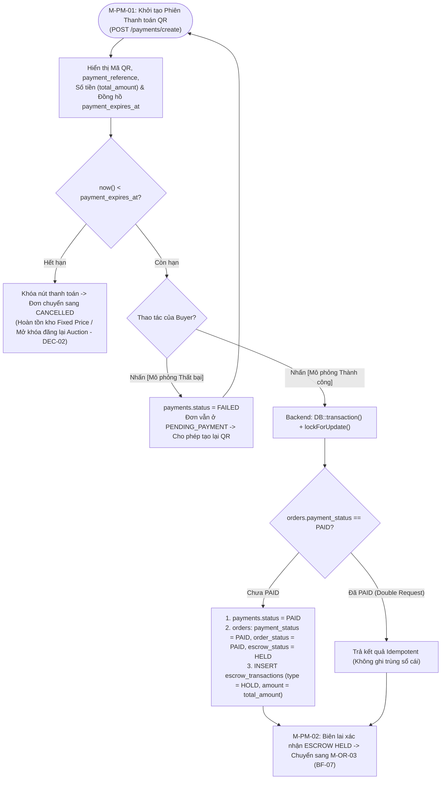

---

### 2.7. `BF-07`: Track Order & 3-Tier Order Cancellation (Theo Dõi Đơn Hàng & Hủy Đơn Theo 3 Cấp Trạng Thái)

- **1. Flow ID & Name:** `BF-07` – Track Order & 3-Tier Order Cancellation (`DEC-06`, `DEC-07`)
- **2. Primary Actor:** `ACT-02` (Buyer)
- **3. Entry Point:** Từ **Tab 5: Cá nhân (`M-PF-01`)** $\rightarrow$ Chọn **Đơn mua của tôi (`M-OR-02`)** $\rightarrow$ Chọn một đơn hàng (`M-OR-03`).
- **4. Preconditions:** Người mua đã đăng nhập và sở hữu đơn hàng (`auth()->id() == order.buyer_id`).
- **5. Main Flow (Bảng Tương Tác UX Chi Tiết):**

| Bước | Màn Hình | Người Dùng Nhìn Thấy Gì (What User Sees) | Thao Tác Của Người Dùng (User Action) | Phản Hồi Của Hệ Thống (System Response) | Bước Tiếp Theo (Next State) |
| :-: | :---: | :--- | :--- | :--- | :--- |
| 1 | `M-OR-02` | Danh sách đơn mua chia theo 7 tab trạng thái: `Chờ thanh toán`, `Đã thanh toán / Đang chuẩn bị`, `Đang giao`, `Đã giao`, `Hoàn tất`, `Đã hủy / Hoàn tiền`, `Đang khiếu nại`, kèm thanh tìm kiếm mã đơn. | Chọn tab và chạm vào một đơn hàng cần xem. | Gọi `GET /orders/{id}` lấy chi tiết đơn hàng, `order_items` (snapshot), `shipments` và 4 trạng thái độc lập. | Mở màn hình Chi tiết Đơn mua `M-OR-03`. |
| 2 | `M-OR-03` | 1. **Header 4 Trạng thái Độc lập:** Trạng thái Đơn hàng (`order_status`) + Huy hiệu Bảo vệ Tiền (`escrow_status`: `HELD` / `RELEASED` / `REFUNDED`). 2. **Timeline Vận chuyển:** Đặt hàng $\rightarrow$ Thanh toán $\rightarrow$ Đang chuẩn bị $\rightarrow$ Đã gửi hàng (kèm tên hãng vận chuyển & mã vận đơn `tracking_code`) $\rightarrow$ Đã giao hàng (`delivered_at` + mốc `auto_complete_at`). 3. **Sản phẩm Snapshot (`BR-OR-02`):** Giữ nguyên giá, tên, ảnh lúc mua. 4. **Bảng tiền:** `item_subtotal` + `buyer_protection_fee` = `total_amount`. | Xem tiến trình giao hàng hoặc nhấn nút hành động tương ứng với trạng thái đơn hàng hiện tại. | Hiển thị đúng nút hành động được phép theo quy tắc trạng thái (`BR-OR-04`, `DEC-06`). | Chuyển sang Hủy đơn (`M-OR-04`), Xác nhận nhận hàng (`BF-08`) hoặc Khiếu nại (`BF-10`). |

- **6. Alternative Flows (Quy trình Hủy đơn 3 cấp trạng thái – `DEC-06` & `DEC-07`):**
  - **A1 – Cấp 1: Đơn đang ở `PENDING_PAYMENT` (Chưa thanh toán):**
    - Buyer nhấn **[Hủy đơn hàng]** $\rightarrow$ Chọn lý do trong Modal `M-OR-04` $\rightarrow$ `POST /orders/{id}/cancel`.
    - Hệ thống chuyển `order_status = CANCELLED`, cộng trả lại `available_quantity` cho sản phẩm.
  - **A2 – Cấp 2: Đơn đang ở `PAID` (Đã thanh toán, nhưng Seller CHƯA bấm `PREPARING`):**
    - Buyer nhìn thấy nút **[Hủy đơn & Hoàn tiền 100%]**.
    - Khi nhấn xác nhận hủy tại `M-OR-04`, Backend mở `DB::transaction()` + `lockForUpdate()`:
      1. Kiểm tra `order_status == PAID`.
      2. Chuyển `order_status = CANCELLED`, `escrow_status = REFUNDED`.
      3. Tạo bản ghi `refunds` và ghi bút toán `REFUND` vào `escrow_transactions` hoàn trả đủ **100% `total_amount` (`item_subtotal` + `buyer_protection_fee`)** về cho Buyer (`DEC-07`, `BR-FN-05`).
      4. Khôi phục tồn kho sản phẩm và gửi thông báo cho Seller.
  - **A3 – Cấp 3: Đơn đang ở `PREPARING` (Seller ĐÃ xác nhận đang đóng gói chuẩn bị hàng):**
    - Buyer không còn nút hủy trực tiếp mà thấy nút **[Gửi yêu cầu hủy đơn (`Request Cancellation`)]** (`DEC-06`).
    - Khi Buyer gửi yêu cầu hủy kèm lý do (`POST /orders/{id}/request-cancel`), đơn hàng gắn cờ `cancellation_requested = true` và hiển thị huy hiệu **`ĐANG CHỜ NGƯỜI BÁN XÁC NHẬN HỦY ĐƠN`** (cho phép Buyer bấm **[Rút lại yêu cầu hủy]** nếu đổi ý trước khi Seller xử lý – `UX-CHECK-02`).
    - **Nếu Seller bấm Đồng ý (`Approve Cancellation`):** Đơn chuyển sang `CANCELLED`, `escrow_status = REFUNDED`, hoàn trả **100% `total_amount`** cho Buyer.
    - **Nếu Seller bấm Từ chối (`Reject Cancellation`) và giao hàng (`SHIPPED`):** Yêu cầu hủy đóng lại, đơn chuyển sang `SHIPPED`.
- **7. Exception Flows:**
  - **E1 (Đơn đã chuyển sang `SHIPPED` hoặc `DELIVERED`):** Cấm tuyệt đối mọi lệnh hủy đơn trực tiếp (`BR-OR-04`). Giao diện ẩn hoàn toàn nút Hủy và hiển thị nút **[Gửi khiếu nại (`BF-10`)]**.
- **8. Screen Sequence:** `M-PF-01` $\rightarrow$ `M-OR-02` (Order List) $\rightarrow$ `M-OR-03` (Buyer Order Detail) $\leftrightarrow$ `M-OR-04` (Cancel / Request Cancel Modal).
- **9. Exit Condition:** Đơn hàng được theo dõi minh bạch hoặc được hủy/hoàn tiền 100% theo đúng cấp trạng thái.
- **10. Related IDs:** `FR-OR-03`, `FR-SH-02` | `UC-OR-02`, `UC-SH-01` | `BR-OR-02`, `BR-OR-04`, `BR-FN-05`, `DEC-06`, `DEC-07`, `NAV-DEC-02`.

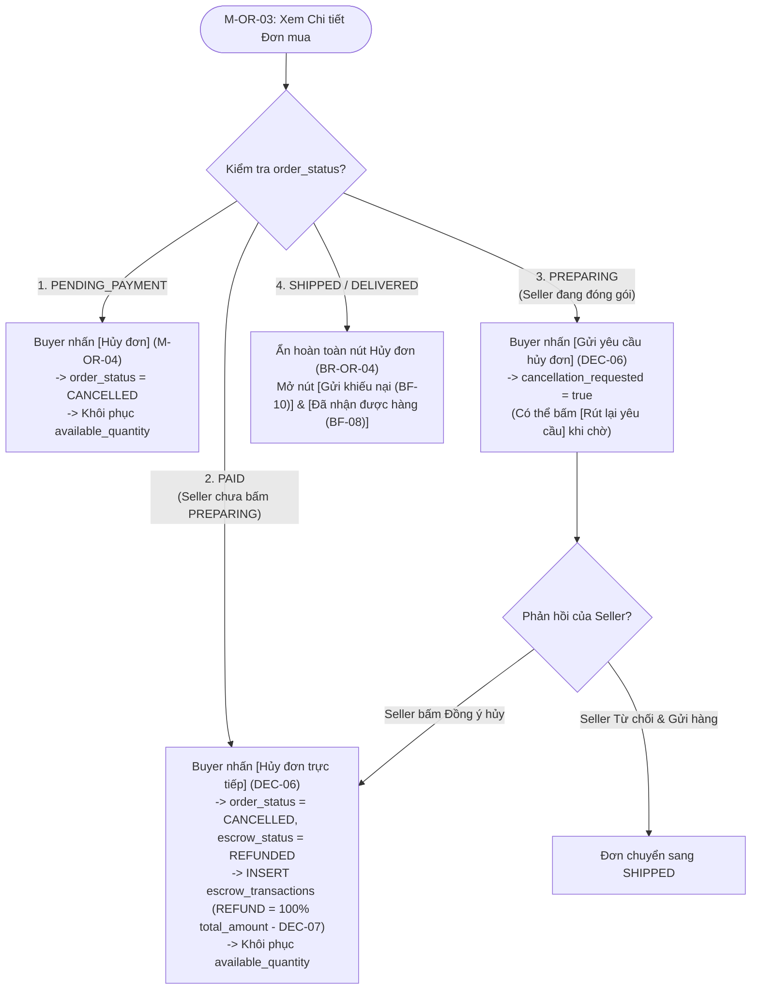

---

### 2.8. `BF-08`: Confirm Delivery & Escrow Release (Xác Nhận Đã Nhận Hàng & Giải Ngân 100% Tiền Hàng Cho Seller)

- **1. Flow ID & Name:** `BF-08` – Buyer Confirm Delivery & Escrow Release
- **2. Primary Actor:** `ACT-02` (Buyer) *(hoặc `ACT-06` System Scheduler sau 24 giờ)*
- **3. Entry Point:** Màn hình Chi tiết Đơn mua (`M-OR-03`) khi `order_status = DELIVERED`.
- **4. Preconditions:** `order_status == DELIVERED`, `payment_status == PAID`, `escrow_status == HELD`, và **không có khiếu nại đang mở (`dispute_status == NONE`)**.
- **5. Main Flow (Bảng Tương Tác UX Chi Tiết):**

| Bước | Màn Hình | Người Dùng Nhìn Thấy Gì (What User Sees) | Thao Tác Của Người Dùng (User Action) | Phản Hồi Của Hệ Thống (System Response) | Bước Tiếp Theo (Next State) |
| :-: | :---: | :--- | :--- | :--- | :--- |
| 1 | `M-OR-03` | Banner thông báo đơn đã giao tới nơi kèm mốc thời gian tự động hoàn tất `auto_complete_at` (24 giờ sau `delivered_at` ở Production / 2 phút ở Demo Mode). Hiển thị 2 nút: **[Đã nhận được hàng (`Confirm Delivery`)]** và **[Gửi khiếu nại / Trả hàng Hoàn tiền]**. | Sau khi kiểm tra món đồ 2hand đúng mô tả, nhấn **[Đã nhận được hàng]**. | Mở hộp thoại xác nhận `M-OR-05` (`Confirmation Dialog` – `NFR-UX-03`) cảnh báo rõ: sau khi xác nhận, tiền hàng sẽ giải ngân cho Người bán và đơn hàng sẽ đóng lại. | Người mua xác nhận trên Dialog `M-OR-05`. |
| 2 | `M-OR-05` $\rightarrow$ `M-OR-03` | Nút **[Đồng ý Xác nhận & Giải ngân]** trong Dialog. | Nhấn **[Đồng ý Xác nhận]**. | Gọi `POST /orders/{id}/confirm-delivery`. Backend thực thi trong `DB::transaction()` kèm `lockForUpdate()`: 1. Kiểm tra `order_status == DELIVERED`, `escrow_status == HELD`, `dispute_status == NONE` (`BR-FN-04`). 2. Cập nhật `order_status = COMPLETED`, `escrow_status = RELEASED`, `completed_at = now()`. 3. Ghi bút toán `RELEASE` vào `escrow_transactions` và bút toán `CREDIT` vào `wallet_transactions` cộng đủ **100% tiền hàng (`item_subtotal`)** vào ví khả dụng của Seller (`DEC-04`). Giữ lại `buyer_protection_fee` cho nền tảng. 4. Gửi thông báo cho Seller. | Màn hình `M-OR-03` chuyển sang `COMPLETED` và bật nút **[Đánh giá Người bán (`BF-09`)]**. |

- **6. Alternative Flows:**
  - **A1 (Tự động hoàn tất sau 24 giờ bởi System Scheduler / Demo Trigger):** Nếu Buyer không bấm xác nhận và cũng không mở khiếu nại khi `now() >= order.auto_complete_at`, Scheduled Job tự động gọi cùng hàm Service giải ngân ở Bước 2 (đảm bảo tính lũy đẳng `BR-AD-01`).
- **7. Exception Flows:**
  - **E1 (Đơn hàng đang có Khiếu nại mở `dispute_status != NONE`):** Nút **[Đã nhận được hàng]** và Scheduled Job tự động hoàn tất bị khóa cứng (`BR-DP-02`).
- **8. Screen Sequence:** `M-OR-03` (`DELIVERED`) $\rightarrow$ `M-OR-05` (Confirm Dialog) $\rightarrow$ `M-OR-03` (`COMPLETED`) $\rightarrow$ `M-RV-01` (`BF-09`).
- **9. Exit Condition:** Đơn hàng đạt trạng thái `COMPLETED`, `escrow_status = RELEASED`, Seller nhận đủ 100% `item_subtotal`.
- **10. Related IDs:** `FR-SH-02`, `FR-ES-02` | `UC-ES-01` | `BR-OR-05`, `BR-FN-04`, `BR-FN-07`, `BR-AD-01`, `DEC-04`, `ADR-05`.

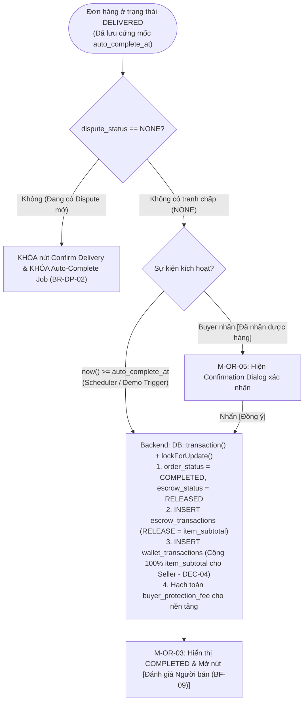

---

### 2.9. `BF-09`: Rate Seller (Đánh Giá 1–5 Sao & Nhận Xét Người Bán)

- **1. Flow ID & Name:** `BF-09` – Rate & Review Seller (`1–5 Stars`)
- **2. Primary Actor:** `ACT-02` (Buyer)
- **3. Entry Point:** Nhấn nút **[Đánh giá Người bán]** trên màn hình `M-OR-03` khi `order_status = COMPLETED`.
- **4. Preconditions:** `auth()->id() == order.buyer_id`, `order_status == COMPLETED`, và đơn hàng chưa có bản ghi trong bảng `reviews` (`BR-RV-01`).
- **5. Main Flow (Bảng Tương Tác UX Chi Tiết):**

| Bước | Màn Hình | Người Dùng Nhìn Thấy Gì (What User Sees) | Thao Tác Của Người Dùng (User Action) | Phản Hồi Của Hệ Thống (System Response) | Bước Tiếp Theo (Next State) |
| :-: | :---: | :--- | :--- | :--- | :--- |
| 1 | `M-RV-01` | Màn hình / Modal Đánh giá hiển thị ảnh & tên món đồ đã mua, tên Tiệm bán, bộ chọn **1 đến 5 sao** và ô nhập nhận xét. | Chọn số sao (`1`–`5`), viết nhận xét thực tế và nhấn **[Gửi đánh giá]**. | Gọi `POST /reviews` (`order_id`, `rating`, `comment`). Trong `DB::transaction()`, Backend lưu bản ghi vào `reviews` (ràng buộc `UNIQUE(order_id)`) và tính lại `average_rating`, `review_count` trong `seller_profiles`. | Quay lại `M-OR-03`, đổi nút thành nhãn *"Đã đánh giá"* và hiển thị bài đánh giá trên `M-US-03`. |

- **6. Alternative Flows:** Người mua xem lại đánh giá của mình trên trang Hồ sơ công khai của Người bán (`M-US-03`).
- **7. Exception Flows:**
  - **E1 (Gửi đánh giá lần 2 cho cùng `order_id`):** Bị chặn bởi Unique Constraint và trả mã `409 Conflict` (`BR-RV-01`).
  - **E2 (Đơn chưa `COMPLETED` hoặc đã `CANCELLED`/`REFUNDED`):** Bị chặn với mã `403 Forbidden`.
- **8. Screen Sequence:** `M-OR-03` (`COMPLETED`) $\rightarrow$ `M-RV-01` (Write Review) $\rightarrow$ `M-OR-03` / `M-US-03`.
- **9. Exit Condition:** Đánh giá được lưu thành công và cập nhật điểm uy tín của Seller.
- **10. Related IDs:** `FR-RV-01` | `UC-RV-01` | `BR-RV-01`.

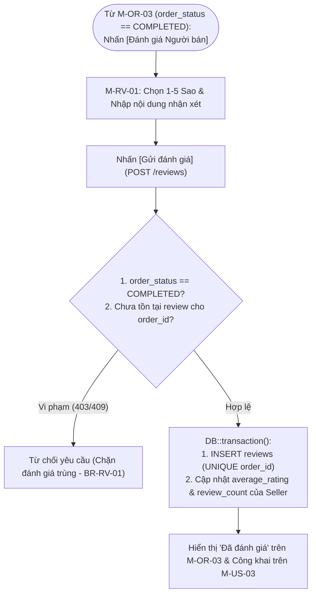

---

### 2.10. `BF-10`: Submit Complaint / Dispute (Gửi Khiếu Nại Ở `SHIPPED`/`DELIVERED` & Khóa Cứng Giải Ngân)

- **1. Flow ID & Name:** `BF-10` – Submit Complaint / Dispute & Escrow Freeze (`DEC-03`, `DEC-07`)
- **2. Primary Actor:** `ACT-02` (Buyer)
- **3. Entry Point:** Nhấn **[Gửi khiếu nại / Trả hàng Hoàn tiền]** trên màn hình `M-OR-03` khi đơn đang ở **`SHIPPED`** hoặc **`DELIVERED`**, hoặc vào **Tab 5 (`M-PF-01`) $\rightarrow$ Khiếu nại của tôi (`M-DP-02`)**.
- **4. Preconditions:** `order_status IN ('SHIPPED', 'DELIVERED')` (`DEC-03`), `payment_status == PAID`, `escrow_status == HELD`, và `dispute_status == NONE`.
- **5. Main Flow (Bảng Tương Tác UX Chi Tiết):**

| Bước | Màn Hình | Người Dùng Nhìn Thấy Gì (What User Sees) | Thao Tác Của Người Dùng (User Action) | Phản Hồi Của Hệ Thống (System Response) | Bước Tiếp Theo (Next State) |
| :-: | :---: | :--- | :--- | :--- | :--- |
| 1 | `M-DP-01` | Màn hình **Gửi Khiếu nại** (`/profile/orders/:id/dispute`) hiển thị thông tin đơn hàng, số tiền đang được bảo vệ (`total_amount`), bộ chọn lý do khiếu nại (*Không nhận được hàng*, *Hàng bị rách/hư hỏng*, *Sai mô tả*, *Nghi ngờ hàng giả*, *Khác*), ô mô tả chi tiết và khung tải ảnh bằng chứng. | Chọn lý do, nhập mô tả chi tiết, tải lên ít nhất 1 ảnh bằng chứng (`dispute_evidence`) và nhấn **[Gửi khiếu nại]**. | Gọi `POST /disputes`. Backend thực thi trong `DB::transaction()`: 1. Tạo bản ghi `disputes` (`status = OPEN`) và lưu ảnh vào `dispute_evidence`. 2. Cập nhật `orders.dispute_status = OPEN`. 3. **Khóa cứng tức thì cơ chế tự động hoàn tất đơn 24h và khóa giải ngân Escrow (`BR-DP-02`)**. 4. Gửi thông báo cho Seller, Support Staff và Admin. | Điều hướng sang màn hình Chi tiết Hồ sơ Khiếu nại `M-DP-03`. |
| 2 | `M-DP-03` | Màn hình **Chi tiết Khiếu nại** hiển thị huy hiệu **`TRANH CHẤP ĐANG MỞ – TIỀN ĐANG ĐƯỢC ĐÓNG BĂNG BẢO VỆ`**, luồng bằng chứng của Buyer, giải trình của Seller và phản hồi từ Support Staff / Admin. | Theo dõi tiến trình; nếu nhận trạng thái `NEED_MORE_INFO` (do Support/Admin yêu cầu thêm bằng chứng), nhấn **[Tải bổ sung bằng chứng]** (`POST /disputes/{id}/evidence`). | Khi **Administrator (`ACT-05`)** ra phán quyết cuối cùng: - **`APPROVE_BUYER_REFUND`:** Hoàn trả đủ **100% `total_amount` (`item_subtotal` + `buyer_protection_fee` – `DEC-07`)** cho Buyer; `order_status = REFUNDED`, `escrow_status = REFUNDED`. - **`PARTIAL_REFUND`:** Hoàn 1 phần cho Buyer, giải ngân phần còn lại cho Seller (`BR-FN-06`). - **`RELEASE_TO_SELLER` / `REJECT_DISPUTE`:** Giải ngân 100% `item_subtotal` cho Seller; `order_status = COMPLETED`. | Khiếu nại đóng lại (`RESOLVED`), thông báo kết quả và cập nhật sổ cái bất biến. |

- **6. Alternative Flows:** Truy cập danh sách toàn bộ khiếu nại tại `M-DP-02` (`/profile/disputes`).
- **7. Exception Flows:**
  - **E1 (Thiếu ảnh bằng chứng hoặc mô tả rỗng):** Backend trả lỗi `422 Unprocessable Entity` yêu cầu cung cấp bằng chứng hình ảnh.
  - **E2 (Đơn hàng đã chuyển sang `COMPLETED` trước khi bấm gửi):** Backend từ chối mở khiếu nại (`403 Forbidden`).
- **8. Screen Sequence:** `M-OR-03` (`SHIPPED`/`DELIVERED`) $\rightarrow$ `M-DP-01` (Submit Dispute) $\rightarrow$ `M-DP-03` (Dispute Detail) $\leftarrow$ `M-DP-02` (Dispute List).
- **9. Exit Condition:** Khoản tiền giữ trong Escrow được khóa an toàn ngay khi mở khiếu nại và phân bổ chính xác theo phán quyết của Admin.
- **10. Related IDs:** `FR-DP-01`..`03` | `UC-DP-01`, `UC-DP-02` | `BR-DP-01`, `BR-DP-02`, `BR-FN-05`, `BR-FN-06`, `DEC-03`, `DEC-07`, `ADR-03`.

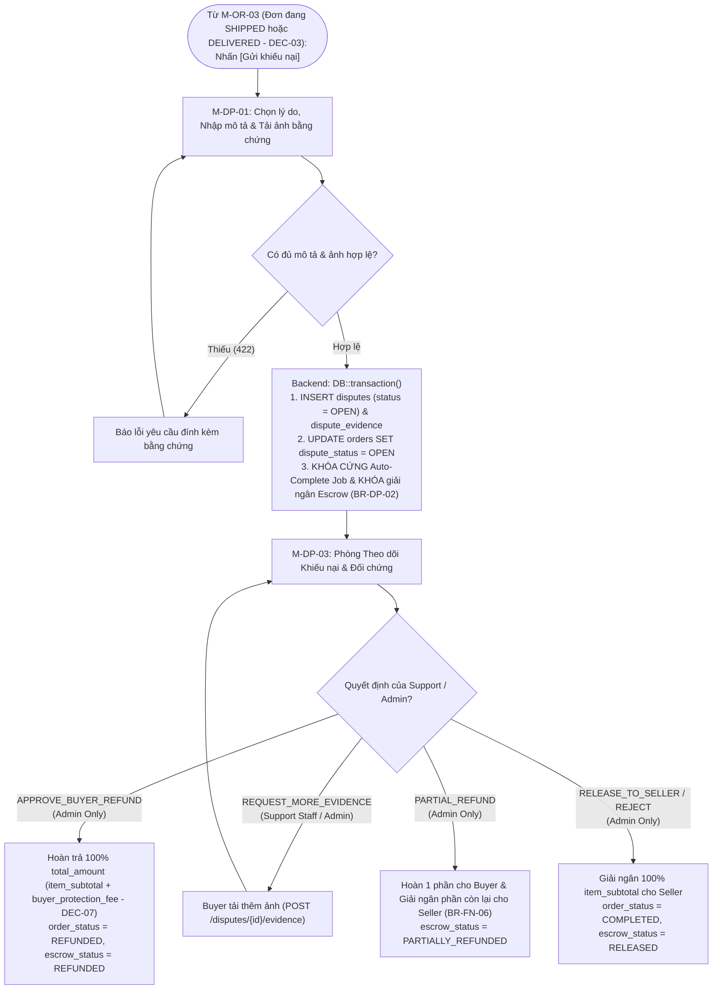

---

### 2.11. `BF-11`: Manage Favorites & Follow Seller (Quản Lý Yêu Thích & Theo Dõi Tiệm Bán)

- **1. Flow ID & Name:** `BF-11` – Manage Favorite Products & Followed Sellers
- **2. Primary Actor:** `ACT-02` (Buyer)
- **3. Entry Point:** Nhấn icon **Trái tim** trên `Product Card` / `M-PR-01`, nút **[+ Theo dõi]** trên `M-US-03`, hoặc mở **Tab 5 (`M-PF-01`) $\rightarrow$ Yêu thích & Đang theo dõi (`M-PF-05`)**.
- **4. Preconditions:** Người dùng đã đăng nhập (`ACT-02`) và `seller_id != auth()->id()` (`BR-AC-02`).
- **5. Main Flow:**
  1. Khi nhấn icon Yêu thích hoặc nút Theo dõi: nếu là `Guest` thì chuyển hướng `/login` (`DEC-01`); nếu đã đăng nhập thì gọi `POST /products/{id}/favorite` hoặc `POST /users/{id}/follow` để bật/tắt trạng thái lưu trong bảng `favorites` / `followed_sellers`.
  2. Tại màn hình `M-PF-05` (`/profile/favorites`), người dùng chuyển đổi giữa 2 tab (**Tab 1: Sản phẩm đã thích** và **Tab 2: Tiệm đang theo dõi**) để xem lại hoặc bỏ lưu.
- **6. Alternative & Exception Flows:** Chặn người bán tự yêu thích sản phẩm của mình hoặc tự theo dõi chính mình (`403 Forbidden` – `BR-AC-02`). Nếu sản phẩm yêu thích đã bán (`SOLD`), hiển thị nhãn `ĐÃ BÁN` trên thẻ.
- **7. Screen Sequence:** `M-PR-01` / `M-US-03` $\leftrightarrow$ `M-PF-01` $\rightarrow$ `M-PF-05`.
- **8. Exit Condition:** Trạng thái Yêu thích / Theo dõi được đồng bộ bền vững trên CSDL.
- **9. Related IDs:** `FR-DS-04`, `FR-US-04` | `UC-DS-02` | `BR-AC-02`, `DEC-01`.

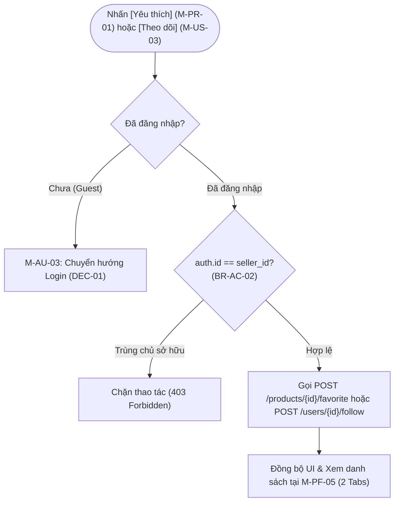

---

### 2.12. `BF-12`: Chat with Seller (Nhắn Tin 1-1 Với Người Bán Qua HTTP Polling)

- **1. Flow ID & Name:** `BF-12` – 1-on-1 Buyer-Seller Chat (Controlled HTTP Polling)
- **2. Primary Actor:** `ACT-02` (Buyer)
- **3. Entry Point:** Nhấn **[Chat với Người bán]** từ `M-PR-01`, `M-OR-03`, `M-US-03`, hoặc nhấn icon **Chat** trên Top Header (`M-CM-01`).
- **4. Preconditions:** Người dùng đã đăng nhập (`ACT-02`) và `seller_id != auth()->id()` (`BR-AC-02`).
- **5. Main Flow (Bảng Tương Tác UX Chi Tiết):**

| Bước | Màn Hình | Người Dùng Nhìn Thấy Gì (What User Sees) | Thao Tác Của Người Dùng (User Action) | Phản Hồi Của Hệ Thống (System Response) | Bước Tiếp Theo (Next State) |
| :-: | :---: | :--- | :--- | :--- | :--- |
| 1 | `M-PR-01` / `M-CM-01` $\rightarrow$ `M-CM-02` | Nút **[Chat]** trên trang sản phẩm/đơn hàng hoặc danh sách hội thoại tại `M-CM-01`. | Nhấn mở cuộc trò chuyện với Người bán. | Gọi `POST /conversations` (`recipient_id`, `product_id`). Mở phòng chat `M-CM-02` hiển thị **Thẻ ngữ cảnh sản phẩm (`Product Context Card`)** ở đầu màn hình và khởi chạy `Polling Timer` (mỗi 3–5 giây gọi `GET /conversations/{id}/messages` – `NFR-PER-03`, `ADR-08`). | Hiển thị lịch sử tin nhắn và trạng thái đã đọc (`is_read`). |
| 2 | `M-CM-02` | Danh sách bong bóng tin nhắn, thời gian gửi, trạng thái đã xem và ô nhập tin nhắn. | Nhập nội dung tin nhắn và nhấn **[Gửi]**; hoặc thoát khỏi màn hình chat khi trao đổi xong. | Gọi `POST /conversations/{id}/messages`. **Ngay khi người dùng rời khỏi `M-CM-02`**, ứng dụng hủy ngay lập tức `Polling Timer` (`dispose`) để giải phóng tài nguyên. | Tin nhắn được lưu và thông báo cho người nhận. |

- **6. Alternative & Exception Flows:**
  - **A1 (Chặn hoặc Báo cáo người dùng):** Nhấn menu `(...)` ở góc trên `M-CM-02` $\rightarrow$ Mở `M-CM-03` để **Chặn (`Block User`)** hoặc **Báo cáo hội thoại vi phạm (`Report`)**.
  - **E1 (Hội thoại bị chặn hoặc vượt Rate Limit):** Nếu bị chặn, khóa thanh nhập tin nhắn; nếu gửi quá 60 tin/phút, trả lỗi `429 Too Many Requests` (`NFR-SEC-04`).
- **7. Screen Sequence:** `M-PR-01` / `M-OR-03` / `M-CM-01` $\rightarrow$ `M-CM-02` (Chat Room) $\leftrightarrow$ `M-CM-03` (Block/Report Modal).
- **8. Exit Condition:** Cuộc trò chuyện được cập nhật và Polling Timer được đóng an toàn khi rời màn hình.
- **9. Related IDs:** `FR-CM-01`, `FR-CM-02`, `FR-NT-01` | `UC-CM-01` | `BR-AC-02`, `NFR-SEC-04`, `NFR-PER-03`, `ADR-08`.

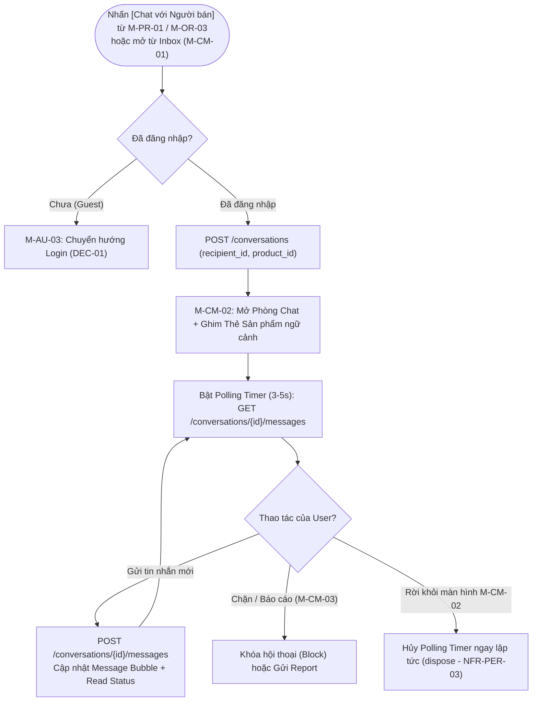

---

## Chương 3. Các Điểm UX Đã Chuẩn Hóa (`UX-CHECK-01` & `UX-CHECK-02`)

1. **`[UX-CHECK-01]` Luồng tắt "Mua ngay (`Buy Now`)" trên `M-PR-01`:** Khi nhấn **[Thêm vào giỏ]**, sản phẩm được thêm vào giỏ hàng (`M-CR-01`) và người mua ở lại trang sản phẩm; khi nhấn **[Mua ngay]**, hệ thống đưa thẳng sản phẩm đó sang màn hình **`M-OR-01` (`Checkout Preview`)** để chọn địa chỉ và xem `Buyer Protection Fee` đặt đơn ngay.
2. **`[UX-CHECK-02]` Quyền rút lại yêu cầu hủy khi đơn ở `PREPARING` (`M-OR-03`):** Trong thời gian chờ Seller duyệt yêu cầu hủy của Buyer ở bước `PREPARING` (`DEC-06`), Buyer được phép bấm **[Rút lại yêu cầu hủy]** nếu đổi ý muốn tiếp tục nhận hàng trước khi Seller xử lý.

---

## Chương 4. Kết Quả Tự Động Kiểm Tra & Nghiệm Thu (`Self-Verified Quality Gate Checklist`)

- [x] **1. Đầy đủ 12 luồng bắt buộc (`BF-01`..`BF-12`):** Tất cả 12 luồng đã có đủ 100% bảng tương tác UX từng bước (User sees, User action, System response, Next state), Alternative Flows, Exception Flows và 12 sơ đồ Mermaid riêng biệt.
- [x] **2. Đồng bộ tuyệt đối với `SITEMAP.md` (`P2-01`):** Mọi mã màn hình (`M-HM-01`..`M-NT-01`) và đường dẫn Route đều khớp 1:1 với bảng Master Route trong `SITEMAP.md`.
- [x] **3. Tuân thủ 100% Quy tắc Nghiệp vụ Phase 01:**
  - Chặn tự giao dịch (`BR-AC-02`) tại `BF-03`, `BF-04`, `BF-11`, `BF-12`.
  - Gom nhóm giỏ hàng & tách đơn theo từng Seller (`BR-OR-01`) tại `BF-04`, `BF-05`.
  - Công thức **Buyer Protection Fee** + **Ship 0đ** (`DEC-04`, `BR-FN-02`) và lưu cứng **Order Snapshot** (`BR-OR-02`) tại `BF-05`.
  - Quy tắc **Hủy đơn 3 cấp trạng thái** (`DEC-06`) và **Hoàn trả 100% `total_amount`** (`DEC-07`) tại `BF-07`.
  - Cho phép **Mở khiếu nại ở cả `SHIPPED` và `DELIVERED`** (`DEC-03`) và khóa cứng tự động giải ngân (`BR-DP-02`) tại `BF-08`, `BF-10`.