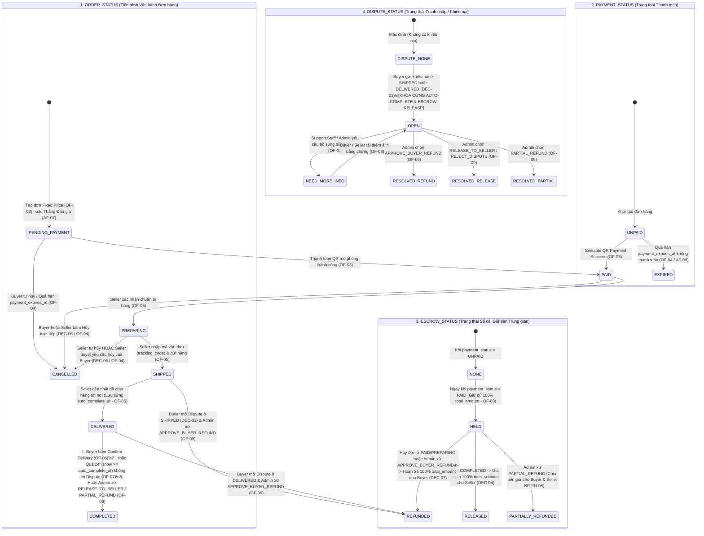
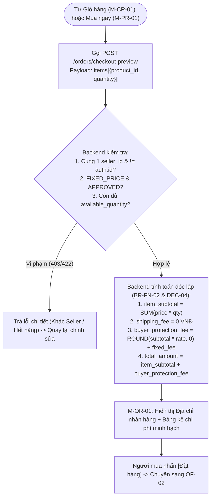
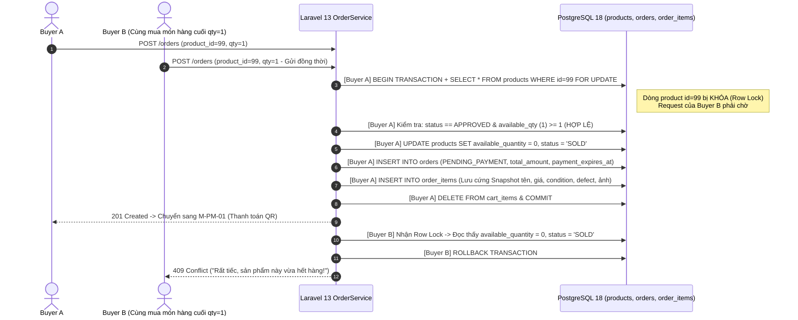
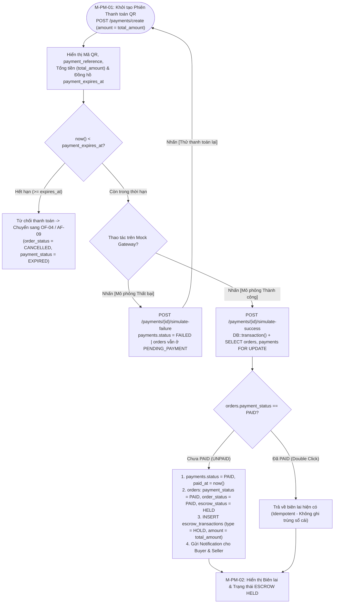
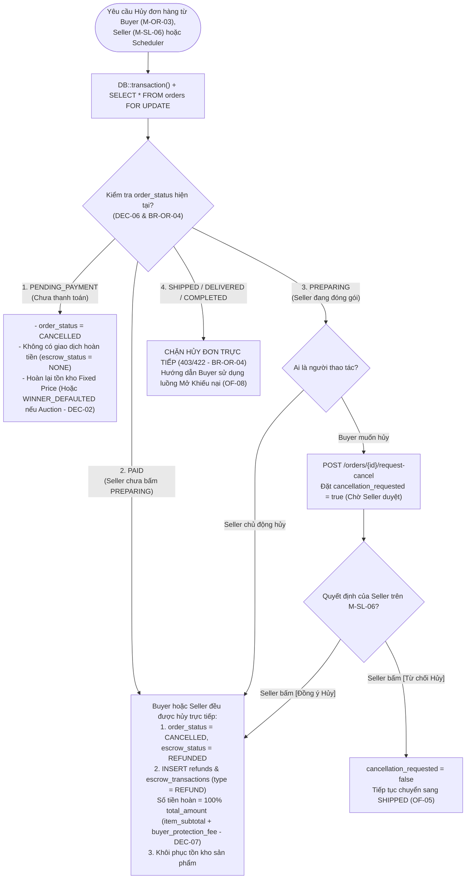
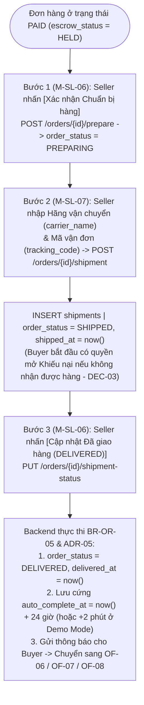
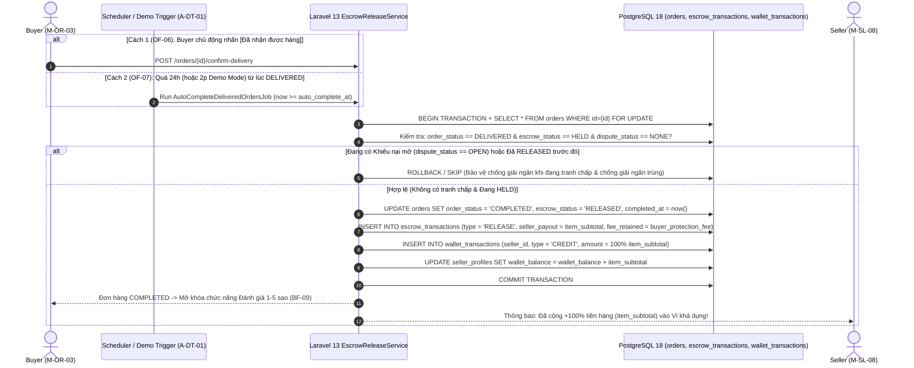
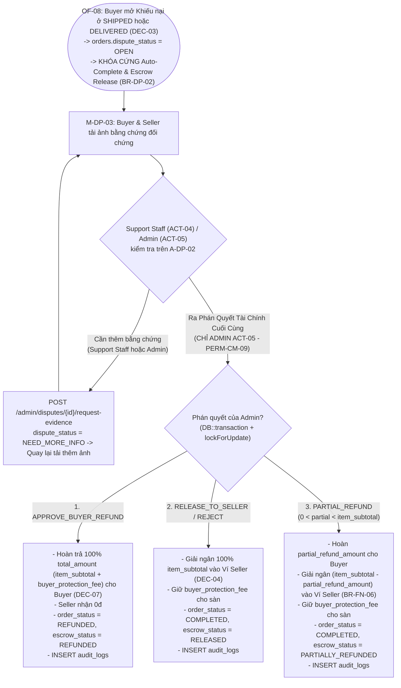
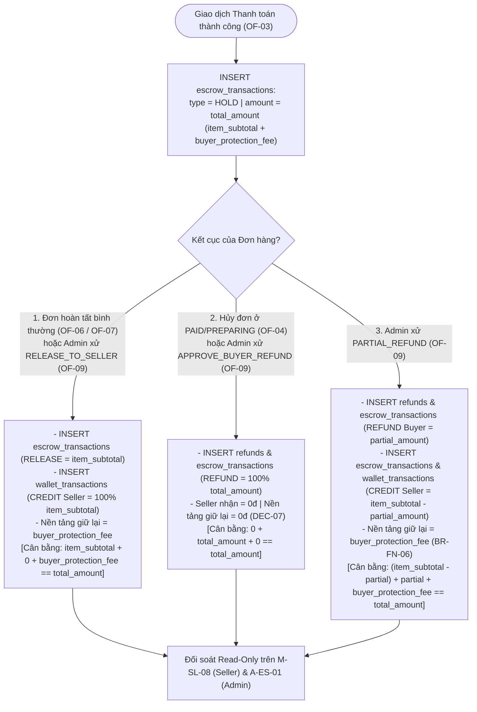

# 05. ORDER, MOCK QR PAYMENT, ESCROW & DISPUTE SYSTEM FLOW – RETRO MARKET (izithrift)

- **Document ID:** `DOC-P205-ORDER-PAYMENT-FLOW`
- **Version:** `2.1.0 (COMPLETE UNTRUNCATED SPECIFICATION)`
- **Status:** `SELF-VERIFIED & READY FOR FINAL LOCK`
- **Project Codename:** `RETRO MARKET`
- **Application Brand Name:** `izithrift`
- **Phase:** `Phase 02 – System Flow & UX Planning`

---

## Chương 1. Kiến Trúc Luồng Đơn Hàng, Thanh Toán QR, Sổ Cái Escrow & 4 Máy Trạng Thái Độc Lập

Khác với các sàn TMĐT thông thường chỉ quản lý đơn hàng bằng một cột trạng thái duy nhất, **`izithrift`** vận hành trên kiến trúc **4 Vòng đời Trạng thái Độc lập (`ADR-03`)** kết hợp **Sổ cái Tài chính Bất biến (`Append-Only Ledger` – `ADR-04`)** và mô hình **Phí Bảo Vệ Người Mua (`Buyer Protection Fee` – `DEC-04`)** để bảo vệ tuyệt đối giao dịch đồ secondhand C2C.

### 1.1. Danh Mục Tổng Hợp 10 Luồng Đơn Hàng, Thanh Toán, Escrow & Khiếu Nại (`Master Order & Escrow Flow Index`)

| Flow ID | Tên Luồng (Flow Name) | Actors Tham Gia | Điểm Bắt Đầu $\rightarrow$ Kết Thúc | API Endpoints / Jobs Liên Quan | Liên Kết FR / UC / BR / DEC |
| :--- | :--- | :--- | :--- | :--- | :--- |
| `OF-01` | Checkout Preview & Buyer Protection Fee Calculation (Tính phí bảo vệ người mua & kiểm tra trước đặt hàng) | `ACT-02` (Buyer) | `M-CR-01` / `M-PR-01` $\rightarrow$ `M-OR-01` | `POST /orders/checkout-preview`, `GET /users/addresses` | `FR-OR-01` \| `UC-OR-01` \| `BR-OR-01`, `BR-FN-01`, `BR-FN-02`, `DEC-04`, `NFR-SEC-03` |
| `OF-02` | Atomic Order Creation, Inventory Lock & Product Snapshot (Tạo đơn nguyên tử, khóa tồn kho & đóng băng snapshot) | `ACT-02` (Buyer) | `M-OR-01` $\rightarrow$ `M-PM-01` | `POST /orders` (`DB::transaction` + `lockForUpdate`) | `FR-OR-02` \| `UC-OR-01` \| `BR-OR-01`..`03`, `ADR-05`, `ADR-06`, `NFR-REL-01`, `NFR-REL-04` |
| `OF-03` | Mock QR Payment Session & Idempotent Escrow Hold (Thanh toán QR mô phỏng & khởi tạo khoản giữ tiền `ESCROW_HOLD`) | `ACT-02` (Buyer), `ACT-06` (Escrow Engine) | `M-PM-01` $\rightarrow$ `M-PM-02` $\rightarrow$ `M-OR-03` | `POST /payments/create`, `POST /payments/{id}/simulate-success`, `POST /payments/{id}/simulate-failure` | `FR-PM-01`, `FR-PM-02`, `FR-ES-01` \| `UC-PM-01` \| `BR-FN-03`, `BR-FN-07`, `ADR-03`, `ADR-04`, `NFR-REL-03` |
| `OF-04` | 3-Tier Order Cancellation & 100% Refund Execution (Hủy đơn hàng theo 3 cấp trạng thái & hoàn trả 100% `total_amount`) | `ACT-02` (Buyer / Seller), `ACT-06` (Scheduler) | `M-OR-03` / `M-SL-06` $\leftrightarrow$ `M-OR-04` | `POST /orders/{id}/cancel`, `POST /orders/{id}/request-cancel`, `POST /orders/{id}/approve-cancel`, `POST /orders/{id}/reject-cancel` | `FR-OR-03`, `FR-AC-06` \| `UC-OR-02` \| `PERM-OR-05A`, `PERM-OR-05B`, `PERM-FN-04B`, `BR-OR-04`, `BR-FN-05`, `DEC-02`, `DEC-06`, `DEC-07` |
| `OF-05` | Seller Order Preparation & Manual Shipment Tracking (Chuẩn bị hàng, nhập mã vận đơn `SHIPPED` & cập nhật `DELIVERED`) | `ACT-02` (Seller) | `M-SL-05` $\rightarrow$ `M-SL-06` $\leftrightarrow$ `M-SL-07` | `POST /orders/{id}/prepare`, `POST /orders/{id}/shipment`, `PUT /orders/{id}/shipment-status` | `FR-SH-01` \| `UC-SH-01` \| `PERM-OR-06`, `PERM-OR-07`, `BR-OR-05`, `ASM-05`, `ADR-05` |
| `OF-06` | Buyer Delivery Confirmation & Immediate Escrow Release (Người mua xác nhận nhận hàng & giải ngân ngay 100% tiền hàng cho Seller) | `ACT-02` (Buyer), `ACT-06` (Escrow Engine) | `M-OR-03` $\rightarrow$ `M-OR-05` $\rightarrow$ `M-RV-01` | `POST /orders/{id}/confirm-delivery` | `FR-SH-02`, `FR-ES-02` \| `UC-ES-01` \| `PERM-OR-08`, `PERM-FN-04`, `BR-FN-04`, `BR-FN-07`, `DEC-04` |
| `OF-07` | 24-Hour Scheduled Auto-Completion & Escrow Release (Hệ thống tự động hoàn tất đơn sau 24 giờ từ lúc `DELIVERED` & giải ngân) | `ACT-06` (Scheduler), `ACT-05` (Demo Trigger) | `AutoCompleteDeliveredOrdersJob` / `A-DT-01` | `AutoCompleteDeliveredOrdersJob`, `POST /admin/dev-tools/auto-complete-orders` | `FR-ES-02`, `FR-AD-05` \| `UC-ES-01`, `UC-AD-02` \| `PERM-OR-09`, `BR-OR-05`, `BR-FN-04`, `BR-AD-01`, `ADR-05` |
| `OF-08` | Dispute Initiation & Immediate Escrow Freeze (Mở khiếu nại ở `SHIPPED` / `DELIVERED` & đóng băng giải ngân tức thì) | `ACT-02` (Buyer / Seller), `ACT-04` (Support) | `M-OR-03` $\rightarrow$ `M-DP-01` $\rightarrow$ `M-DP-03` | `POST /disputes`, `POST /disputes/{id}/evidence`, `POST /admin/disputes/{id}/request-evidence` | `FR-DP-01`, `FR-DP-02` \| `UC-DP-01` \| `PERM-CM-05`..`08`, `BR-DP-01`, `BR-DP-02`, `DEC-03` |
| `OF-09` | Admin Dispute Financial Verdict & Ledger Settlement (Admin ra phán quyết tài chính cuối cùng: Hoàn 100%, Giải ngân hoặc Hoàn 1 phần) | `ACT-05` (Admin Only) | `A-DP-01` $\rightarrow$ `A-DP-02` $\rightarrow$ `A-ES-01` | `POST /admin/disputes/{id}/resolve` | `FR-DP-03`, `FR-AD-06` \| `UC-DP-02` \| `PERM-CM-09`, `BR-FN-04`..`07`, `BR-AD-02`, `DEC-07` |
| `OF-10` | Immutable Financial Ledger & Reconciliation Audit (Đối soát Sổ cái Escrow, Ví người bán & Phí bảo vệ nền tảng) | `ACT-02` (Seller), `ACT-05` (Admin) | `M-SL-08` (Mobile) / `A-ES-01` (Admin Web) | `GET /seller/wallet`, `GET /admin/escrow`, `GET /admin/payments` | `FR-SL-06`, `FR-AD-03` \| `UC-AD-01` \| `PERM-FN-05`..`07`, `BR-FN-01`, `BR-FN-07`, `ADR-04` |

---

### 1.2. Biểu Đồ Phối Hợp 4 Máy Trạng Thái Độc Lập Trên Bảng `orders` (`ADR-03`)

---

### 1.3. Ma Trận Chuyển Đổi Đồng Bộ Giữa 4 Trạng Thái & Bút Toán Tài Chính (`State Synchronization Matrix`)

Mọi hàm trong `OrderService`, `PaymentService`, `EscrowService` và `DisputeService` tại Backend bắt buộc đảm bảo 4 cột trạng thái luôn nằm trong **10 tổ hợp hợp lệ** dưới đây (bất kỳ tổ hợp nào lệch khỏi bảng này đều là lỗi bất toàn dữ liệu và bị chặn bởi Transaction):

| STT | Sự Kiện Nghiệp Vụ | `order_status` | `payment_status` | `escrow_status` | `dispute_status` | Bút Toán Sổ Cái Sinh Ra (`escrow_transactions` / `wallet_transactions`) |
| :-: | :--- | :---: | :---: | :---: | :---: | :--- |
| 01 | Vừa tạo đơn hàng mới (Fixed Price / Thắng Đấu giá) | `PENDING_PAYMENT` | `UNPAID` | `NONE` | `NONE` | Chưa phát sinh bút toán tiền tệ (đã giữ chỗ tồn kho sản phẩm). |
| 02 | Hủy đơn khi chưa thanh toán / Quá hạn 30p | `CANCELLED` | `UNPAID` / `EXPIRED` | `NONE` | `NONE` | Không phát sinh bút toán tiền tệ; hoàn lại `available_quantity` (hoặc `WINNER_DEFAULTED`). |
| 03 | Thanh toán QR mô phỏng thành công | `PAID` | `PAID` | `HELD` | `NONE` | `+ ESCROW_HOLD`: số tiền = **`total_amount`** (`item_subtotal + buyer_protection_fee`). |
| 04 | Seller xác nhận chuẩn bị hàng | `PREPARING` | `PAID` | `HELD` | `NONE` | Giữ nguyên khoản `HELD` trong Escrow. |
| 05 | Hủy đơn hợp lệ ở `PAID` hoặc `PREPARING` (`DEC-06`) | `CANCELLED` | `PAID` | `REFUNDED` | `NONE` | `+ ESCROW_REFUND`: hoàn trả đủ **100% `total_amount`** cho Buyer (`DEC-07`). |
| 06 | Seller gửi hàng & cập nhật đã giao hàng | `SHIPPED` / `DELIVERED` | `PAID` | `HELD` | `NONE` | Giữ nguyên khoản `HELD`; ghi cứng `auto_complete_at` khi `DELIVERED`. |
| 07 | Buyer mở Khiếu nại ở `SHIPPED` hoặc `DELIVERED` (`DEC-03`) | `SHIPPED` / `DELIVERED` | `PAID` | `HELD` *(Frozen)* | `OPEN` / `NEED_MORE_INFO` | **Khóa cứng khoản `HELD`**, chặn Scheduled Job tự hoàn tất đơn. |
| 08 | Hoàn tất đơn (Buyer xác nhận / Quá 24h / Admin bác bỏ Dispute) | `COMPLETED` | `PAID` | `RELEASED` | `NONE` / `RESOLVED_RELEASE` | `+ ESCROW_RELEASE` & `+ WALLET_CREDIT`: cộng **100% `item_subtotal`** vào Ví Seller; giữ `buyer_protection_fee` cho sàn (`DEC-04`). |
| 09 | Admin xử Buyer thắng Khiếu nại (`APPROVE_BUYER_REFUND`) | `REFUNDED` | `PAID` | `REFUNDED` | `RESOLVED_REFUND` | `+ ESCROW_REFUND`: hoàn trả đủ **100% `total_amount`** cho Buyer (`DEC-07`); Seller nhận `0đ`. |
| 10 | Admin xử Hoàn tiền một phần (`PARTIAL_REFUND`) | `COMPLETED` | `PAID` | `PARTIALLY_REFUNDED` | `RESOLVED_PARTIAL` | `+ ESCROW_REFUND` (`partial_refund_amount` cho Buyer) + `+ ESCROW_RELEASE` & `+ WALLET_CREDIT` (`item_subtotal - partial_refund_amount` cho Seller); giữ `buyer_protection_fee` cho sàn (`BR-FN-06`). |

---

## Chương 2. Đặc Tả Chi Tiết 10 Luồng Đơn Hàng, Thanh Toán, Escrow & Khiếu Nại (`OF-01` – `OF-10`)

### 2.1. `OF-01`: Checkout Preview & Buyer Protection Fee Calculation (Tính Phí Bảo Vệ Người Mua & Kiểm Tra Trước Đặt Hàng)

- **1. Flow ID & Name:** `OF-01` – Checkout Preview & Server-Side Buyer Protection Fee Calculation
- **2. Primary Actor:** `ACT-02` (Buyer)
- **3. Entry Point:** Nhấn **[Mua hàng (`Checkout`)]** từ Giỏ hàng (`M-CR-01`) sau khi chọn các món đồ của cùng 1 Seller, hoặc nhấn **[Mua ngay (`Buy Now`)]** từ trang Chi tiết sản phẩm (`M-PR-01` – `UX-CHECK-01`).
- **4. Preconditions:** Người mua đã đăng nhập (`ACT-02`), các sản phẩm được chọn có `listing_type = FIXED_PRICE`, `status = APPROVED`, `available_quantity >= requested_quantity` và thuộc cùng một `seller_id` (`seller_id != auth()->id()`).
- **5. Main Flow (Bảng Tương Tác UX & Hệ Thống):**

| Bước | Màn Hình | Người Dùng Nhìn Thấy Gì (What User Sees) | Thao Tác Của Người Dùng (User Action) | Phản Hồi Của Hệ Thống (System Response) | Bước Tiếp Theo (Next State) |
| :-: | :---: | :--- | :--- | :--- | :--- |
| 1 | `M-OR-01` | Màn hình **Checkout Preview** (`/checkout`) hiển thị trạng thái tải dữ liệu từ Server, sau đó trình bày: 1. **Địa chỉ nhận hàng:** Địa chỉ mặc định (`is_default`) từ `user_addresses` hoặc nút **[+ Thêm / Đổi địa chỉ]** (`M-PF-03` / `M-PF-04`). 2. **Danh sách sản phẩm của Tiệm:** Ảnh, tên, tình trạng (`condition`), lỗi đã khai báo (`defect_info`), đơn giá hiện hành và số lượng. 3. **Bảng Tính Chi Phí Minh Bạch (`DEC-04`, `BR-FN-02`):**    - Tiền hàng gốc (`item_subtotal`): $\sum (\text{price} \times \text{quantity})$.    - Phí vận chuyển (`shipping_fee`): **`0 VNĐ`** *(Miễn thu phí vận chuyển trên app)*.    - **Phí bảo vệ người mua (`buyer_protection_fee`):** $\text{ROUND}(\text{item\_subtotal} \times \text{rate}, 0) + \text{fixed\_fee}$ *(kèm hộp thông tin giải thích cam kết giữ tiền Escrow và hoàn tiền 100%)*.    - **Tổng thanh toán (`total_amount`):** $\text{item\_subtotal} + \text{buyer\_protection\_fee}$. | Kiểm tra hoặc đổi địa chỉ nhận hàng, xem bảng kê chi phí. | Gọi `POST /api/v1/orders/checkout-preview` truyền danh sách `{product_id, quantity}`. Backend truy vấn trực tiếp giá sản phẩm từ PostgreSQL và lấy cấu hình `protection_fee_rate` (mặc định `6%`) + `protection_fixed_fee` (mặc định `7.000đ`) từ bảng `platform_settings` để tính toán (`NFR-SEC-03` – Tuyệt đối không nhận số tiền tính từ Client). | Hiển thị bảng tính chính xác và mở khóa nút **[Đặt hàng (`Place Order`)]**. |

- **6. Alternative Flows:** Nếu người mua chưa có địa chỉ nhận hàng, nhấn **[+ Thêm địa chỉ mới]** mở `M-PF-04`, lưu địa chỉ xong tự động quay lại `M-OR-01`.
- **7. Exception Flows:**
  - **E1 (Truyền lẫn sản phẩm của 2 Seller khác nhau vào API):** Backend từ chối ngay với mã `422 Unprocessable Entity` (`BR-OR-01` – Mỗi đơn hàng chỉ thuộc 1 Seller duy nhất).
  - **E2 (Có sản phẩm vừa hết hàng hoặc bị ẩn):** Backend trả về danh sách sản phẩm không còn khả dụng để người mua loại bỏ trước khi đặt đơn.
- **8. Screen Sequence:** `M-CR-01` / `M-PR-01` $\rightarrow$ `M-OR-01` (Checkout Preview) $\leftrightarrow$ `M-PF-03` / `M-PF-04`.
- **9. Exit Condition:** Người mua xác nhận bảng tính phí và nhấn **[Đặt hàng]** chuyển sang `OF-02`.
- **10. Related IDs:** `FR-OR-01` | `UC-OR-01` | `BR-AC-02`, `BR-OR-01`, `BR-FN-01`, `BR-FN-02`, `DEC-04`, `NFR-SEC-03`.

---

### 2.2. `OF-02`: Atomic Order Creation, Inventory Lock & Product Snapshot (Tạo Đơn Nguyên Tử, Khóa Tồn Kho & Đóng Băng Snapshot)

- **1. Flow ID & Name:** `OF-02` – Atomic Order Creation, Row-Level Inventory Locking & Mandatory Snapshot Persistence
- **2. Primary Actor:** `ACT-02` (Buyer)
- **3. Entry Point:** Nhấn nút **[Đặt hàng (`Place Order`)]** trên màn hình `M-OR-01` (`Checkout Preview`).
- **4. Preconditions:** Người mua đã chọn địa chỉ nhận hàng hợp lệ (`shipping_address_id`).
- **5. Main Flow (Bảng Thực Thi Giao Dịch Nguyên Tử):**

| Bước | Màn Hình / Tầng Xử Lý | Thao Tác & Xử Lý Trong `DB::transaction()` | Kết Quả Dữ Liệu Trên PostgreSQL 18 | Bước Tiếp Theo |
| :-: | :---: | :--- | :--- | :--- |
| 1 | `M-OR-01` $\rightarrow$ `OrderCreationService` | Người mua nhấn **[Đặt hàng]** và xác nhận trong Dialog. Flutter gửi `POST /api/v1/orders` (`shipping_address_id`, `items`). | Backend mở `DB::transaction()` và thực thi **`SELECT * FROM products WHERE id IN (...) FOR UPDATE` (`lockForUpdate()`)** để khóa các dòng sản phẩm đang đặt mua (`ADR-06`, `NFR-REL-01`). | Kiểm tra tồn kho trong Row Lock ở Bước 2. |
| 2 | `OrderCreationService` | Bên trong khóa dòng: 1. Kiểm tra lại `product.status == APPROVED` và `available_quantity >= requested_quantity`. 2. Trừ ngay số lượng: `available_quantity = available_quantity - requested_quantity`. Nếu `available_quantity == 0`, cập nhật `product.status = SOLD` để chặn người khác mua tiếp (`BR-OR-03`). 3. Tính lại `item_subtotal`, `buyer_protection_fee`, `total_amount` và lấy bản chụp địa chỉ giao hàng. 4. **`INSERT` vào bảng `orders`:**    - `order_code` (duy nhất), `buyer_id`, `seller_id`, `order_type = FIXED_PRICE`.    - `order_status = PENDING_PAYMENT`, `payment_status = UNPAID`, `escrow_status = NONE`, `dispute_status = NONE`.    - Lưu cứng `payment_expires_at = now() + order_payment_deadline` (`ADR-05`). 5. **`INSERT` vào bảng `order_items` (Mandatory Snapshot – `BR-OR-02`):**    - Lưu cứng `product_name_snapshot`, `unit_price_snapshot`, `condition_snapshot`, `defect_snapshot`, `image_url_snapshot`, `quantity`, `line_total`. 6. Xóa các sản phẩm vừa đặt khỏi bảng `cart_items` của Buyer. | Commit Transaction thành công. Mọi thay đổi về sau của Seller trên bảng `products` hoàn toàn không ảnh hưởng tới `order_items`. | Điều hướng tự động sang màn hình Thanh toán QR Mô phỏng `M-PM-01` (`OF-03`). |

- **6. Exception Flows (Chống Race Condition khi 2 người cùng mua món đồ cuối cùng – `RSK-01`):**
  - Nếu **Buyer A** và **Buyer B** cùng bấm **[Đặt hàng]** cho 1 chiếc áo khoác vintage duy nhất (`available_quantity = 1`) tại cùng một thời điểm:
    - Transaction của **Buyer A** giữ khóa `FOR UPDATE` trước, trừ `available_quantity` từ `1` về `0` và chuyển `status = SOLD`, sau đó `COMMIT`.
    - Transaction của **Buyer B** nhận khóa ngay sau đó, đọc thấy `available_quantity == 0` $\rightarrow$ Lập tức `ROLLBACK` toàn bộ và trả mã lỗi `409 Conflict` (*"Rất tiếc, món đồ này vừa được người mua khác đặt trước vài giây"*), không bao giờ xảy ra tình trạng bán lố tồn kho (Overselling).
- **7. Screen Sequence:** `M-OR-01` (Place Order) $\rightarrow$ `M-PM-01` (Mock QR Payment Screen).
- **8. Exit Condition:** Đơn hàng được tạo ở trạng thái `PENDING_PAYMENT` kèm đầy đủ dữ liệu snapshot và giữ chỗ tồn kho.
- **9. Related IDs:** `FR-OR-02` | `UC-OR-01` | `BR-OR-01`..`03`, `ADR-05`, `ADR-06`, `NFR-REL-01`, `NFR-REL-04`.

---

### 2.3. `OF-03`: Mock QR Payment Session & Idempotent Escrow Hold (Thanh Toán QR Mô Phỏng & Khởi Tạo Khoản Giữ Tiền Trung Gian `ESCROW_HOLD`)

- **1. Flow ID & Name:** `OF-03` – Mock QR Payment Gateway Execution & Idempotent Escrow Hold Ledger Recording
- **2. Primary Actor:** `ACT-02` (Buyer) & `ACT-06` (System Escrow Engine)
- **3. Entry Point:** Tự động mở `M-PM-01` (`/payments/:id`) ngay sau `OF-02` (đơn Fixed Price) hoặc từ `AF-08` (đơn thắng Đấu giá).
- **4. Preconditions:** Đơn hàng có `order_status = PENDING_PAYMENT`, `payment_status = UNPAID`, `escrow_status = NONE` và thời gian hiện tại `now() < payment_expires_at`.
- **5. Main Flow (Bảng Tương Tác UX & Ghi Sổ Cái Nguyên Tử):**

| Bước | Màn Hình | Người Dùng Nhìn Thấy Gì (What User Sees) | Thao Tác Của Người Dùng (User Action) | Phản Hồi Của Hệ Thống (System Response) | Bước Tiếp Theo (Next State) |
| :-: | :---: | :--- | :--- | :--- | :--- |
| 1 | `M-PM-01` | Màn hình **Thanh Toán QR Mô Phỏng** (`/payments/:id`) hiển thị: 1. Mã đơn hàng (`order_code`) và Mã tham chiếu thanh toán duy nhất (`payment_reference`). 2. Số tiền thanh toán chính xác: **`total_amount`** (`item_subtotal + buyer_protection_fee`). 3. **Hình ảnh Mã QR** được render động từ chuỗi payload nội bộ. 4. Đồng hồ đếm ngược thời gian hết hạn `payment_expires_at`. 5. **Bảng Điều Khiển Mô Phỏng Đồ Án (`Mock Gateway Panel`):**    - Nút chính màu xanh Forest Green (`#294638`): **[Mô phỏng Thanh toán Thành công (`Simulate Payment Success`)]**.    - Nút phụ viền đỏ Burgundy (`#873A43`): **[Mô phỏng Thanh toán Thất bại (`Simulate Failure`)]**. | Nhấn nút **[Mô phỏng Thanh toán Thành công]** và xác nhận trong Dialog. | Gọi `POST /api/v1/payments/{id}/simulate-success`. Backend mở `DB::transaction()` và thực hiện **`lockForUpdate()` trên cả bản ghi `orders` và `payments`** (`BR-FN-03`, `NFR-REL-01`). | Thực thi ghi sổ cái giữ tiền ở Bước 2. |
| 2 | `PaymentService` & `EscrowService` $\rightarrow$ `M-PM-02` | Màn hình Biên lai Thanh toán & Xác nhận Giữ tiền (`M-PM-02`) hiển thị: 1. Huy hiệu **`ĐÃ THANH TOÁN – TIỀN ĐANG ĐƯỢC GIỮ BẢO VỆ (ESCROW HELD)`**. 2. Số tiền đang giữ trong Escrow = **`total_amount`**. 3. Cam kết bảo vệ: *"Tiền của bạn đang được giữ an toàn tại sổ cái trung gian của izithrift. Người bán chỉ nhận được tiền hàng sau khi bạn nhận được hàng đúng mô tả"*. | Xem biên lai và nhấn **[Theo dõi Đơn hàng (`M-OR-03`)]**. | Bên trong Transaction ở Bước 1: 1. Cập nhật `payments.status = PAID`, `paid_at = now()`. 2. Cập nhật `orders`: **`payment_status = PAID`**, **`order_status = PAID`**, **`escrow_status = HELD`**.  3. **`INSERT` vào bảng bất biến `escrow_transactions` (`BR-FN-07`):**    - `transaction_reference` (duy nhất), `order_id`, `transaction_type = HOLD`.    - `gross_amount = total_amount`, `seller_principal_amount = item_subtotal`, `protection_fee_amount = buyer_protection_fee`.    - `status = COMPLETED`, `created_at = now()`. 4. Tạo thông báo `In-App Notification` cho cả Buyer và Seller. | Đơn hàng sẵn sàng để Seller chuẩn bị hàng (`OF-05`) hoặc hủy trực tiếp nếu đổi ý trước khi chuẩn bị (`OF-04`). |

- **6. Alternative Flows:**
  - **A1 (Nhấn nút `[Mô phỏng Thanh toán Thất bại]`):** Gọi `POST /payments/{id}/simulate-failure` $\rightarrow$ Bản ghi `payments` hiện tại chuyển sang `status = FAILED` (ghi lý do mô phỏng lỗi), nhưng `orders.order_status` vẫn giữ nguyên là `PENDING_PAYMENT` và `payment_status = UNPAID`. Người mua có thể nhấn **[Tạo phiên QR mới & Thử lại]** miễn là vẫn còn trước mốc `payment_expires_at`.
- **7. Exception Flows:**
  - **E1 (Chống Thanh toán Trùng – Idempotent Double Payment Guard `BR-FN-03`, `NFR-REL-03`):** Nếu người mua bấm liên tiếp 2 lần vào nút `Simulate Payment Success` (hoặc gửi 2 request song song): request thứ hai sau khi qua `lockForUpdate()` thấy `orders.payment_status == PAID` và `escrow_status == HELD` sẽ tự động trả về kết quả thành công hiện có, **tuyệt đối không tạo dòng `ESCROW_HOLD` thứ hai**.
  - **E2 (Quá thời hạn `now() >= payment_expires_at`):** Backend từ chối thanh toán với mã `422/409` (*"Phiên thanh toán đã hết hạn"*) và chuyển đơn sang trạng thái hủy quá hạn (`OF-04` / `AF-09`).
- **8. Screen Sequence:** `M-OR-01` / `M-OR-03` $\rightarrow$ `M-PM-01` (Mock QR Payment) $\rightarrow$ `M-PM-02` (Payment & Escrow Receipt) $\rightarrow$ `M-OR-03`.
- **9. Exit Condition:** Đơn hàng chuyển sang tổ hợp trạng thái chuẩn: `order_status = PAID`, `payment_status = PAID`, `escrow_status = HELD`, `dispute_status = NONE`.
- **10. Related IDs:** `FR-PM-01`, `FR-PM-02`, `FR-ES-01` | `UC-PM-01` | `BR-FN-03`, `BR-FN-07`, `ADR-03`, `ADR-04`, `NFR-REL-01`, `NFR-REL-03`.

---

### 2.4. `OF-04`: 3-Tier Order Cancellation & 100% Refund Execution (Hủy Đơn Hàng Theo 3 Cấp Trạng Thái & Hoàn Trả 100% `total_amount` – `DEC-06`, `DEC-07`)

- **1. Flow ID & Name:** `OF-04` – 3-Tier State-Based Order Cancellation & Full Refund Ledger Settlement
- **2. Primary Actor:** `ACT-02` (Buyer hoặc Seller), `ACT-06` (System Scheduler)
- **3. Entry Point:** Từ màn hình Chi tiết Đơn mua (`M-OR-03` – Buyer) hoặc Chi tiết Đơn bán (`M-SL-06` – Seller).
- **4. Preconditions:** Đơn hàng đang ở một trong 3 trạng thái: `PENDING_PAYMENT`, `PAID` hoặc `PREPARING` (`BR-OR-04`, `DEC-06`).
- **5. Main Flow (Bảng Quy Tắc Hủy Đơn 3 Cấp & Hoàn Tiền 100%):**

| Cấp Trạng Thái | Người Có Quyền Hủy (`DEC-06`) | Luồng Thao Tác UX & API | Xử Lý Tài Chính & Tồn Kho Trong `DB::transaction()` + `lockForUpdate()` |
| :--- | :--- | :--- | :--- |
| **Cấp 1: `PENDING_PAYMENT`** *(Chưa thanh toán)* | - **Buyer** (Tự hủy trực tiếp) - **System Scheduler** (Tự hủy khi quá hạn `payment_expires_at`) | Buyer nhấn **[Hủy đơn hàng]** tại `M-OR-03` $\rightarrow$ Chọn lý do ở Modal `M-OR-04` $\rightarrow$ `POST /orders/{id}/cancel`. | 1. Chuyển `order_status = CANCELLED`. 2. Không phát sinh bút toán hoàn tiền vì `payment_status == UNPAID` và `escrow_status == NONE`. 3. Nếu là đơn `FIXED_PRICE`: cộng trả lại `available_quantity` và mở lại `product.status = APPROVED`. 4. Nếu là đơn `AUCTION` quá hạn 30p: chuyển phiên sang `WINNER_DEFAULTED` và mở khóa cho Seller đăng lại (`DEC-02`). |
| **Cấp 2: `PAID`** *(Đã thanh toán, Seller **chưa** bấm `PREPARING`)* | - **Buyer** (Hủy trực tiếp) - **Seller** (Hủy trực tiếp) | Buyer (trên `M-OR-03`) hoặc Seller (trên `M-SL-06`) nhấn **[Hủy đơn & Hoàn tiền 100%]** $\rightarrow$ Chọn lý do $\rightarrow$ `POST /orders/{id}/cancel`. | 1. Kiểm tra đúng `order_status == PAID` và `escrow_status == HELD`. 2. Chuyển `order_status = CANCELLED`, **`escrow_status = REFUNDED`**. 3. **Hoàn trả 100% (`DEC-07`, `BR-FN-05`):**    - `INSERT` vào bảng `refunds` (`amount = order.total_amount`, `reason`).    - `INSERT` dòng mới vào `escrow_transactions` (`type = REFUND`, **`amount = order.total_amount` gồm cả `item_subtotal` + `buyer_protection_fee`**). 4. Khôi phục `available_quantity` và `product.status = APPROVED` (với đơn Fixed Price). |
| **Cấp 3: `PREPARING`** *(Seller **đã** bấm xác nhận chuẩn bị hàng)* | - **Seller:** Được hủy trực tiếp. - **Buyer:** Phải gửi **Yêu cầu hủy đơn (`Request Cancellation`)** và chờ **Seller bấm Đồng ý (`Approve`)** (`DEC-06`). | 1. Buyer nhấn **[Gửi yêu cầu hủy đơn]** (`POST /orders/{id}/request-cancel`) $\rightarrow$ Gắn cờ `cancellation_requested = true` (Buyer có thể bấm **[Rút lại yêu cầu]** nếu đổi ý trước khi Seller xử lý – `UX-CHECK-02`). 2. Seller mở `M-SL-06` thấy yêu cầu hủy và chọn:    - **[Đồng ý Hủy (`POST /orders/{id}/approve-cancel`)]**    - Hoặc **[Từ chối Hủy (`POST /orders/{id}/reject-cancel`)]**. | - **Nếu Seller tự hủy HOẶC bấm Đồng ý yêu cầu hủy của Buyer:** Thực thi y hệt Cấp 2 (`order_status = CANCELLED`, `escrow_status = REFUNDED`, hoàn trả đủ **100% `total_amount`** cho Buyer, khôi phục tồn kho). - **Nếu Seller bấm Từ chối:** Đặt `cancellation_requested = false`, giữ nguyên `order_status = PREPARING` để Seller nhập mã vận đơn chuyển sang `SHIPPED` (`OF-05`). |

- **6. Exception Flows:**
  - **E1 (Gọi lệnh hủy khi đơn đã chuyển sang `SHIPPED`, `DELIVERED` hoặc `COMPLETED`):** Backend chặn tuyệt đối với mã `422/403` (`BR-OR-04` – Ở giai đoạn `SHIPPED` hoặc `DELIVERED`, mọi vấn đề phải giải quyết qua luồng Khiếu nại `OF-08`).
- **7. Screen Sequence:** `M-OR-03` (Buyer) $\leftrightarrow$ `M-OR-04` (Cancel Modal) $\leftrightarrow$ `M-SL-06` (Seller Approval).
- **8. Exit Condition:** Đơn hàng bị hủy hợp lệ chuyển sang `CANCELLED`, Buyer nhận lại trọn vẹn 100% `total_amount` (gồm cả Phí bảo vệ người mua).
- **9. Related IDs:** `FR-OR-03`, `FR-AC-06` | `UC-OR-02` | `PERM-OR-05A`, `PERM-OR-05B`, `PERM-FN-04B`, `BR-OR-04`, `BR-FN-05`, `DEC-02`, `DEC-06`, `DEC-07`.

---

### 2.5. `OF-05`: Seller Order Preparation & Manual Shipment Tracking (Chuẩn Bị Hàng, Nhập Mã Vận Đơn `SHIPPED` & Cập Nhật `DELIVERED`)

- **1. Flow ID & Name:** `OF-05` – Seller Order Preparation, Manual Tracking Entry & Delivery Timestamp Freezing
- **2. Primary Actor:** `ACT-02` (Seller)
- **3. Entry Point:** Seller mở màn hình Chi tiết Đơn bán **`M-SL-06` (`/seller/orders/:id`)**.
- **4. Preconditions:** `auth()->id() == order.seller_id`, `payment_status == PAID`, `escrow_status == HELD`.
- **5. Main Flow (Bảng Tương Tác 3 Bước Vận Chuyển Thủ Công):**

| Bước | Chuyển Trạng Thái | Thao Tác Của Seller Trên `M-SL-06` / `M-SL-07` | Xử Lý Tại Backend (`ShipmentService`) | Phản Hồi Tới Buyer (`M-OR-03`) |
| :-: | :---: | :--- | :--- | :--- |
| 1 | `PAID` $\rightarrow$ `PREPARING` | Nhấn nút **[Xác nhận Chuẩn bị hàng]** trên `M-SL-06`. | `POST /orders/{id}/prepare`: Cập nhật `order_status = PREPARING`, `prepared_at = now()`. | Timeline đơn mua chuyển sang *"Người bán đang chuẩn bị hàng"*. |
| 2 | `PREPARING` $\rightarrow$ `SHIPPED` | Sau khi gửi hàng tại bưu cục, Seller nhấn **[Cập nhật Gửi hàng]** mở Modal `M-SL-07`, nhập **Tên hãng vận chuyển (`carrier_name`)** + **Mã vận đơn (`tracking_code`)** và nhấn xác nhận. | `POST /orders/{id}/shipment`: 1. `INSERT` bản ghi vào bảng `shipments` (`carrier_name`, `tracking_code`, `shipped_at = now()`). 2. Cập nhật `orders.order_status = SHIPPED` (nếu đang có `cancellation_requested = true` thì tự động đóng yêu cầu hủy). | Buyer nhận thông báo kèm mã vận đơn `tracking_code`. Từ bước `SHIPPED` này, nút **[Gửi khiếu nại]** được mở cho Buyer nếu quá lâu không nhận được hàng (`DEC-03`). |
| 3 | `SHIPPED` $\rightarrow$ `DELIVERED` | Khi kiện hàng đã giao tới nơi, Seller nhấn **[Cập nhật: Đã giao hàng thành công (`DELIVERED`)]** và xác nhận. | `PUT /orders/{id}/shipment-status`: Thực thi quy tắc **`BR-OR-05` & `ADR-05`**: 1. Cập nhật `orders.order_status = DELIVERED`, `delivered_at = now()`. 2. Lấy cấu hình `auto_complete_duration` từ `platform_settings` (**24 giờ** ở Production Mode / **2 phút** ở Demo Mode). 3. **Tính cứng và lưu cố định cột `orders.auto_complete_at = now() + duration`**. | Buyer nhận thông báo: *"Đơn hàng đã giao tới nơi. Vui lòng kiểm tra sản phẩm và bấm Xác nhận nhận hàng hoặc Gửi khiếu nại trước thời điểm `auto_complete_at`"*. |

- **6. Exception Flows:** Nếu đơn hàng đang ở bước `SHIPPED` mà Buyer đã mở Khiếu nại (`dispute_status == OPEN` do nghi ngờ mã vận đơn ảo / không giao hàng), hệ thống giữ nguyên khóa giải ngân chờ Admin kiểm tra (`BR-DP-02`).
- **7. Screen Sequence:** `M-SL-05` $\rightarrow$ `M-SL-06` $\leftrightarrow$ `M-SL-07` (Shipment Modal) $\rightarrow$ Đồng bộ sang `M-OR-03` (Buyer View).
- **8. Exit Condition:** Đơn hàng đạt trạng thái `DELIVERED` với mốc `auto_complete_at` được đóng băng trong CSDL.
- **9. Related IDs:** `FR-SH-01`, `FR-SH-02` | `UC-SH-01` | `PERM-OR-06`, `PERM-OR-07`, `BR-OR-05`, `ASM-05`, `ADR-05`.

---

### 2.6. `OF-06` & `OF-07`: Order Completion & Escrow Release (Buyer Chủ Động Xác Nhận Nhận Hàng Hoặc Tự Động Hoàn Tất Sau 24 Giờ & Giải Ngân 100% Tiền Hàng Cho Seller)

- **1. Flow ID & Name:**
  - `OF-06`: Buyer Manual Delivery Confirmation & Immediate Escrow Release
  - `OF-07`: 24-Hour Scheduled Auto-Completion & Idempotent Escrow Release
- **2. Primary Actor:** `ACT-02` (Buyer – `OF-06`), `ACT-06` (System Scheduler – `OF-07`), `ACT-05` (Admin qua **Developer Tools** `A-DT-01` khi `DEMO_MODE=true`).
- **3. Entry Point:**
  - `OF-06`: Buyer nhấn nút **[Đã nhận được hàng (`Confirm Delivery`)]** trên `M-OR-03` $\rightarrow$ Xác nhận ở Dialog `M-OR-05`.
  - `OF-07`: Scheduled Job `AutoCompleteDeliveredOrdersJob` chạy mỗi phút quét các đơn có `now() >= auto_complete_at`, hoặc Admin nhấn nút **`[Run: Auto Complete Delivered Orders & Release Escrow]`** trong `A-DT-01`.
- **4. Preconditions (`BR-FN-04`):** Bắt buộc thỏa mãn đồng thời **3 điều kiện nghiêm ngặt**:
  1. `order_status == DELIVERED`.
  2. `payment_status == PAID` và `escrow_status == HELD`.
  3. **Tuyệt đối không có khiếu nại đang mở (`dispute_status == NONE`)** (`BR-DP-02`).
- **5. Main Flow (Bảng Thực Thi Giải Ngân Sổ Cái Nguyên Tử & Lũy Đẳng):**

| Bước | Con Đường Kích Hoạt | Kiểm Tra Trong `DB::transaction()` + `lockForUpdate()` (`EscrowReleaseService`) | Hạch Toán Sổ Cái Bất Biến (`DEC-04`, `BR-FN-04`, `BR-FN-07`) | Kết Quả Đầu Ra |
| :-: | :--- | :--- | :--- | :--- |
| 1 | - **Cách A (`OF-06`):** Buyer bấm `POST /orders/{id}/confirm-delivery`. - **Cách B (`OF-07`):** Scheduler hoặc Admin Demo Trigger gọi `EscrowReleaseService` khi `now() >= order.auto_complete_at`. | Khóa dòng bản ghi `orders` và `seller_profiles` (`SELECT ... FOR UPDATE`). - Nếu `order_status == COMPLETED` hoặc `escrow_status == RELEASED`: **bỏ qua ngay lập tức (Idempotent Guard – `BR-AD-01`)**. - Nếu `dispute_status != NONE` (`OPEN` / `NEED_MORE_INFO`): **từ chối/bỏ qua ngay lập tức (`BR-DP-02`)**. | Khi đủ 3 điều kiện hợp lệ: 1. Cập nhật `orders`: **`order_status = COMPLETED`**, **`escrow_status = RELEASED`**, `completed_at = now()`. 2. **`INSERT` vào `escrow_transactions`:**    - `transaction_type = RELEASE`.    - **`seller_payout_amount = order.item_subtotal`** (Seller nhận đủ **100% tiền hàng**).    - **`platform_fee_retained = order.buyer_protection_fee`** (Nền tảng giữ lại Phí bảo vệ người mua). 3. **`INSERT` vào `wallet_transactions` của Seller:**    - `transaction_type = CREDIT`, **`amount = order.item_subtotal`**, cập nhật `balance_after`. 4. Cộng `order.item_subtotal` vào số dư ví khả dụng của Seller. | - Gửi thông báo giải ngân thành công cho Seller (`M-SL-08`). - Mở khóa nút **[Đánh giá Người bán (1–5 sao)]** trên `M-OR-03` cho Buyer (`BF-09`). |

- **6. Exception Flows:**
  - **E1 (Buyer vừa mở Khiếu nại ở phút thứ 23 giờ 59 trước mốc `auto_complete_at`):** Cột `dispute_status` đã chuyển sang `OPEN` $\rightarrow$ Khi Scheduled Job quét tới ở phút thứ 24:00, điều kiện `dispute_status == NONE` thất bại, Job bắt buộc bỏ qua đơn hàng đó và giữ nguyên tiền trong `ESCROW_HELD` (`BR-DP-02`).
- **7. Screen Sequence:** `M-OR-03` (`DELIVERED`) $\rightarrow$ `M-OR-05` / `A-DT-01` $\rightarrow$ `M-OR-03` (`COMPLETED`) & `M-SL-08` (Seller Wallet Updated).
- **8. Exit Condition:** Đơn hàng đạt trạng thái `COMPLETED`, `escrow_status = RELEASED`, Seller nhận trọn vẹn 100% `item_subtotal` vào ví.
- **9. Related IDs:** `FR-SH-02`, `FR-ES-02`, `FR-AD-05` | `UC-ES-01`, `UC-AD-02` | `PERM-OR-08`, `PERM-OR-09`, `PERM-FN-04`, `BR-OR-05`, `BR-FN-04`, `BR-FN-07`, `BR-DP-02`, `BR-AD-01`, `DEC-04`, `ADR-05`.

---

### 2.7. `OF-08`: Dispute Initiation & Immediate Escrow Freeze (Mở Khiếu Nại Ở `SHIPPED` / `DELIVERED` & Đóng Băng Giải Ngân Tức Thì – `DEC-03`)

- **1. Flow ID & Name:** `OF-08` – Dispute Initiation at `SHIPPED`/`DELIVERED`, Escrow Freeze & Evidence Exchange
- **2. Primary Actor:** `ACT-02` (Buyer & Seller), `ACT-04` (Support Staff), `ACT-05` (Admin)
- **3. Entry Point:** Buyer nhấn nút **[Gửi khiếu nại / Trả hàng Hoàn tiền]** trên màn hình `M-OR-03` khi đơn đang ở trạng thái **`SHIPPED`** hoặc **`DELIVERED`** (`DEC-03`).
- **4. Preconditions:** `order_status IN ('SHIPPED', 'DELIVERED')`, `payment_status == PAID`, `escrow_status == HELD`, `dispute_status == NONE`.
- **5. Main Flow (Bảng Tương Tác Khóa Tiền & Đối Chứng Bằng Chứng):**

| Bước | Màn Hình / Tác Nhân | Thao Tác Thực Hiện | Xử Lý Tại Backend (`DisputeService`) | Kết Quả Trạng Thái |
| :-: | :---: | :--- | :--- | :--- |
| 1 | `M-DP-01` (Buyer) | Buyer chọn lý do khiếu nại (*Không nhận được hàng*, *Hàng bị rách/hư hỏng*, *Sai mô tả*, *Nghi ngờ hàng giả*, *Khác*), nhập mô tả chi tiết, tải lên ảnh bằng chứng (`dispute_evidence`) và nhấn **[Gửi khiếu nại]**. | `POST /api/v1/disputes` trong `DB::transaction()` + `lockForUpdate()` trên `orders`: 1. Kiểm tra `order_status IN ('SHIPPED', 'DELIVERED')` và `escrow_status == HELD`. 2. `INSERT` bản ghi vào `disputes` (`status = OPEN`) và `dispute_evidence` (`uploader_role = BUYER`). 3. Cập nhật `orders.dispute_status = OPEN`. 4. **Đóng băng tức thì khoản tiền giữ trong Escrow (`BR-DP-02`):** Vô hiệu hóa nút `Confirm Delivery` và chặn Scheduled Job tự động hoàn tất đơn. | `dispute_status = OPEN`; `escrow_status = HELD` (Frozen). |
| 2 | `M-DP-03` (Seller) | Seller nhận thông báo có khiếu nại mới, mở `M-DP-03`, nhập giải trình và tải lên bằng chứng đối chứng (ảnh đóng gói, phiếu vận đơn, ảnh lỗi đã khai báo sẵn lúc đăng bài). | `POST /api/v1/disputes/{id}/evidence`: Lưu bằng chứng đối chứng với `uploader_role = SELLER`. | Hồ sơ khiếu nại có đủ bằng chứng của 2 phía. |
| 3 | `A-DP-02` (Support Staff / Admin) | Support Staff (`ACT-04`) hoặc Admin (`ACT-05`) kiểm tra hồ sơ trên Admin Web. Nếu ảnh bằng chứng bị mờ hoặc cần thêm video/ảnh vận đơn, nhấn **[Yêu cầu bổ sung bằng chứng (`REQUEST_MORE_EVIDENCE`)]** (`PERM-CM-08`). | `POST /admin/disputes/{id}/request-evidence`: Chuyển `dispute_status = NEED_MORE_INFO`, ghi chú nội dung cần bổ sung và gửi thông báo cho Buyer/Seller tải thêm bằng chứng lên `M-DP-03`. *(Lưu ý: Support Staff bị khóa hoàn toàn các nút phán quyết tài chính)*. | Chờ Buyer/Seller bổ sung bằng chứng để Admin ra phán quyết ở `OF-09`. |

- **6. Screen Sequence:** `M-OR-03` (`SHIPPED`/`DELIVERED`) $\rightarrow$ `M-DP-01` $\rightarrow$ `M-DP-03` (Buyer & Seller) $\leftrightarrow$ `A-DP-02` (Support Staff / Admin).
- **7. Exit Condition:** Tiền trong Escrow được khóa an toàn tuyệt đối và bằng chứng hai bên được thu thập đầy đủ.
- **8. Related IDs:** `FR-DP-01`, `FR-DP-02` | `UC-DP-01` | `PERM-CM-05`..`08`, `BR-DP-01`, `BR-DP-02`, `DEC-03`.

---

### 2.8. `OF-09`: Admin Dispute Financial Verdict & Ledger Settlement (Admin Ra Phán Quyết Tài Chính Cuối Cùng – `DEC-07`, `BR-FN-05`, `BR-FN-06`)

- **1. Flow ID & Name:** `OF-09` – Administrator Final Dispute Financial Resolution & Ledger Settlement
- **2. Primary Actor:** `ACT-05` (**Administrator Only** – `PERM-CM-09`)
- **3. Entry Point:** Admin mở phòng xử lý tranh chấp **`A-DP-02` (`/admin/disputes/{id}`)** trên Laravel Blade.
- **4. Preconditions:** Hồ sơ khiếu nại đang ở `OPEN` hoặc `NEED_MORE_INFO`, và `orders.escrow_status == HELD`.
- **5. Main Flow (Bảng 3 Phán Quyết Tài Chính Độc Quyền Của Administrator):**

| Phương Án Phán Quyết Của Admin | Khi Nào Áp Dụng | Hạch Toán Sổ Cái Trong `DB::transaction()` + `lockForUpdate()` | Trạng Thái Cuối Cùng Của Đơn Hàng |
| :--- | :--- | :--- | :--- |
| **1. `APPROVE_BUYER_REFUND`** *(Chấp nhận khiếu nại – Hoàn tiền 100% cho Buyer)* | Seller không giao hàng, giao hàng bị rách/hỏng nặng hoặc sai khác hoàn toàn mô tả. | Thực thi chính sách **`DEC-07` & `BR-FN-05`**: 1. `INSERT` vào `refunds`: **`amount = order.total_amount`**. 2. `INSERT` vào `escrow_transactions`: `type = REFUND`, **`amount = order.total_amount` (Hoàn trả đủ 100% gồm cả `item_subtotal` + `buyer_protection_fee`)** cho Buyer. 3. Seller nhận `0 VNĐ`; nền tảng hoàn lại cả phí bảo vệ cho Buyer. 4. Ghi `audit_logs` (`BR-AD-02`). | - `order_status = REFUNDED` - `escrow_status = REFUNDED` - `dispute_status = RESOLVED_REFUND` |
| **2. `RELEASE_TO_SELLER` / `REJECT_DISPUTE`** *(Bác bỏ khiếu nại – Giải ngân cho Seller)* | Seller giao đúng hàng, vết xước nhỏ đã được khai báo rõ trong `defect_info` từ đầu, khiếu nại của Buyer không có căn cứ. | Thực thi chính sách **`DEC-04` & `BR-FN-04`**: 1. `INSERT` vào `escrow_transactions`: `type = RELEASE`, **`seller_payout = order.item_subtotal`**, `fee_retained = order.buyer_protection_fee`. 2. `INSERT` vào `wallet_transactions`: `type = CREDIT`, cộng đủ **100% `item_subtotal`** vào Ví khả dụng của Seller. 3. Ghi `audit_logs`. | - `order_status = COMPLETED` - `escrow_status = RELEASED` - `dispute_status = RESOLVED_RELEASE` |
| **3. `PARTIAL_REFUND`** *(Hoàn tiền một phần – Chia sẻ thiện chí)* | Sản phẩm có sai sót nhỏ ngoài mô tả nhưng Buyer đồng ý giữ lại sản phẩm nếu được giảm/hoàn một phần tiền. | Thực thi công thức **`BR-FN-06`**: 1. Admin nhập `partial_refund_amount` ($0 < \text{partial\_refund\_amount} < \text{item\_subtotal}$). 2. Tính phần giải ngân cho Seller: $\text{seller\_release\_amount} = \text{item\_subtotal} - \text{partial\_refund\_amount}$. 3. `INSERT` vào `refunds` & `escrow_transactions` (`type = REFUND`, số tiền = `partial_refund_amount` cho Buyer). 4. `INSERT` vào `escrow_transactions` (`type = RELEASE`) & `wallet_transactions` (`type = CREDIT`, số tiền = `seller_release_amount` cho Seller). 5. Nền tảng giữ lại `buyer_protection_fee`. Tổng cân bằng: `partial_refund + seller_release + fee == total_amount`. 6. Ghi `audit_logs`. | - `order_status = COMPLETED` - `escrow_status = PARTIALLY_REFUNDED` - `dispute_status = RESOLVED_PARTIAL` |

- **6. Exception Flows:**
  - **E1 (Support Staff cố gọi POST `/admin/disputes/{id}/resolve`):** Bị chặn ngay tại Middleware/Policy với mã `403 Forbidden` (`PERM-CM-09`).
  - **E2 (Nhập `partial_refund_amount <= 0` hoặc `>= item_subtotal`):** Form báo lỗi validation `422` (nếu hoàn 100% thì phải chọn `APPROVE_BUYER_REFUND`).
- **7. Screen Sequence:** `A-DP-01` $\rightarrow$ `A-DP-02` (Admin Verdict) $\rightarrow$ Đồng bộ kết quả tới `M-DP-03` (Mobile) & `A-ES-01` (Escrow Monitor).
- **8. Exit Condition:** Tranh chấp được giải quyết dứt điểm, tổng tiền ra khớp tuyệt đối 100% với khoản `HOLD` ban đầu và lưu vết vào `audit_logs`.
- **9. Related IDs:** `FR-DP-03`, `FR-AD-06` | `UC-DP-02` | `PERM-CM-08`, `PERM-CM-09`, `BR-FN-04`..`07`, `BR-AD-02`, `DEC-04`, `DEC-07`.

---

### 2.9. `OF-10`: Immutable Financial Ledger & Reconciliation Audit (Đối Soát Sổ Cái Bất Biến & Kiểm Toán Dòng Tiền)

- **1. Flow ID & Name:** `OF-10` – Append-Only Escrow & Wallet Ledger Monitoring
- **2. Primary Actor:** `ACT-05` (Admin trên `A-ES-01` & `A-PM-01`), `ACT-02` (Seller trên `M-SL-08`)
- **3. Entry Point:** Admin truy cập **`A-ES-01` (`/admin/escrow`)** hoặc **`A-PM-01` (`/admin/payments`)**; Seller truy cập **`M-SL-08` (`/seller/wallet`)**.
- **4. Preconditions:** Đã có các giao dịch thanh toán, giữ tiền, giải ngân hoặc hoàn tiền trong hệ thống.
- **5. Main Flow & Quy Tắc Bất Biến (`BR-FN-01`, `BR-FN-07`, `ADR-04`):**
  1. Trên màn hình `A-ES-01`, Admin theo dõi 4 chỉ số tổng hợp thời gian thực từ PostgreSQL:
     - **Tổng tiền đang giữ trong Escrow (`Total Escrow Held`):** Tổng các đơn đang có `escrow_status = HELD`.
     - **Tổng tiền hàng đã giải ngân cho Người bán (`Total Released to Sellers`):** Tổng tiền đã cộng vào ví Seller.
     - **Tổng tiền đã hoàn trả cho Người mua (`Total Refunded to Buyers`):** Tổng các khoản hoàn 100% hoặc hoàn 1 phần.
     - **Tổng doanh thu Phí bảo vệ người mua đã kết chuyển (`Total Platform Buyer Protection Fee Retained`):** Tổng phí bảo vệ của các đơn đã hoàn tất.
  2. **Phương trình Cân bằng Sổ cái Bất biến (`Ledger Invariant Equation`):** Với mọi đơn hàng đã kết thúc vòng đời Escrow (`RELEASED`, `REFUNDED`, `PARTIALLY_REFUNDED`), hệ thống luôn thỏa mãn phương trình kiểm toán:
     $$\text{ESCROW\_HOLD\_AMOUNT} = \text{SELLER\_RELEASE\_AMOUNT} + \text{BUYER\_REFUND\_AMOUNT} + \text{PLATFORM\_FEE\_RETAINED}$$
  3. **Chế độ Chỉ đọc Tuyệt đối (`Strict Read-Only Ledger` – `PERM-FN-07`):** Giao diện `A-ES-01` và Backend hoàn toàn không cung cấp bất kỳ API hay nút bấm nào cho phép sửa/xóa dòng lịch sử trong `escrow_transactions` và `wallet_transactions`.
- **6. Screen Sequence:** `A-DB-01` $\rightarrow$ `A-ES-01` (Admin Escrow Monitor) / `A-PM-01` (Payment Monitor) / `A-OR-02` (Order Detail).
- **7. Exit Condition:** Toàn bộ dòng tiền mô phỏng trong đồ án được đối soát minh bạch đến từng đồng (`NUMERIC(15,2)`).
- **8. Related IDs:** `FR-SL-06`, `FR-AD-01`, `FR-AD-03` | `UC-AD-01` | `PERM-FN-05`..`07`, `BR-FN-01`..`07`, `ADR-04`.

---

## Chương 3. Bảng Ví Dụ Minh Họa Toán Học Cho 3 Kịch Bản Dòng Tiền (`Concrete Financial Walkthrough`)

Để đội ngũ phát triển Backend và QA viết Unit Test / Feature Test chính xác 100%, dưới đây là ví dụ số học cụ thể với cấu hình mặc định:
- **Giá sản phẩm (`item_subtotal`):** `500.000 VNĐ`
- **Phí vận chuyển (`shipping_fee`):** `0 VNĐ` (`DEC-04`)
- **Cấu hình Phí bảo vệ người mua (`platform_settings`):** `protection_fee_rate = 6% (0.06)`, `protection_fixed_fee = 7.000 VNĐ`
- **Phí bảo vệ người mua tính ra (`buyer_protection_fee`):** $(500.000 \times 6\%) + 7.000 = 30.000 + 7.000 = \mathbf{37.000\text{ VNĐ}}$
- **Tổng tiền Buyer thanh toán QR & đưa vào `ESCROW_HOLD` (`total_amount`):** $500.000 + 37.000 = \mathbf{537.000\text{ VNĐ}}$

| Kịch Bản Kết Thúc Đơn Hàng | Tiền Giữ Ban Đầu (`HOLD`) | Tiền Hoàn Về Cho Buyer (`REFUND`) | Tiền Cộng Vào Ví Seller (`RELEASE`) | Phí Bảo Vệ Nền Tảng Giữ Lại | Kiểm Tra Tổng Cân Bằng |
| :--- | :---: | :---: | :---: | :---: | :---: |
| **Kịch bản 1: Giao dịch Hoàn tất** (`OF-06` / `OF-07` / Admin `RELEASE_TO_SELLER`) | `537.000đ` | `0đ` | **`500.000đ`** *(100% tiền hàng – `DEC-04`)* | **`37.000đ`** | $0 + 500.000 + 37.000 = \mathbf{537.000\text{đ}}$ ✅ |
| **Kịch bản 2: Hủy đơn ở `PAID`/`PREPARING` hoặc Buyer thắng Dispute 100%** (`OF-04` / Admin `APPROVE_BUYER_REFUND`) | `537.000đ` | **`537.000đ`** *(100% `total_amount` – `DEC-07`)* | `0đ` | `0đ` | $537.000 + 0 + 0 = \mathbf{537.000\text{đ}}$ ✅ |
| **Kịch bản 3: Admin xử Hoàn tiền 1 phần `150.000đ` cho Buyer** (`OF-09` – `PARTIAL_REFUND`) | `537.000đ` | **`150.000đ`** | **`350.000đ`** *($500.000 - 150.000$)* | **`37.000đ`** | $150.000 + 350.000 + 37.000 = \mathbf{537.000\text{đ}}$ ✅ |

---

## Chương 4. Kết Quả Tự Động Kiểm Tra & Nghiệm Thu (`Self-Verified Quality Gate Checklist`)

- [x] **1. Đầy đủ 10 luồng Đơn hàng, Thanh toán QR, Escrow & Khiếu nại (`OF-01`..`OF-10`):** Bao phủ trọn vẹn từ Checkout Preview, tạo đơn khóa tồn kho & lưu snapshot, thanh toán QR mô phỏng, hủy đơn 3 cấp trạng thái, cập nhật vận chuyển thủ công, xác nhận nhận hàng / tự hoàn tất sau 24h, mở khiếu nại khóa giải ngân đến phán quyết tài chính của Admin và đối soát sổ cái.
- [x] **2. Phối hợp chuẩn xác 4 Máy trạng thái độc lập (`ADR-03`):** Có sơ đồ `stateDiagram-v2` và bảng Ma trận 10 tổ hợp trạng thái hợp lệ giữa `order_status`, `payment_status`, `escrow_status` và `dispute_status`.
- [x] **3. Khớp tuyệt đối phương trình cân bằng tiền tệ (`DEC-04`, `DEC-06`, `DEC-07`):** Đã chứng minh bằng bảng toán học cụ thể cho cả 3 kịch bản (Giải ngân 100% `item_subtotal` cho Seller, Hoàn trả 100% `total_amount` cho Buyer, và Hoàn tiền 1 phần `PARTIAL_REFUND`).
- [x] **4. Đầy đủ Biểu đồ Mermaid (8 Sơ đồ chuyên sâu):** Gồm `stateDiagram-v2`, 2 `sequenceDiagram` (chống Race Condition đặt hàng & giải ngân Escrow) và 5 `flowchart` nghiệp vụ.