# 03. SELLER USER FLOW SPECIFICATION – RETRO MARKET (izithrift)

- **Document ID:** `DOC-P203-SELLER-FLOW`
- **Version:** `2.1.0 (COMPLETE UNTRUNCATED SPECIFICATION)`
- **Status:** `SELF-VERIFIED & READY FOR FINAL LOCK`
- **Project Codename:** `RETRO MARKET`
- **Application Brand Name:** `izithrift`
- **Phase:** `Phase 02 – System Flow & UX Planning`

---

## Chương 1. Danh Mục Tổng Hợp 12 Luồng Người Bán (Master Seller Flow Index)

Toàn bộ hành trình của Người bán (`Registered User` trong ngữ cảnh **Seller Context** – không cần tạo tài khoản riêng theo `BR-AC-01`) tại **Tab 4: Kênh Bán (`/seller`)** trên ứng dụng `izithrift` được chuẩn hóa thành **12 luồng nghiệp vụ khép kín (`SF-01` đến `SF-12`)**:

| Flow ID | Tên Luồng (Flow Name) | Actor Chính | Điểm Bắt Đầu $\rightarrow$ Kết Thúc | API Endpoints Liên Quan (`/api/v1`) | Liên Kết FR / UC / BR / DEC |
| :--- | :--- | :--- | :--- | :--- | :--- |
| `SF-01` | Access Seller Center & Setup Shop Bio (Truy cập Kênh Bán & Thiết lập Tiệm) | `ACT-01`, `ACT-02` | `M-SL-01` $\leftrightarrow$ `M-PF-02` | `GET /seller/dashboard`, `PUT /users/profile` | `FR-AU-05`, `FR-US-01`, `FR-SL-06` \| `UC-US-01` \| `BR-AC-01`, `NAV-DEC-03` |
| `SF-02` | Create Fixed-Price Product Listing (Đăng sản phẩm Giá cố định) | `ACT-02` (Seller) | `M-SL-01` $\rightarrow$ `M-SL-03` $\rightarrow$ `M-SL-02` | `GET /categories`, `POST /products`, `POST /products/{id}/submit` | `FR-SL-01`, `FR-SL-03` \| `UC-SL-01` \| `BR-PR-01`..`03`, `NFR-SEC-05` |
| `SF-03` | Create Auction Product Listing (Đăng sản phẩm Đấu giá theo phiên) | `ACT-02` (Seller) | `M-SL-01` $\rightarrow$ `M-SL-03` $\rightarrow$ `M-SL-02` | `GET /auctions/sessions`, `POST /products`, `POST /products/{id}/submit` | `FR-SL-02`, `FR-SL-03` \| `UC-SL-01` \| `BR-PR-01`..`03`, `ASM-02` |
| `SF-04` | Save Draft, Preview & Submit for Review (Lưu nháp, Xem trước & Gửi duyệt) | `ACT-02` (Seller) | `M-SL-03` $\leftrightarrow$ `M-SL-03B` $\rightarrow$ `M-SL-02` | `POST /products`, `PUT /products/{id}`, `POST /products/{id}/submit` | `FR-SL-03`, `FR-SL-04` \| `UC-SL-01` \| `BR-PR-02` |
| `SF-05` | View Rejection Reason, Edit & Resubmit (Sửa bài bị `REJECTED` & Gửi duyệt lại) | `ACT-02` (Seller) | `M-SL-02` $\rightarrow$ `M-SL-04` $\rightarrow$ `M-SL-03` | `GET /products/{id}/moderation-logs`, `PUT /products/{id}`, `POST /products/{id}/submit` | `FR-SL-05`, `FR-MD-02` \| `UC-SL-02`, `UC-MD-01` \| `BR-PR-02`, `BR-PR-04`, `DEC-05` |
| `SF-06` | Manage My Listings Across 7 Statuses (Quản lý sản phẩm 7 tab trạng thái) | `ACT-02` (Seller) | `M-SL-01` $\rightarrow$ `M-SL-02` | `GET /seller/products?status=`, `PUT /products/{id}/status`, `DELETE /products/{id}` | `FR-SL-04` \| `UC-SL-02` \| `PERM-PR-05`, `PERM-PR-08`, `BR-PR-05` |
| `SF-07` | Monitor Seller Auction, Close Early & Relist Defaulted Auction (Quản lý đấu giá, Chốt sớm & Đăng lại khi khách bỏ cọc) | `ACT-02` (Seller) | `M-SL-02` $\rightarrow$ `M-AC-03` $\rightarrow$ `M-AC-05` | `POST /auctions/{id}/close-early`, `POST /auctions/{id}/relist` | `FR-AC-04`, `FR-AC-06` \| `UC-AC-03`, `UC-AC-04` \| `BR-AU-05`, `BR-AU-07`, `DEC-02` |
| `SF-08` | Manage Incoming Orders & Confirm Preparation (Nhận đơn mới & Xác nhận chuẩn bị hàng) | `ACT-02` (Seller) | `M-SL-01` $\rightarrow$ `M-SL-05` $\rightarrow$ `M-SL-06` | `GET /seller/orders`, `GET /seller/orders/{id}`, `POST /orders/{id}/prepare` | `FR-SH-01` \| `UC-SH-01` \| `PERM-OR-06`, `NAV-DEC-02` |
| `SF-09` | Handle Order Cancellation & Buyer Cancel Request (Hủy đơn bán & Duyệt yêu cầu hủy ở `PREPARING`) | `ACT-02` (Seller) | `M-SL-06` (Seller Order Detail) | `POST /orders/{id}/cancel`, `POST /orders/{id}/approve-cancel`, `POST /orders/{id}/reject-cancel` | `FR-OR-03` \| `UC-OR-02` \| `BR-OR-04`, `BR-FN-05`, `DEC-06`, `DEC-07` |
| `SF-10` | Manual Shipment & Delivery Status Update (Nhập mã vận đơn `SHIPPED` & Cập nhật `DELIVERED`) | `ACT-02` (Seller) | `M-SL-06` $\rightarrow$ `M-SL-07` | `POST /orders/{id}/shipment`, `PUT /orders/{id}/shipment-status` | `FR-SH-01` \| `UC-SH-01` \| `PERM-OR-07`, `BR-OR-05`, `ADR-05` |
| `SF-11` | Respond to Buyer Dispute & Upload Counter-Evidence (Phản hồi khiếu nại & Tải bằng chứng đối chứng) | `ACT-02` (Seller) | `M-SL-06` / `M-DP-02` $\rightarrow$ `M-DP-03` | `GET /disputes/{id}`, `POST /disputes/{id}/evidence`, `POST /disputes/{id}/respond` | `FR-DP-02` \| `UC-DP-01` \| `PERM-CM-07`, `BR-DP-02` |
| `SF-12` | Track Revenue, Seller Wallet & Immutable Escrow Ledger (Xem doanh thu 100% tiền hàng & Sổ cái Ví) | `ACT-02` (Seller) | `M-SL-01` $\rightarrow$ `M-SL-08` | `GET /seller/wallet`, `GET /seller/wallet/transactions`, `GET /seller/escrow-ledger` | `FR-SL-06`, `FR-ES-02` \| `UC-SL-02`, `UC-ES-01` \| `BR-FN-04`, `BR-FN-07`, `DEC-04` |

---

## Chương 2. Đặc Tả Chi Tiết 12 Luồng Người Bán (`SF-01` – `SF-12`)

### 2.1. `SF-01`: Access Seller Center & Setup Shop Bio (Truy Cập Kênh Bán & Thiết Lập Hồ Sơ Tiệm)

- **1. Flow ID & Name:** `SF-01` – Access Seller Center Dashboard & Setup Seller Profile
- **2. Primary Actor:** `ACT-01` (Guest) hoặc `ACT-02` (Registered User)
- **3. Entry Point:** Chạm vào **Tab 4: Kênh Bán (`/seller`)** trên thanh Bottom Navigation (`M-SL-01`).
- **4. Preconditions:** Ứng dụng đang chạy; nếu người dùng đã đăng nhập (`ACT-02`), hệ thống đã tự động khởi tạo `seller_profiles` ngay từ lúc đăng ký (`FR-AU-01`, `BR-AC-01`).
- **5. Main Flow (Bảng Tương Tác UX Chi Tiết):**

| Bước | Màn Hình | Người Dùng Nhìn Thấy Gì (What User Sees) | Thao Tác Của Người Dùng (User Action) | Phản Hồi Của Hệ Thống (System Response) | Bước Tiếp Theo (Next State) |
| :-: | :---: | :--- | :--- | :--- | :--- |
| 1 | `M-SL-01` | - **Nếu là `Guest` (`NAV-DEC-03`):** Hiển thị **Guest Welcome Card** ấm cúng (*"Mở tiệm đồ si miễn phí 100% – Nhận trọn vẹn 100% tiền bán hàng"*) kèm 2 nút **[Đăng nhập]** / **[Đăng ký]** (giữ nguyên thanh Bottom Navigation). - **Nếu đã đăng nhập (`ACT-02`):** Hiển thị **Seller Center Dashboard** gồm:   1. Thẻ Tóm tắt Ví: *Số dư khả dụng* & *Tiền đang chờ giải ngân trong Escrow (`ESCROW_HELD`)*.   2. Cụm Badge Việc cần làm: *Đơn mới chờ chuẩn bị (`PAID`)*, *Yêu cầu hủy chờ duyệt (`PREPARING`)*, *Khiếu nại cần phản hồi (`OPEN`)*, *Bài đăng bị từ chối (`REJECTED`)*.   3. Nút nổi bật **[+ Đăng sản phẩm mới]**.   4. Lối tắt tới *Sản phẩm của tôi (`M-SL-02`)*, *Đơn bán (`M-SL-05`)*, *Sổ cái Ví (`M-SL-08`)* và *Sửa thông tin Tiệm (`M-PF-02`)*. | Nhấn vào **Tab 4: Kênh Bán** và xem tổng quan hoạt động bán hàng, hoặc nhấn **[Sửa thông tin Tiệm]** nếu bán lần đầu. | Gọi `GET /seller/dashboard` trả về số liệu thống kê thực từ PostgreSQL (`wallet_balance`, `escrow_held_total`, `order_counts`, `listing_counts`). | Hiển thị Dashboard `M-SL-01` hoặc chuyển sang `M-PF-02`. |
| 2 | `M-PF-02` | Form cập nhật Tên hiển thị/Tên tiệm, Số điện thoại liên hệ, Ảnh đại diện và Mô tả phong cách tiệm đồ si (`bio`). | Cập nhật thông tin tiệm và nhấn **[Lưu thay đổi]**. | Gọi `PUT /users/profile`. Lưu thông tin vào `user_profiles` & `seller_profiles`. | Quay lại `M-SL-01` sẵn sàng đăng bán sản phẩm (`SF-02` / `SF-03`). |

- **6. Alternative Flows:** Người bán nhấn vào **[Xem Tiệm của tôi dưới góc nhìn Khách mua]** $\rightarrow$ Mở `M-US-03` (`Public Seller Profile`) để tự kiểm tra giao diện tiệm mình.
- **7. Exception Flows:** Tài khoản đang bị `SUSPENDED` hoặc `BANNED` (`BR-AC-04`) $\rightarrow$ Chặn quyền truy cập và thu hồi token.
- **8. Screen Sequence:** `M-SL-01` (Seller Dashboard / Guest Card) $\leftrightarrow$ `M-PF-02` (Edit Shop Profile) / `M-US-03`.
- **9. Exit Condition:** Người dùng truy cập thành công vào không gian quản lý bán hàng trên cùng tài khoản mà không phải chuyển đổi tài khoản.
- **10. Related IDs:** `FR-AU-01`, `FR-AU-05`, `FR-US-01`, `FR-SL-06` | `UC-US-01` | `BR-AC-01`, `NAV-DEC-01`..`03`.

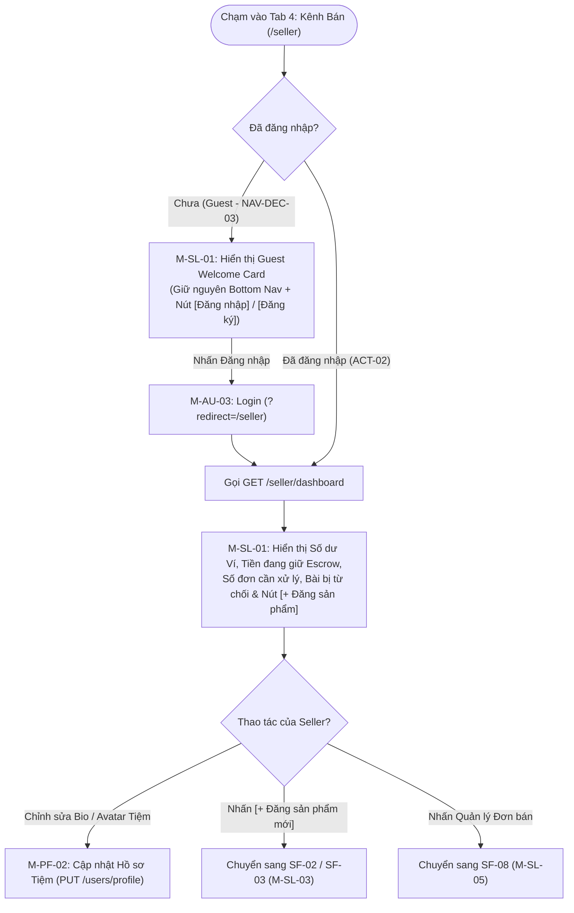

---

### 2.2. `SF-02`: Create Fixed-Price Product Listing (Đăng Bán Sản Phẩm Giá Cố Định)

- **1. Flow ID & Name:** `SF-02` – Create Fixed-Price Secondhand Product Listing
- **2. Primary Actor:** `ACT-02` (Seller)
- **3. Entry Point:** Nhấn **[+ Đăng sản phẩm mới]** từ `M-SL-01` hoặc `M-SL-02`.
- **4. Preconditions:** Người bán đã đăng nhập; danh sách `Categories` và `Brands` đã có sẵn từ Backend.
- **5. Main Flow (Bảng Tương Tác UX Chi Tiết):**

| Bước | Màn Hình | Người Dùng Nhìn Thấy Gì (What User Sees) | Thao Tác Của Người Dùng (User Action) | Phản Hồi Của Hệ Thống (System Response) | Bước Tiếp Theo (Next State) |
| :-: | :---: | :--- | :--- | :--- | :--- |
| 1 | `M-SL-03` | Form **Đăng sản phẩm mới** (`/seller/products/form`): 1. **Khung tải ảnh sản phẩm** (tối thiểu 1 ảnh, tối đa 8 ảnh) & **Khung tải bằng chứng xác thực (`authenticity_evidence`):** ảnh chụp tag, mã code, hóa đơn cũ. 2. Tên sản phẩm, Danh mục (`Category`), Thương hiệu (`Brand`). 3. **Thông tin đồ si bắt buộc (`BR-PR-03`):** Tình trạng (`condition`: *Like New*, *Good*, *Fair*, *Vintage Worn*) và Mô tả chi tiết lỗi/vết xước (`defect_info`). 4. Bộ chọn phương thức bán (`Listing Type Selector`): **`Bán Giá Cố Định (Fixed Price)`** \| `Đấu Giá Theo Phiên (Auction)`. | Tải ảnh thực tế của món đồ, nhập thông tin, khai báo rõ vết xước/lỗi trong `defect_info` và chọn chế độ **`Bán Giá Cố Định (Fixed Price)`**. | Kiểm tra định dạng ảnh (`jpg`, `png`, `webp`, $\le 5\text{MB}$ – `NFR-SEC-05`). Khi chọn `FIXED_PRICE`, hiển thị cụm trường nhập **Giá bán cố định (`price`)** và **Số lượng (`available_quantity`)**. | Hiển thị form nhập Giá cố định. |
| 2 | `M-SL-03` | Ô nhập **Giá bán (`price` VNĐ)**, **Số lượng (`available_quantity`, mặc định = `1`)**, và dòng ghi chú minh bạch: *"Miễn phí hoa hồng bán hàng – Bạn sẽ nhận về đủ 100% giá bán khi đơn hoàn tất (`DEC-04`)"*. | Nhập `price > 0`, `available_quantity >= 1`, sau đó nhấn **[Gửi kiểm duyệt (`Submit for Review`)]** (hoặc nhấn **[Xem trước]** / **[Lưu nháp]** tại `SF-04`). | Gọi `POST /products` (kèm cờ gửi duyệt hoặc `POST /products/{id}/submit`). Backend lưu ảnh vào Local Storage và tạo bản ghi `products` với trạng thái `PENDING_REVIEW` (`BR-PR-02`). | Điều hướng về `M-SL-02` (mở sẵn tab `Chờ duyệt - PENDING_REVIEW`). |

- **6. Alternative Flows:** Chuyển sang lưu nháp (`DRAFT`) hoặc xem trước bài đăng (`M-SL-03B`) tại luồng `SF-04`.
- **7. Exception Flows:**
  - **E1 (Thiếu thông tin bắt buộc hoặc Giá $\le 0$):** Nếu thiếu ảnh, chưa chọn `condition`, để trống mô tả hoặc nhập `price <= 0`, Backend trả lỗi `422 Unprocessable Entity` và hiển thị lỗi đỏ dưới từng trường tương ứng.
  - **E2 (File ảnh không hợp lệ hoặc quá 5MB):** Báo lỗi ngay khi chọn ảnh và từ chối tải lên (`NFR-SEC-05`).
- **8. Screen Sequence:** `M-SL-01` $\rightarrow$ `M-SL-03` (Create Product - Fixed Price Mode) $\rightarrow$ `M-SL-02` (My Listings - Tab `PENDING_REVIEW`).
- **9. Exit Condition:** Sản phẩm `FIXED_PRICE` được tạo ở trạng thái `PENDING_REVIEW`, chờ Moderator kiểm duyệt (`P2-06`).
- **10. Related IDs:** `FR-SL-01`, `FR-SL-03` | `UC-SL-01` | `BR-PR-01`..`03`, `DEC-04`, `NFR-SEC-05`.

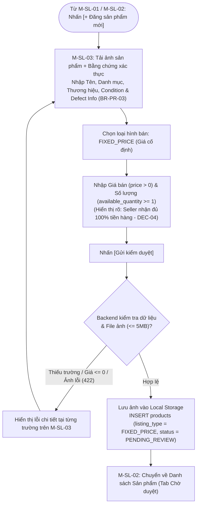

---

### 2.3. `SF-03`: Create Auction Product Listing (Đăng Sản Phẩm Đấu Giá Theo Phiên Hàng Ngày)

- **1. Flow ID & Name:** `SF-03` – Create Scheduled Auction Product Listing
- **2. Primary Actor:** `ACT-02` (Seller)
- **3. Entry Point:** Trong màn hình `M-SL-03` (`Create Product Listing`), người bán chuyển công tắc loại hình bán sang **`Đấu Giá Theo Phiên (Auction)`**.
- **4. Preconditions:** Admin đã cấu hình các khung giờ phiên đấu giá hàng ngày (`auction_sessions`) đang hoạt động.
- **5. Main Flow (Bảng Tương Tác UX Chi Tiết):**

| Bước | Màn Hình | Người Dùng Nhìn Thấy Gì (What User Sees) | Thao Tác Của Người Dùng (User Action) | Phản Hồi Của Hệ Thống (System Response) | Bước Tiếp Theo (Next State) |
| :-: | :---: | :--- | :--- | :--- | :--- |
| 1 | `M-SL-03` | Sau khi nhập thông tin sản phẩm đồ si (Ảnh, Tên, Danh mục, Tình trạng `condition`, Lỗi `defect_info`, Bằng chứng xác thực) và chọn tab **`Đấu Giá Theo Phiên (Auction)`**: 1. Trường Số lượng tự động khóa cố định bằng **`1`** (`BR-PR-01`, `ASM-02`). 2. **Chọn Khung giờ Phiên đấu giá (`Auction Session`):** Danh sách các phiên sắp mở do Admin cấu hình (kèm thời gian bắt đầu `start_time` và kết thúc `end_time`). 3. **Giá khởi điểm (`starting_price > 0`)**. 4. **Bước giá tối thiểu (`min_bid_increment > 0`)** (tuân thủ ngưỡng tối thiểu của hệ thống). 5. **Giá sàn kỳ vọng tùy chọn (`reserve_price`):** Giải thích rõ nếu hết giờ mà giá cao nhất chưa đạt `reserve_price` thì người bán không bắt buộc phải bán (`ENDED_UNSOLD`). | Chọn khung giờ phiên đấu giá, nhập `starting_price`, `min_bid_increment`, `reserve_price` (nếu có) và nhấn **[Gửi kiểm duyệt]**. | Kiểm tra quy tắc đấu giá: `starting_price > 0`, `min_bid_increment >= min_system_increment`, và nếu có nhập `reserve_price` thì bắt buộc `reserve_price >= starting_price`. | Gửi request tạo sản phẩm đấu giá lên Backend. |
| 2 | `M-SL-03` $\rightarrow$ `M-SL-02` | Thông báo xác nhận bài đăng đấu giá đã được gửi tới Moderator. | Xác nhận hoàn tất. | Backend mở `DB::transaction()`: tạo bản ghi `products` (`listing_type = AUCTION`, `available_quantity = 1`, `status = PENDING_REVIEW`) và bản ghi cấu hình trong `auctions` gắn với `auction_session_id`. | Chuyển về `M-SL-02` (Tab `PENDING_REVIEW`). Chỉ khi được Moderator duyệt (`APPROVED`) trước giờ mở phiên thì sản phẩm mới vào phiên `SCHEDULED` / `LIVE`. |

- **6. Alternative Flows:** Lưu nháp (`DRAFT`) hoặc Xem trước giao diện phòng đấu giá (`M-SL-03B`) tại `SF-04`.
- **7. Exception Flows:**
  - **E1 (`reserve_price < starting_price`):** Báo lỗi tại chỗ *"Giá sàn kỳ vọng phải lớn hơn hoặc bằng giá khởi điểm"*.
  - **E2 (Phiên đấu giá được chọn đã đóng đăng ký hoặc đã bắt đầu chạy):** Backend trả lỗi `422` yêu cầu người bán chọn một khung giờ phiên đấu giá tiếp theo trong tương lai.
- **8. Screen Sequence:** `M-SL-01` $\rightarrow$ `M-SL-03` (Create Product - Auction Mode) $\rightarrow$ `M-SL-02` (My Listings - Tab `PENDING_REVIEW`).
- **9. Exit Condition:** Sản phẩm đấu giá và cấu hình phiên nằm ở trạng thái `PENDING_REVIEW` chờ Moderator duyệt.
- **10. Related IDs:** `FR-SL-02`, `FR-SL-03`, `FR-AC-01` | `UC-SL-01` | `BR-PR-01`..`03`, `ASM-02`.

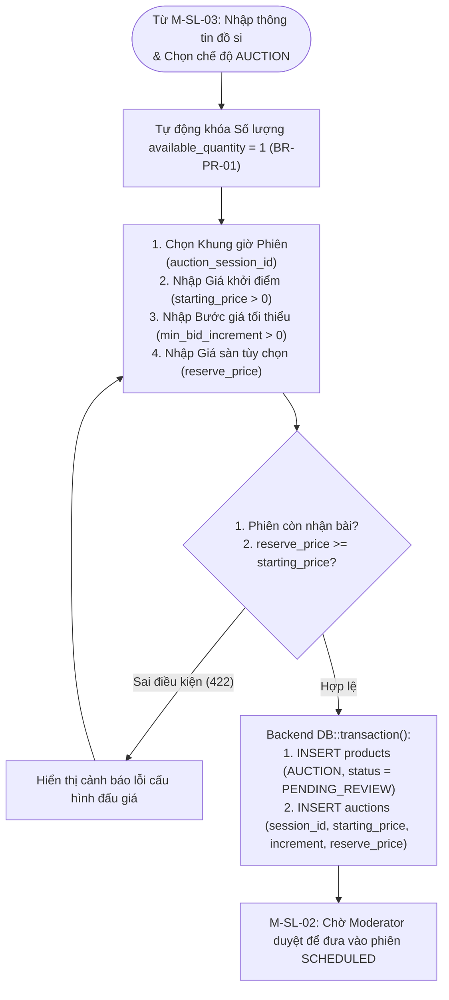

---

### 2.4. `SF-04`: Save Draft, Preview & Submit for Review (Lưu Bản Nháp, Xem Trước & Gửi Kiểm Duyệt)

- **1. Flow ID & Name:** `SF-04` – Save Draft, Preview Listing & Submit for Moderation
- **2. Primary Actor:** `ACT-02` (Seller)
- **3. Entry Point:** Trên màn hình tạo/sửa sản phẩm (`M-SL-03`), hoặc từ tab `Nháp (DRAFT)` trong `M-SL-02`.
- **4. Preconditions:** Người bán đang soạn thảo thông tin sản phẩm.
- **5. Main Flow (Bảng Tương Tác UX Chi Tiết):**

| Bước | Màn Hình | Người Dùng Nhìn Thấy Gì (What User Sees) | Thao Tác Của Người Dùng (User Action) | Phản Hồi Của Hệ Thống (System Response) | Bước Tiếp Theo (Next State) |
| :-: | :---: | :--- | :--- | :--- | :--- |
| 1 | `M-SL-03` $\rightarrow$ `M-SL-03B` | Ba nút hành động ở cuối form `M-SL-03`: **[Lưu nháp (`Save Draft`)]** \| **[Xem trước (`Preview`)]** \| **[Gửi kiểm duyệt (`Submit`)]**. | Nhấn **[Xem trước]** để kiểm tra bài đăng sẽ hiển thị như thế nào dưới mắt người mua. | Mở màn hình `M-SL-03B` (`Listing Preview`) mô phỏng chính xác bố cục `M-PR-01` (nếu Fixed Price) hoặc `M-AC-03` (nếu Auction) kèm thanh nhắc *"Chế độ xem trước của Người bán"*. | Người bán kiểm tra bố cục ảnh, mô tả lỗi và giá bán. |
| 2 | `M-SL-03B` $\rightarrow$ `M-SL-02` | Nút **[Quay lại sửa]** hoặc **[Gửi kiểm duyệt ngay]** trên màn hình Xem trước. | Nhấn **[Gửi kiểm duyệt ngay]** (hoặc nếu chưa chụp đủ ảnh thì nhấn **[Lưu nháp]** tại `M-SL-03`). | - **Nếu Lưu nháp:** Lưu bản ghi với `status = DRAFT` (cho phép bỏ trống một số trường chưa hoàn thiện). - **Nếu Gửi kiểm duyệt:** Kiểm tra đủ 100% trường bắt buộc và chuyển trạng thái `DRAFT` $\rightarrow$ `PENDING_REVIEW` (`POST /products/{id}/submit`). | Hiển thị trong tab `DRAFT` hoặc `PENDING_REVIEW` tại `M-SL-02`. |

- **6. Alternative Flows:** Mở lại bản nháp từ tab `DRAFT` trong `M-SL-02` $\rightarrow$ Bổ sung thêm ảnh thực tế $\rightarrow$ Nhấn **[Gửi kiểm duyệt]**.
- **7. Exception Flows:** Khi chuyển từ `DRAFT` sang `PENDING_REVIEW`, nếu bản nháp vẫn còn thiếu ảnh hoặc thiếu giá/tình trạng, Backend chặn thao tác gửi duyệt (`422`) và yêu cầu hoàn thiện đủ các trường bắt buộc.
- **8. Screen Sequence:** `M-SL-03` $\leftrightarrow$ `M-SL-03B` (Preview) $\rightarrow$ `M-SL-02` (Tab `DRAFT` / `PENDING_REVIEW`).
- **9. Exit Condition:** Bài đăng được lưu an toàn ở trạng thái `DRAFT` hoặc gửi vào hàng chờ `PENDING_REVIEW`.
- **10. Related IDs:** `FR-SL-03`, `FR-SL-04` | `UC-SL-01` | `BR-PR-02`.

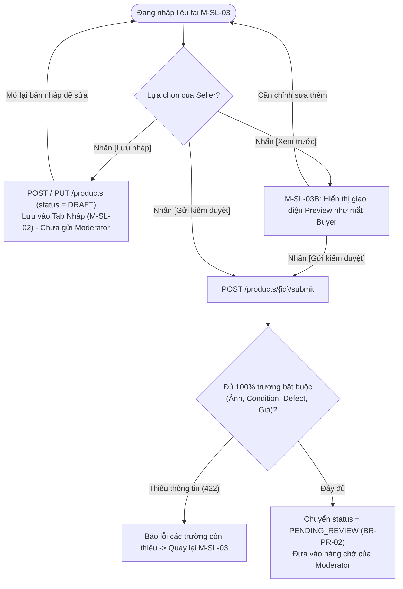

---

### 2.5. `SF-05`: View Rejection Reason, Edit & Resubmit (Xem Lý Do Từ Chối, Chỉnh Sửa & Gửi Duyệt Lại – `DEC-05`)

- **1. Flow ID & Name:** `SF-05` – Inspect Moderation Rejection Feedback, Edit & Resubmit Product
- **2. Primary Actor:** `ACT-02` (Seller)
- **3. Entry Point:** Nhấn vào thông báo *"Sản phẩm của bạn cần chỉnh sửa / bị từ chối kiểm duyệt"* (`M-NT-01`) hoặc vào `M-SL-02` $\rightarrow$ Chọn tab **`Bị từ chối (`REJECTED`)`** $\rightarrow$ Chạm vào sản phẩm.
- **4. Preconditions:** Sản phẩm có `status = REJECTED` do Moderator/Admin từ chối kèm lý do bắt buộc (`DEC-05`, `BR-PR-04`).
- **5. Main Flow (Bảng Tương Tác UX Chi Tiết):**

| Bước | Màn Hình | Người Dùng Nhìn Thấy Gì (What User Sees) | Thao Tác Của Người Dùng (User Action) | Phản Hồi Của Hệ Thống (System Response) | Bước Tiếp Theo (Next State) |
| :-: | :---: | :--- | :--- | :--- | :--- |
| 1 | `M-SL-04` | Màn hình **Chi tiết Kiểm duyệt & Phản hồi (`Moderation Feedback`)** hiển thị: 1. Hộp cảnh báo màu đỏ Burgundy (`#873A43`) nêu rõ **Lý do từ chối / Yêu cầu chỉnh sửa của Moderator** (ví dụ: *"Ảnh chụp mờ chưa thấy rõ vết sờn ở cổ áo như mô tả, vui lòng chụp bổ sung ảnh cận cảnh"*). 2. Thời gian duyệt và lịch sử các lần kiểm duyệt trước đó (`product_moderation_logs`). 3. Nút hành động chính: **[Chỉnh sửa & Gửi duyệt lại (`Edit & Resubmit`)]**. | Đọc kỹ yêu cầu chỉnh sửa của Moderator và nhấn **[Chỉnh sửa & Gửi duyệt lại]**. | Mở màn hình `M-SL-03` điền sẵn toàn bộ dữ liệu hiện tại của sản phẩm kèm banner ghim tóm tắt lý do cần sửa ở đầu form. | Người bán chỉnh sửa bài đăng trên `M-SL-03`. |
| 2 | `M-SL-03` $\rightarrow$ `M-SL-02` | Form chỉnh sửa sản phẩm. | Tải thêm ảnh cận cảnh/bằng chứng xác thực, cập nhật lại mô tả lỗi/giá hoặc chọn lại phiên đấu giá mới (nếu phiên cũ đã qua), sau đó nhấn **[Gửi duyệt lại (`Resubmit`)]**. | Gọi `PUT /products/{id}` và `POST /products/{id}/submit`. Backend chuyển trạng thái sản phẩm từ `REJECTED` $\rightarrow$ `PENDING_REVIEW` (`BR-PR-02`) và lưu lịch sử gửi lại. | Sản phẩm quay lại tab `PENDING_REVIEW` trên `M-SL-02` và xuất hiện lại trong hàng chờ của Moderator. |

- **6. Alternative Flows:** Nếu người bán không muốn bán món đồ đó nữa, có thể nhấn **[Lưu trữ (`Archive`)]** hoặc **[Xóa bài đăng]** ngay tại `M-SL-04`.
- **7. Exception Flows:** Nếu sản phẩm là hàng Đấu giá (`AUCTION`) mà khung giờ phiên đấu giá đã chọn ban đầu hiện đã trôi qua, hệ thống bắt buộc người bán chọn lại một khung giờ phiên đấu giá mới trong tương lai trước khi cho phép bấm `Resubmit`.
- **8. Screen Sequence:** `M-NT-01` / `M-SL-02` (Tab `REJECTED`) $\rightarrow$ `M-SL-04` (Moderation Feedback) $\rightarrow$ `M-SL-03` (Edit Form) $\rightarrow$ `M-SL-02` (Tab `PENDING_REVIEW`).
- **9. Exit Condition:** Sản phẩm sau khi sửa đạt trạng thái `PENDING_REVIEW` để Moderator duyệt lại.
- **10. Related IDs:** `FR-SL-05`, `FR-MD-01`, `FR-MD-02` | `UC-SL-02`, `UC-MD-01` | `BR-PR-02`, `BR-PR-04`, `DEC-05`.

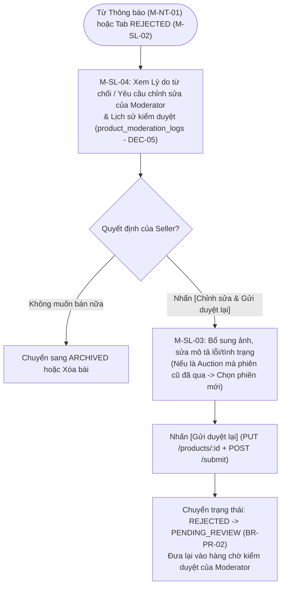

---

### 2.6. `SF-06`: Manage My Listings Across 7 Statuses (Quản Lý Danh Sách Sản Phẩm Theo 7 Trạng Thái)

- **1. Flow ID & Name:** `SF-06` – Manage Seller Product Listings Across 7 Lifecycle States
- **2. Primary Actor:** `ACT-02` (Seller)
- **3. Entry Point:** Từ `M-SL-01` nhấn **[Sản phẩm của tôi (`My Listings`)]** để mở `M-SL-02`.
- **4. Preconditions:** Người bán đã đăng nhập (`ACT-02`).
- **5. Main Flow (Bảng Tương Tác UX Chi Tiết):**

| Bước | Màn Hình | Người Dùng Nhìn Thấy Gì (What User Sees) | Thao Tác Của Người Dùng (User Action) | Phản Hồi Của Hệ Thống (System Response) | Bước Tiếp Theo (Next State) |
| :-: | :---: | :--- | :--- | :--- | :--- |
| 1 | `M-SL-02` | Màn hình **Sản phẩm của tôi** (`/seller/products`) với thanh Tab ngang gồm đúng **7 trạng thái vòng đời sản phẩm (`8.1` trong `06_BUSINESS_RULES.md`)**: 1. `Đang bán (APPROVED)` 2. `Chờ duyệt (PENDING_REVIEW)` 3. `Bị từ chối (REJECTED)` 4. `Bản nháp (DRAFT)` 5. `Đã bán (SOLD)` 6. `Đang ẩn (HIDDEN)` 7. `Lưu trữ (ARCHIVED)` | Chuyển đổi giữa các tab để kiểm tra sản phẩm và nhấn menu thao tác nhanh trên từng thẻ sản phẩm. | Gọi `GET /seller/products?status=...` lấy danh sách sản phẩm thuộc quyền sở hữu của `auth()->id()`. | Hiển thị các thao tác hợp lệ theo từng trạng thái. |
| 2 | `M-SL-02` | Các nút thao tác ngữ cảnh trên thẻ sản phẩm: - Ở `APPROVED` (chưa có đơn/bid): **[Chỉnh sửa]**, **[Tạm ẩn (`HIDDEN`)]**. - Ở `HIDDEN`: **[Hiện lại lên sàn (`APPROVED`)]**, **[Lưu trữ (`ARCHIVED`)]**. - Ở `DRAFT`: **[Tiếp tục sửa]**, **[Gửi duyệt]**, **[Xóa]**. - Ở `REJECTED`: **[Xem lý do & Sửa lại (`SF-05`)]**. | Chọn thao tác (ví dụ: nhấn **[Tạm ẩn]** một món đồ đang `APPROVED` vì bận đi công tác chưa giao hàng được) và xác nhận trong Dialog. | Kiểm tra điều kiện khóa chỉnh sửa (`BR-PR-05`): nếu sản phẩm không nằm trong đơn hàng đang hoạt động hoặc phiên đấu giá đang chạy, cập nhật trạng thái tương ứng. | Cập nhật danh sách sản phẩm tức thì. |

- **6. Alternative Flows:** Tìm kiếm nhanh trong danh sách sản phẩm của chính mình theo tên món đồ hoặc lọc theo loại hình (`FIXED_PRICE` / `AUCTION`).
- **7. Exception Flows (`BR-PR-05` – Khóa sửa/ẩn/xóa khi đang có giao dịch):**
  - **E1 (Sản phẩm đang trong phiên đấu giá `LIVE` hoặc đã có người đặt giá thầu `bid_count > 0`):** Hệ thống khóa cứng nút Sửa giá, Ẩn và Xóa (`403/422` – *"Không thể chỉnh sửa hoặc ẩn sản phẩm khi phiên đấu giá đang diễn ra hoặc đã có người trả giá"*).
  - **E2 (Sản phẩm đã có người đặt mua trong một đơn hàng đang xử lý):** Không cho phép sửa thông tin hoặc xóa sản phẩm.
- **8. Screen Sequence:** `M-SL-01` $\rightarrow$ `M-SL-02` (7 Status Tabs) $\leftrightarrow$ `M-SL-03` / `M-SL-04`.
- **9. Exit Condition:** Trạng thái hiển thị của sản phẩm được quản lý đúng quy tắc vòng đời.
- **10. Related IDs:** `FR-SL-04` | `UC-SL-02` | `PERM-PR-05`, `PERM-PR-08`, `BR-PR-05`.

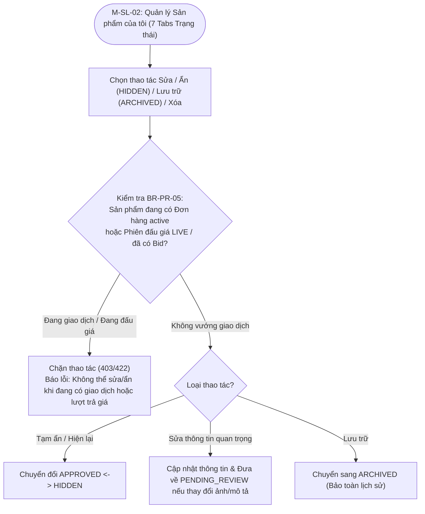

---

### 2.7. `SF-07`: Monitor Seller Auction, Close Early & Relist Defaulted Auction (Theo Dõi Đấu Giá, Chốt Phiên Sớm & Đăng Lại Khi Khách Bỏ Cọc – `DEC-02`)

- **1. Flow ID & Name:** `SF-07` – Monitor Own Auction, Seller Early Close & Relist After Winner Default
- **2. Primary Actor:** `ACT-02` (Seller)
- **3. Entry Point:** Từ `M-SL-02` (chọn sản phẩm đấu giá) hoặc từ `M-AC-03` (`Auction Detail` khi người xem là chủ sở hữu sản phẩm `auth()->id() == auction.seller_id`).
- **4. Preconditions:** Sản phẩm đấu giá đã được duyệt (`APPROVED`) và gắn với một phiên đấu giá.
- **5. Main Flow (Bảng Tương Tác UX Chi Tiết):**

| Bước | Màn Hình | Người Dùng Nhìn Thấy Gì (What User Sees) | Thao Tác Của Người Dùng (User Action) | Phản Hồi Của Hệ Thống (System Response) | Bước Tiếp Theo (Next State) |
| :-: | :---: | :--- | :--- | :--- | :--- |
| 1 | `M-AC-03` | Khi chủ sản phẩm mở màn hình phòng đấu giá `M-AC-03`: 1. Hệ thống **ẩn hoàn toàn nút `[Đặt giá thầu]`** (`BR-AC-02` – Cấm tự trả giá sản phẩm của mình). 2. Hiển thị **Bảng điều khiển của Người bán (`Seller Auction Control Bar`):** Số người đang theo dõi, tổng số lượt bid, giá cao nhất hiện tại (`current_highest_bid`), trạng thái đạt giá sàn (`Reserve Met` / `Reserve Not Met`), và nút **[Chốt phiên sớm (`Close Early`)]**. | Theo dõi diễn biến trả giá; khi thấy mức giá cao nhất hiện tại đã ưng ý và đạt điều kiện, nhấn nút **[Chốt phiên sớm (`Close Early`)]**. | Kiểm tra điều kiện `BR-AU-05`: 1. Phiên đang `LIVE` (`now() < auction_ends_at`). 2. Đã có người dẫn đầu hợp lệ (`leading_bidder_id != null`). 3. Đã đạt giá sàn (`current_highest_bid >= reserve_price`). Nếu thỏa mãn, mở hộp thoại xác nhận `M-AC-05`. | Người bán xác nhận chốt sớm trên Dialog `M-AC-05`. |
| 2 | `M-AC-05` $\rightarrow$ `M-SL-06` | Hộp thoại `M-AC-05` hiển thị tên người đang dẫn đầu, mức giá chốt `current_highest_bid` và cảnh báo không thể hoàn tác. | Nhấn **[Xác nhận Chốt bán ngay]**. | Gọi `POST /auctions/{id}/close-early`. Backend thực thi trong `DB::transaction()` + `lockForUpdate()`: 1. Chuyển `auction.status = COMPLETED`, `winner_id = leading_bidder_id`, `closed_early_by_seller = true`. 2. **Tự động tạo Đơn hàng (`orders`):** `item_subtotal = current_highest_bid`, cộng `buyer_protection_fee`, gán hạn thanh toán `payment_expires_at` (**30 phút** ở Production / **2 phút** ở Demo Mode – `BR-AU-06`, `BR-AU-07`). 3. Ghi `audit_logs` và gửi thông báo thắng đấu giá cho Buyer. | Chờ người thắng thanh toán trong 30 phút để xử lý giao hàng tại `SF-08`. |

- **6. Alternative Flows (Đăng lại sản phẩm khi không có người mua hoặc người thắng không thanh toán sau 30 phút – `DEC-02`):**
  - **A1 (Phiên kết thúc không có người thắng `ENDED_UNSOLD`):** Hết giờ nhưng không có ai bid hoặc chưa đạt `reserve_price` $\rightarrow$ Trên `M-SL-02` / `M-AC-03` hiển thị nút **[Đăng lại vào phiên đấu giá khác (`Relist Auction`)]**.
  - **A2 (Người thắng quá hạn 30 phút không thanh toán `WINNER_DEFAULTED` – `DEC-02`):** Khi `now() >= order.payment_expires_at` mà `payment_status == UNPAID`, Scheduled Job (hoặc Admin Demo Trigger) tự động hủy đơn hàng quá hạn, chuyển phiên sang `WINNER_DEFAULTED` và mở khóa sản phẩm. Người bán nhận thông báo *"Người thắng đấu giá đã quá hạn thanh toán. Bạn có thể đăng lại sản phẩm vào phiên tiếp theo"* và nhấn **[Đăng lại phiên mới]** (tuyệt đối không tự động ép người trả giá cao thứ 2 phải mua).
- **7. Exception Flows:**
  - **E1 (Chưa có người trả giá hoặc chưa đạt `reserve_price`):** Nút **[Chốt phiên sớm]** bị khóa (`Disabled`) kèm chú thích *"Chỉ có thể chốt sớm khi đã có lượt trả giá đạt mức giá sàn"*.
- **8. Screen Sequence:** `M-SL-02` $\rightarrow$ `M-AC-03` (Seller View) $\rightarrow$ `M-AC-05` (Early Close Dialog) $\rightarrow$ `M-SL-05` / `M-SL-03` (Relist).
- **9. Exit Condition:** Phiên đấu giá được chốt thành công (sinh đơn hàng cho Winner) hoặc được đăng lại hợp lệ sau khi hết hạn thanh toán.
- **10. Related IDs:** `FR-AC-04`..`06` | `UC-AC-03`, `UC-AC-04` | `BR-AC-02`, `BR-AU-03`, `BR-AU-05`..`07`, `DEC-02`.

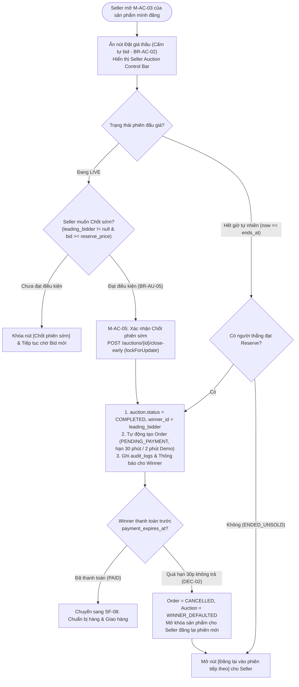

---

### 2.8. `SF-08`: Manage Incoming Orders & Confirm Preparation (Quản Lý Đơn Bán & Xác Nhận Chuẩn Bị Hàng)

- **1. Flow ID & Name:** `SF-08` – Manage Seller Orders & Confirm Order Preparation (`PAID` $\rightarrow$ `PREPARING`)
- **2. Primary Actor:** `ACT-02` (Seller)
- **3. Entry Point:** Từ **Tab 4: Kênh Bán (`M-SL-01`)** $\rightarrow$ Nhấn **[Quản lý Đơn bán (`M-SL-05`)]** (`NAV-DEC-02`), hoặc nhấn từ Thông báo có đơn hàng mới đã thanh toán (`M-NT-01`).
- **4. Preconditions:** Người mua đã hoàn tất thanh toán QR mô phỏng (`order_status = PAID`, `payment_status = PAID`, `escrow_status = HELD`).
- **5. Main Flow (Bảng Tương Tác UX Chi Tiết):**

| Bước | Màn Hình | Người Dùng Nhìn Thấy Gì (What User Sees) | Thao Tác Của Người Dùng (User Action) | Phản Hồi Của Hệ Thống (System Response) | Bước Tiếp Theo (Next State) |
| :-: | :---: | :--- | :--- | :--- | :--- |
| 1 | `M-SL-05` | Màn hình **Danh sách Đơn bán** (`/seller/orders`) chia theo các tab trạng thái: 1. `Chờ xác nhận (PAID)` 2. `Đang chuẩn bị (PREPARING)` *(kèm badge nếu có Yêu cầu hủy từ Buyer)* 3. `Đang giao (SHIPPED)` 4. `Đã giao chờ hoàn tất (DELIVERED)` 5. `Đang khiếu nại (DISPUTED)` 6. `Hoàn tất (COMPLETED)` 7. `Đã hủy / Hoàn tiền (CANCELLED / REFUNDED)`. | Chọn tab `Chờ xác nhận (PAID)` và chạm vào đơn hàng mới. | Gọi `GET /seller/orders/{id}` lấy chi tiết đơn hàng, địa chỉ người nhận và snapshot sản phẩm. | Mở màn hình Chi tiết Đơn bán `M-SL-06`. |
| 2 | `M-SL-06` | Màn hình **Chi tiết Đơn bán** hiển thị: 1. Huy hiệu **`ĐÃ THANH TOÁN – TIỀN ĐANG ĐƯỢC GIỮ TRONG ESCROW`**. 2. **Số tiền Seller sẽ thực nhận khi đơn hoàn tất:** Bằng đúng **100% Tiền hàng (`item_subtotal`)** (`DEC-04`). 3. Thông tin Người mua & Địa chỉ giao hàng đầy đủ. 4. Hai nút hành động: **[Xác nhận Chuẩn bị hàng (`Confirm Preparation`)]** và **[Hủy đơn bán]**. | Kiểm tra món đồ si trong kho và nhấn **[Xác nhận Chuẩn bị hàng]**. | Gọi `POST /orders/{id}/prepare`. Backend kiểm tra `order_status == PAID`, chuyển `order_status` sang **`PREPARING`**, ghi nhận `prepared_at = now()` và gửi thông báo cho Buyer. | Đơn hàng chuyển sang `PREPARING` (từ thời điểm này Buyer không thể tự hủy trực tiếp nữa mà phải gửi yêu cầu chờ Seller duyệt theo `DEC-06`). |

- **6. Alternative Flows:** Người bán nhấn nút **[Chat với Người mua]** ngay trên `M-SL-06` để trao đổi thêm trước khi đóng gói.
- **7. Exception Flows:** Nếu Buyer vừa bấm hủy đơn trực tiếp ở trạng thái `PAID` trước khi Seller bấm `Xác nhận Chuẩn bị hàng` vài giây $\rightarrow$ Backend báo đơn hàng đã bị hủy (`409 Conflict`) và cập nhật lại màn hình.
- **8. Screen Sequence:** `M-SL-01` $\rightarrow$ `M-SL-05` (Seller Order List) $\rightarrow$ `M-SL-06` (Seller Order Detail: `PAID` $\rightarrow$ `PREPARING`).
- **9. Exit Condition:** Đơn hàng chuyển sang trạng thái `PREPARING`, sẵn sàng đóng gói và nhập mã vận đơn (`SF-10`).
- **10. Related IDs:** `FR-SH-01` | `UC-SH-01` | `PERM-OR-04`, `PERM-OR-06`, `DEC-04`, `DEC-06`, `NAV-DEC-02`.

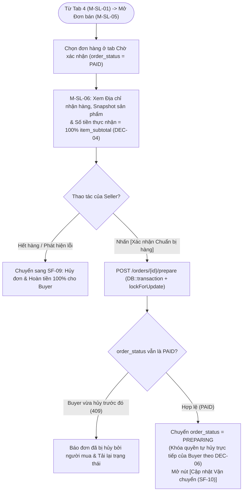

---

### 2.9. `SF-09`: Handle Order Cancellation & Buyer Cancel Request (Hủy Đơn Bán & Duyệt Yêu Cầu Hủy Của Người Mua Ở `PREPARING` – `DEC-06`, `DEC-07`)

- **1. Flow ID & Name:** `SF-09` – Seller Direct Cancellation & Buyer Cancellation Request Approval
- **2. Primary Actor:** `ACT-02` (Seller)
- **3. Entry Point:** Màn hình Chi tiết Đơn bán (`M-SL-06`) khi đơn đang ở trạng thái `PAID` hoặc `PREPARING`.
- **4. Preconditions:** `auth()->id() == order.seller_id`, `order_status IN ('PAID', 'PREPARING')`, `escrow_status == HELD`.
- **5. Main Flow (Bảng Tương Tác UX Chi Tiết):**

| Bước | Màn Hình | Người Dùng Nhìn Thấy Gì (What User Sees) | Thao Tác Của Người Dùng (User Action) | Phản Hồi Của Hệ Thống (System Response) | Bước Tiếp Theo (Next State) |
| :-: | :---: | :--- | :--- | :--- | :--- |
| 1 | `M-SL-06` *(Khi có Yêu cầu hủy từ Buyer ở `PREPARING`)* | Hộp cảnh báo nổi bật: **`NGƯỜI MUA GỬI YÊU CẦU HỦY ĐƠN`** kèm lý do hủy của Buyer, và 2 nút quyết định dành cho Seller (`DEC-06`): - **[Đồng ý Hủy đơn (Hoàn tiền 100% cho khách)]** - **[Từ chối Hủy & Tiếp tục Giao hàng]**. | Seller xem lý do của khách: - Nếu hàng chưa gửi đi và đồng ý hỗ trợ khách $\rightarrow$ Nhấn **[Đồng ý Hủy đơn]**. - Nếu đã đóng gói/ra bưu cục gửi hàng $\rightarrow$ Nhấn **[Từ chối Hủy]** và tiến hành nhập mã vận đơn (`SF-10`). | - **Nếu Đồng ý (`POST /orders/{id}/approve-cancel`):** Trong `DB::transaction()` + `lockForUpdate()`, chuyển `order_status = CANCELLED`, `escrow_status = REFUNDED`, hoàn trả **100% `total_amount` (`item_subtotal` + `buyer_protection_fee`)** từ Escrow về cho Buyer (`DEC-07`), khôi phục tồn kho sản phẩm. - **Nếu Từ chối (`POST /orders/{id}/reject-cancel`):** Đặt `cancellation_requested = false`, thông báo cho Buyer và chuyển sang bước nhập mã vận đơn `SHIPPED`. | Đơn hàng chuyển sang `CANCELLED` (đã hoàn tiền) hoặc tiếp tục sang `SHIPPED` (`SF-10`). |

- **6. Alternative Flows (Seller chủ động hủy đơn ở `PAID` hoặc `PREPARING`):**
  - Nếu trong lúc kiểm tra hàng để đóng gói, Seller phát hiện món đồ bị hỏng/thất lạc không thể giao cho khách: Seller nhấn **[Chủ động Hủy đơn bán]**, chọn lý do $\rightarrow$ Hệ thống hủy đơn ngay lập tức, hoàn trả đủ **100% `total_amount`** cho Buyer (`DEC-07`) và ghi nhận tỷ lệ hủy đơn của Seller (`FR-CM-02`).
- **7. Exception Flows:**
  - **E1 (Đơn đã chuyển sang `SHIPPED` hoặc `DELIVERED`):** Seller không được phép bấm hủy đơn nữa (`BR-OR-04`).
- **8. Screen Sequence:** `M-SL-05` $\rightarrow$ `M-SL-06` (Seller Order Detail + Cancel Request Card).
- **9. Exit Condition:** Yêu cầu hủy đơn được xử lý minh bạch theo đúng quy tắc 3 cấp trạng thái (`DEC-06`) và đảm bảo hoàn tiền 100% (`DEC-07`).
- **10. Related IDs:** `FR-OR-03` | `UC-OR-02` | `PERM-OR-05A`, `PERM-OR-05B`, `PERM-FN-04B`, `BR-OR-04`, `BR-FN-05`, `DEC-06`, `DEC-07`.

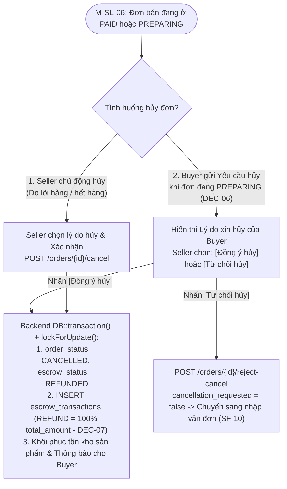

---

### 2.10. `SF-10`: Manual Shipment & Delivery Status Update (Nhập Mã Vận Đơn Thủ Công `SHIPPED` & Cập Nhật `DELIVERED`)

- **1. Flow ID & Name:** `SF-10` – Manual Shipment Tracking Entry & Delivery Status Update
- **2. Primary Actor:** `ACT-02` (Seller)
- **3. Entry Point:** Nhấn **[Cập nhật Gửi hàng (`Ship Order`)]** hoặc **[Cập nhật Đã giao hàng (`Mark Delivered`)]** trên màn hình `M-SL-06` để mở Modal `M-SL-07`.
- **4. Preconditions:** Đơn hàng đang ở trạng thái `PREPARING` (để chuyển sang `SHIPPED`) hoặc `SHIPPED` (để chuyển sang `DELIVERED`).
- **5. Main Flow (Bảng Tương Tác UX Chi Tiết):**

| Bước | Màn Hình | Người Dùng Nhìn Thấy Gì (What User Sees) | Thao Tác Của Người Dùng (User Action) | Phản Hồi Của Hệ Thống (System Response) | Bước Tiếp Theo (Next State) |
| :-: | :---: | :--- | :--- | :--- | :--- |
| 1 | `M-SL-06` $\rightarrow$ `M-SL-07` | Khi đơn đang `PREPARING`, Seller nhấn **[Xác nhận Đã gửi hàng]** mở Bottom Sheet `M-SL-07` gồm: 1. Tên đơn vị vận chuyển (`carrier_name`: GHN, GHTK, Viettel Post, J&T, Tự giao...). 2. Mã vận đơn (`tracking_code`). 3. Ghi chú vận chuyển / Ảnh chụp phiếu gửi hàng (nếu có). | Nhập tên đơn vị vận chuyển, mã vận đơn `tracking_code` và nhấn **[Xác nhận Đã gửi hàng]**. | Gọi `POST /orders/{id}/shipment`. Backend tạo bản ghi `shipments`, cập nhật `order_status = SHIPPED`, `shipped_at = now()`, và gửi thông báo kèm mã vận đơn cho Buyer. | Đơn hàng chuyển sang `SHIPPED` (hiển thị trên Timeline của cả 2 bên). |
| 2 | `M-SL-06` $\rightarrow$ `M-SL-07` | Khi bưu kiện đã giao tới tay người nhận, Seller mở đơn hàng đang `SHIPPED` và nhấn **[Cập nhật: Đã giao hàng thành công (`DELIVERED`)]**. | Xác nhận kiện hàng đã giao tới nơi. | Gọi `PUT /orders/{id}/shipment-status` (`status = DELIVERED`). Backend thực thi quy tắc cốt lõi **`BR-OR-05` & `ADR-05`**: 1. Cập nhật `order_status = DELIVERED`, `delivered_at = now()`. 2. **Tính cứng và lưu mốc `auto_complete_at = now() + auto_complete_duration`** (**24 giờ** ở Production Mode / **2 phút** ở Demo Mode). 3. Gửi thông báo nhắc Buyer kiểm tra hàng và xác nhận. | Bắt đầu đếm ngược 24 giờ (hoặc 2 phút ở Demo Mode) để tự động hoàn tất & giải ngân nếu không có khiếu nại (`SF-12`). |

- **6. Alternative Flows:** Cập nhật lại mã vận đơn nếu nhập sai ký tự khi đơn vẫn đang ở `SHIPPED`.
- **7. Exception Flows:**
  - **E1 (Để trống mã vận đơn hoặc tên hãng vận chuyển):** Báo lỗi `422 Unprocessable Entity` yêu cầu nhập đầy đủ thông tin vận đơn.
  - **E2 (Đơn hàng đã bị Buyer mở Khiếu nại ngay ở bước `SHIPPED` do lâu không nhận được hàng – `DEC-03`):** Nếu `dispute_status == OPEN`, hệ thống cảnh báo đơn đang có tranh chấp và yêu cầu Seller cung cấp bằng chứng phiếu gửi hàng tại luồng `SF-11`.
- **8. Screen Sequence:** `M-SL-06` (Seller Order Detail) $\leftrightarrow$ `M-SL-07` (Shipment Update Modal).
- **9. Exit Condition:** Đơn hàng chuyển sang `SHIPPED` và `DELIVERED` kèm mốc `auto_complete_at` được đóng băng chính xác trong CSDL.
- **10. Related IDs:** `FR-SH-01` | `UC-SH-01` | `PERM-OR-07`, `BR-OR-05`, `ASM-05`, `ADR-05`.

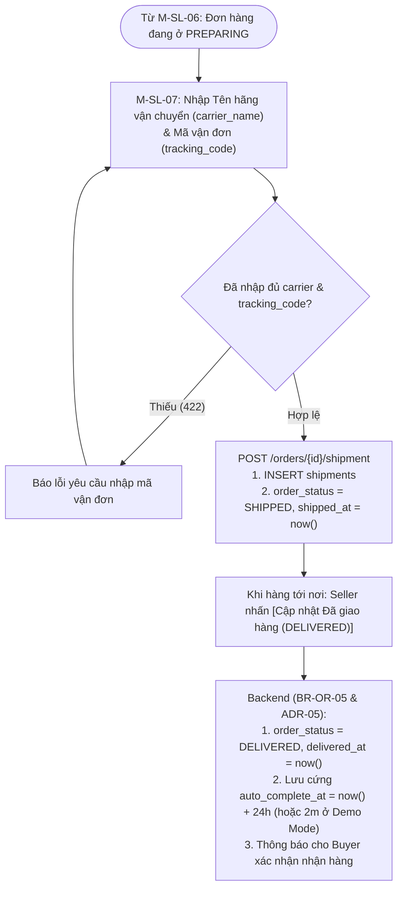

---

### 2.11. `SF-11`: Respond to Buyer Dispute & Upload Counter-Evidence (Phản Hồi Khiếu Nại & Tải Bằng Chứng Đối Chứng)

- **1. Flow ID & Name:** `SF-11` – Seller Dispute Response & Counter-Evidence Submission
- **2. Primary Actor:** `ACT-02` (Seller)
- **3. Entry Point:** Nhấn vào thông báo *"Đơn hàng #... có khiếu nại mới từ Người mua"* (`M-NT-01`), hoặc từ `M-SL-05` (tab `Đang khiếu nại`) $\rightarrow$ `M-SL-06` $\rightarrow$ `M-DP-03`.
- **4. Preconditions:** Buyer đã mở khiếu nại ở trạng thái `SHIPPED` hoặc `DELIVERED` (`dispute_status = OPEN`), khiến khoản tiền trong Escrow bị đóng băng tạm thời (`BR-DP-02`).
- **5. Main Flow (Bảng Tương Tác UX Chi Tiết):**

| Bước | Màn Hình | Người Dùng Nhìn Thấy Gì (What User Sees) | Thao Tác Của Người Dùng (User Action) | Phản Hồi Của Hệ Thống (System Response) | Bước Tiếp Theo (Next State) |
| :-: | :---: | :--- | :--- | :--- | :--- |
| 1 | `M-DP-03` | Màn hình **Chi tiết Hồ sơ Khiếu nại** (`/profile/disputes/:id`) hiển thị: 1. Trạng thái **`TRANH CHẤP ĐANG MỞ – TẠM DỪNG TỰ ĐỘNG GIẢI NGÂN ESCROW`**. 2. Lý do khiếu nại, nội dung mô tả và các hình ảnh bằng chứng do Buyer tải lên. 3. Yêu cầu từ Support Staff / Admin (nếu ở trạng thái `NEED_MORE_INFO`). 4. Khung **Gửi Giải trình & Tải Bằng chứng Đối chứng của Người bán**. | Nhập nội dung giải trình (ví dụ: *"Vết xước ở góc túi đã được chụp rõ ở ảnh số 4 và ghi trong mục defect_info khi đăng bài"*) và tải lên ảnh chụp lúc đóng gói / biên lai gửi hàng. | Gọi `POST /disputes/{id}/evidence` (lưu vào bảng `dispute_evidence` với `uploader_role = SELLER`) và cập nhật luồng đối chứng. | Thông báo cho Support Staff và Administrator vào kiểm tra phân xử (`P2-06`). |
| 2 | `M-DP-03` | Kết quả phán quyết cuối cùng từ **Administrator (`ACT-05`)**. | Xem kết quả phân xử và kiểm tra biến động trong Sổ cái Ví (`M-SL-08`). | - **Nếu Admin chọn `RELEASE_TO_SELLER` / `REJECT_DISPUTE`:** Giải ngân đủ **100% `item_subtotal`** vào ví Seller; đơn chuyển sang `COMPLETED`. - **Nếu Admin chọn `PARTIAL_REFUND`:** Giải ngân phần tiền còn lại (`item_subtotal - partial_refund_amount`) vào ví Seller (`BR-FN-06`). - **Nếu Admin chọn `APPROVE_BUYER_REFUND`:** Hoàn 100% `total_amount` cho Buyer; Seller nhận `0đ`. | Khiếu nại đóng lại (`RESOLVED`). |

- **6. Alternative Flows:** Nếu Support Staff gửi yêu cầu `REQUEST_MORE_EVIDENCE`, Seller nhận thông báo và tải bổ sung thêm hình ảnh vận đơn/đóng gói.
- **7. Exception Flows:** Nếu khiếu nại đã được Admin đóng lại (`RESOLVED`), form tải thêm bằng chứng tự động khóa (Read-Only).
- **8. Screen Sequence:** `M-SL-05` / `M-NT-01` $\rightarrow$ `M-DP-03` (Dispute Detail & Counter-Evidence Upload) $\rightarrow$ `M-SL-08` (Seller Wallet).
- **9. Exit Condition:** Bằng chứng đối chứng của Seller được ghi nhận đầy đủ để Admin ra phán quyết công bằng.
- **10. Related IDs:** `FR-DP-02`, `FR-DP-03` | `UC-DP-01`, `UC-DP-02` | `PERM-CM-07`, `BR-DP-02`, `BR-FN-04`..`06`.

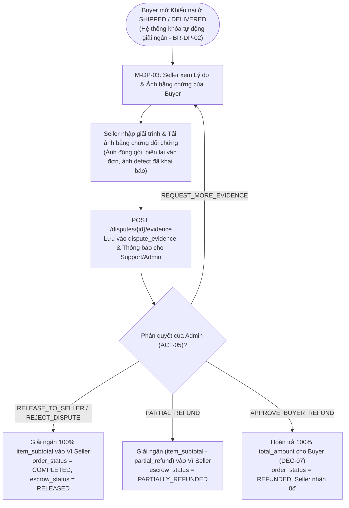

---

### 2.12. `SF-12`: Track Revenue, Seller Wallet & Immutable Escrow Ledger (Theo Dõi Doanh Thu 100% Tiền Hàng & Sổ Cái Ví Bất Biến – `DEC-04`)

- **1. Flow ID & Name:** `SF-12` – Track Seller Revenue, Wallet Balance & Immutable Escrow Ledger
- **2. Primary Actor:** `ACT-02` (Seller)
- **3. Entry Point:** Từ `M-SL-01` (`Seller Center Dashboard`) nhấn vào thẻ **Ví & Doanh thu (`M-SL-08` – `/seller/wallet`)**.
- **4. Preconditions:** Người bán đã đăng nhập (`ACT-02`).
- **5. Main Flow (Bảng Tương Tác UX Chi Tiết):**

| Bước | Màn Hình | Người Dùng Nhìn Thấy Gì (What User Sees) | Thao Tác Của Người Dùng (User Action) | Phản Hồi Của Hệ Thống (System Response) | Bước Tiếp Theo (Next State) |
| :-: | :---: | :--- | :--- | :--- | :--- |
| 1 | `M-SL-08` | Màn hình **Ví Người Bán & Sổ Cái Escrow** (`/seller/wallet`) hiển thị: 1. **Số dư Ví khả dụng (`Available Simulated Balance`):** Tổng số tiền hàng đã được giải ngân thành công. 2. **Số tiền đang chờ giải ngân (`Pending in Escrow - HELD`):** Tổng `item_subtotal` của các đơn hàng đã thanh toán nhưng đang trong quá trình giao nhận. 3. **Chú thích chính sách nền tảng (`DEC-04`):** *"izithrift miễn phí 100% hoa hồng cho Người bán. Bạn nhận về trọn vẹn 100% giá bán sản phẩm (`item_subtotal`) ngay khi đơn hàng hoàn tất. Khoản Phí bảo vệ người mua do người mua chi trả riêng"*. 4. Hai tab lịch sử sổ cái bất biến (`BR-FN-07`):    - **Tab 1: Lịch sử Biến động Ví (`wallet_transactions`)**: Các bút toán `+ Cộng tiền giải ngân đơn hàng (CREDIT)`.    - **Tab 2: Lịch sử Giữ tiền Trung gian (`escrow_transactions`)**: Theo dõi từng đơn hàng ở trạng thái `HELD`, `RELEASED`, `REFUNDED`, `PARTIALLY_REFUNDED`. | Chuyển đổi giữa các tab sổ cái, lọc theo khoảng thời gian hoặc chạm vào một dòng bút toán để xem đơn hàng gốc. | Gọi `GET /seller/wallet` và `GET /seller/wallet/transactions` (có phân trang). Mọi dữ liệu được truy xuất từ các bảng sổ cái Append-only trên PostgreSQL. | Chạm vào bút toán sẽ điều hướng tới `M-SL-06` (`Seller Order Detail`) của đơn hàng tương ứng. |

- **6. Alternative Flows:** Lọc lịch sử giao dịch theo loại biến động (`HOLD`, `RELEASE`, `REFUND`).
- **7. Exception Flows:** Bảng sổ cái là **Read-Only tuyệt đối** (`BR-FN-07`, `PERM-FN-07`): không tồn tại bất kỳ nút xóa hay sửa lịch sử giao dịch nào. Đồng thời hiển thị dòng tuyên bố học thuật rõ ràng: *"Ví điện tử mô phỏng phục vụ đồ án môn học – Không kết nối tài khoản ngân hàng thực tế"* (`CON-02`, `ASM-06`).
- **8. Screen Sequence:** `M-SL-01` $\rightarrow$ `M-SL-08` (Seller Wallet & Escrow Ledger) $\rightarrow$ `M-SL-06` (Order Detail).
- **9. Exit Condition:** Người bán đối soát minh bạch 100% doanh thu tiền hàng và trạng thái giải ngân của từng đơn bán.
- **10. Related IDs:** `FR-SL-06`, `FR-ES-01`, `FR-ES-02` | `UC-SL-02`, `UC-ES-01` | `PERM-FN-05`, `PERM-FN-07`, `BR-FN-04`, `BR-FN-07`, `DEC-04`, `ADR-04`.

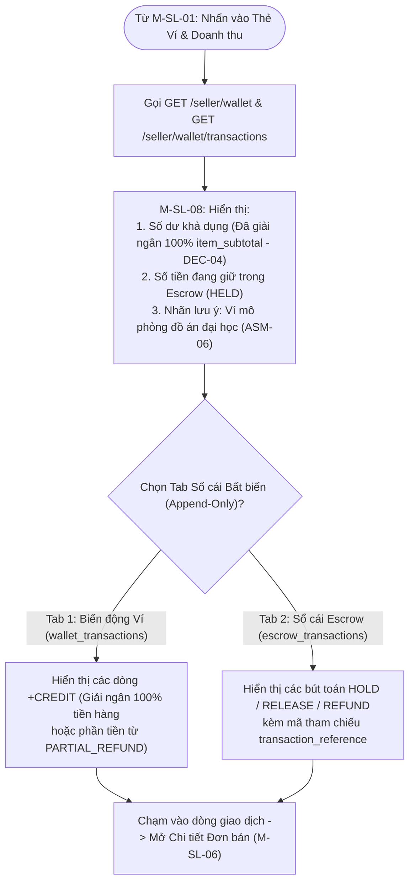

---

## Chương 3. Các Điểm UX Đã Chuẩn Hóa Trong Luồng Người Bán (`SELLER-UX-01` & `SELLER-UX-02`)

1. **`[SELLER-UX-01]` Hiển thị rõ chính sách "Nhận 100% tiền hàng" ngay trên Form Đăng bán (`M-SL-03`) và Chi tiết Đơn bán (`M-SL-06`, `M-SL-08`):**
   - Để người bán không thắc mắc vì sao tổng thanh toán của người mua (`total_amount`) cao hơn giá đăng bán (`item_subtotal`), giao diện của Người bán luôn tách rõ: **Giá bán của bạn (`item_subtotal` – Nhận về 100%)** và **Phí bảo vệ người mua (`buyer_protection_fee` – Do người mua trả cho sàn)** (`DEC-04`).
2. **`[SELLER-UX-02]` Tự động tính và hiển thị mốc đếm ngược `auto_complete_at` ngay khi Seller bấm `DELIVERED` (`M-SL-06`):**
   - Ngay khi Seller cập nhật trạng thái đơn sang `DELIVERED`, màn hình `M-SL-06` hiển thị rõ mốc thời gian `auto_complete_at` (24 giờ sau ở Production / 2 phút sau ở Demo Mode) để Seller biết chính xác khi nào tiền sẽ tự động giải ngân vào Ví nếu người mua quên bấm xác nhận.

---

## Chương 4. Kết Quả Tự Động Kiểm Tra & Nghiệm Thu (`Self-Verified Quality Gate Checklist`)

- [x] **1. Đầy đủ 12 luồng Người bán (`SF-01`..`SF-12`):** Bao phủ 100% vòng đời từ mở Kênh Bán, đăng hàng Fixed Price & Auction, lưu nháp/xem trước, sửa bài bị `REJECTED` (`DEC-05`), quản lý 7 trạng thái sản phẩm, chốt đấu giá sớm & đăng lại khi khách bỏ cọc quá 30 phút (`DEC-02`), chuẩn bị hàng, xử lý hủy đơn/duyệt yêu cầu hủy ở `PREPARING` (`DEC-06`, `DEC-07`), nhập mã vận đơn thủ công (`SHIPPED`/`DELIVERED`), đối chứng khiếu nại và đối soát sổ cái Ví nhận 100% tiền hàng (`DEC-04`).
- [x] **2. Đầy đủ 12 Sơ đồ Mermaid riêng biệt:** Từng luồng từ `SF-01` đến `SF-12` đều có sơ đồ Mermaid chứa các nút kiểm tra điều kiện (`Decision Nodes`) khớp với Backend logic.
- [x] **3. Đồng bộ 100% mã màn hình với `SITEMAP.md` (`P2-01`) và `BUYER_FLOW.md` (`P2-02`):** Khớp nối hoàn hảo tại các điểm giao nhau giữa Buyer và Seller (Duyệt yêu cầu hủy đơn ở `PREPARING`, Cập nhật `DELIVERED` kích hoạt `auto_complete_at`, Đối chứng bằng chứng tại `M-DP-03`).