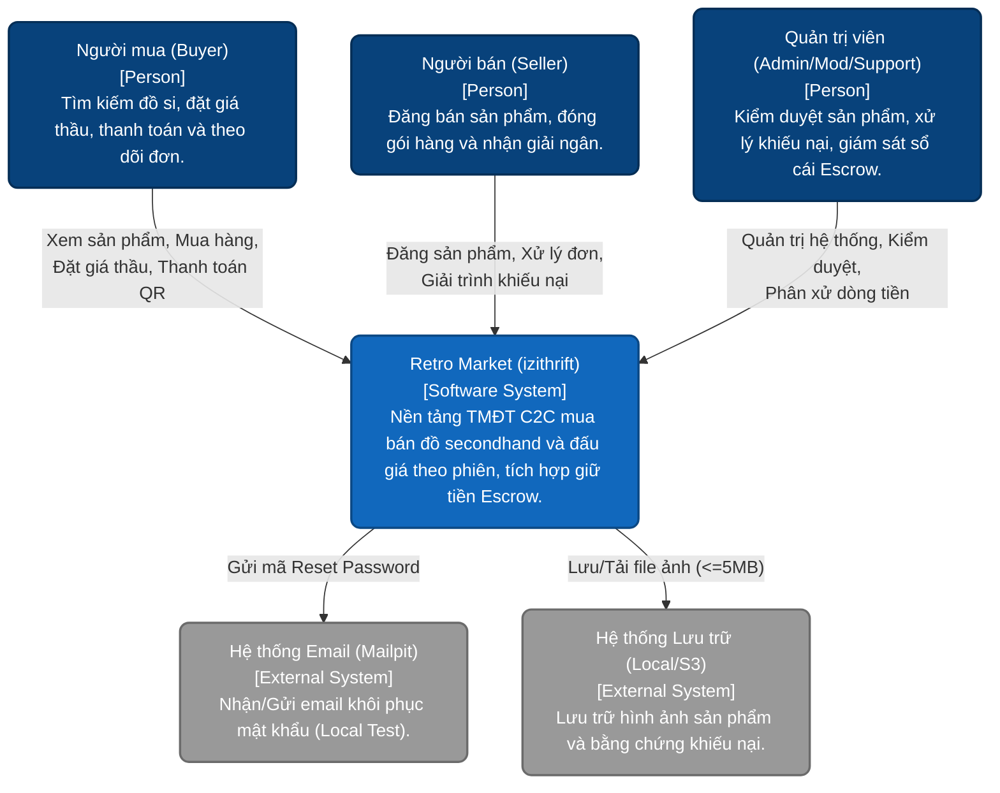
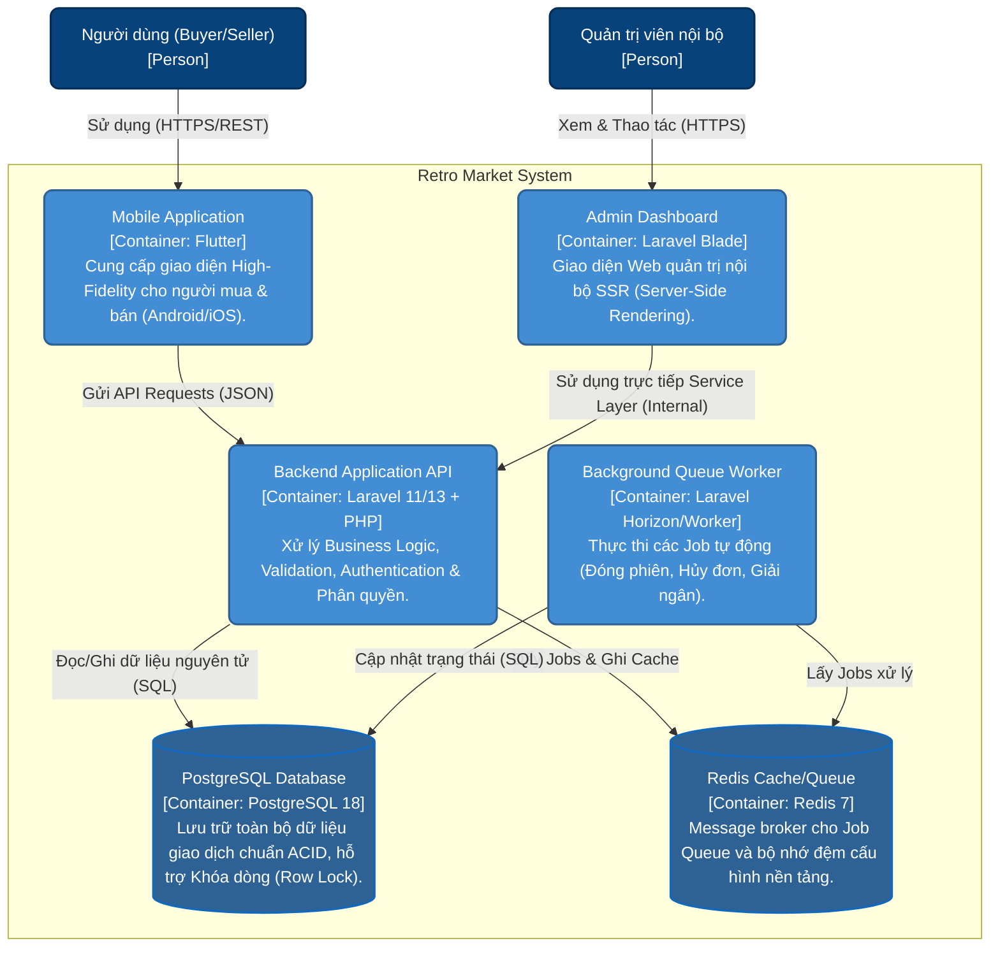
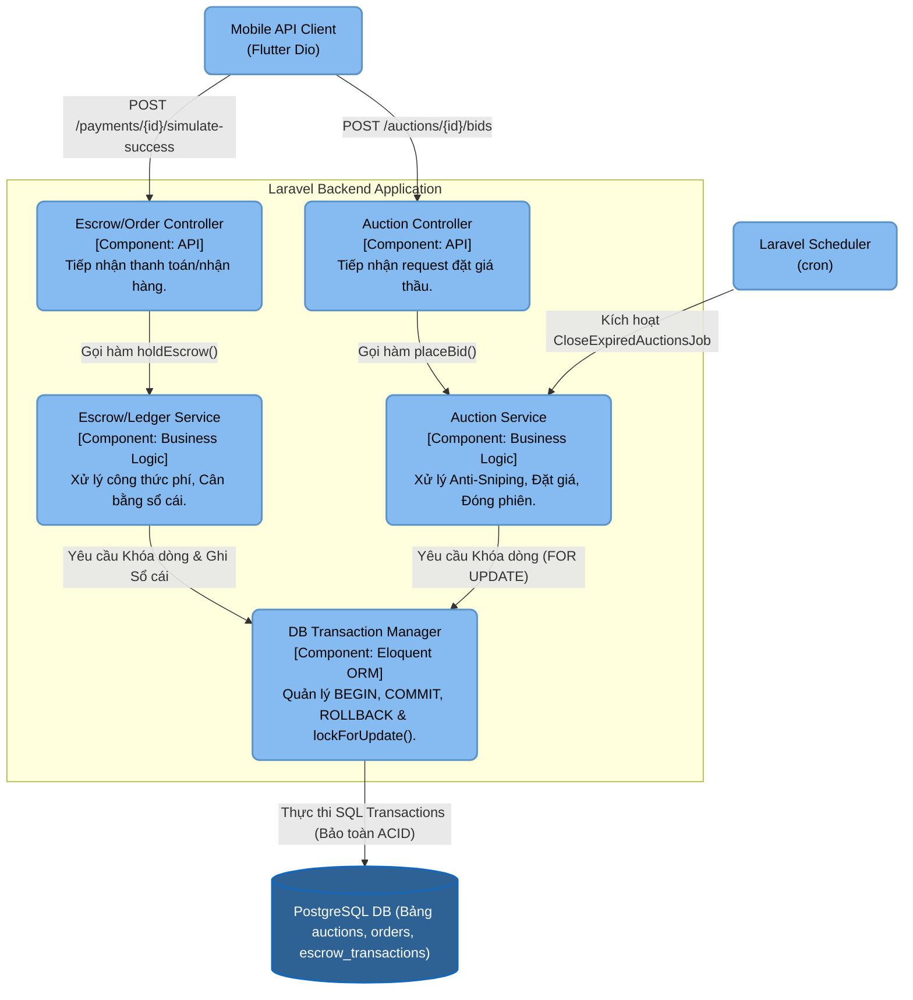

# 02. C4 MODEL ARCHITECTURE DIAGRAMS – RETRO MARKET (izithrift)

- **Document ID:** `DOC-P401B-C4-MODELS`
- **Version:** `1.0.0`
- **Status:** `SELF-VERIFIED & READY FOR PO REVIEW`
- **Project Codename:** `RETRO MARKET`
- **Phase:** `Phase 04 – System Architecture, Database Design & API Specification`

*(Tài liệu này sử dụng cú pháp `Mermaid` chuẩn để phác họa Mô hình C4 từ cấp độ Ngữ cảnh đến cấp độ Component nghiệp vụ cốt lõi).*

---

## 1. C4 Level 1: System Context Diagram (`Sơ đồ Ngữ cảnh Hệ thống`)

Mô tả sự tương tác ở góc nhìn vĩ mô giữa các nhóm người dùng (Actors) và hệ thống Retro Market, cũng như sự phụ thuộc vào các hệ thống bên ngoài.

---

## 2. C4 Level 2: Container Diagram (`Sơ đồ Container`)

Phóng to vào bên trong hệ thống `Retro Market` để thấy các ứng dụng (Containers), kho lưu trữ dữ liệu và các giao thức giao tiếp (REST API, Web, SQL).

---

## 3. C4 Level 3: Component Diagram (`Sơ đồ Component Trọng Tâm`)

Phóng to vào `Backend Application API` để thấy cách luồng dữ liệu (Data Flow) và Khóa bi quan (`Pessimistic Locking`) được áp dụng trong 2 tiến trình phức tạp nhất: **Đấu giá (Auction)** và **Giữ tiền Escrow (Transaction)**.

