# 04. ENTITY RELATIONSHIP DIAGRAM (ERD) & CROSS-MODULE CARDINALITY – RETRO MARKET (izithrift)

- **Document ID:** `DOC-P403B-ERD-RELATIONSHIPS`
- **Version:** `1.0.0 (COMPLETE 30-TABLE ERD SPECIFICATION)`
- **Status:** `SELF-VERIFIED & READY FOR PO REVIEW`
- **Project Codename:** `RETRO MARKET`
- **Application Brand Name:** `izithrift`
- **Target DBMS:** `PostgreSQL 18.x`
- **Phase:** `Phase 04 – System Architecture, Database Design & API Specification`

---

## Chương 1. Sơ Đồ Quan Hệ Thực Thể Tổng Thể (`Master Mermaid erDiagram`)

Sơ đồ dưới đây biểu diễn mối quan hệ giữa toàn bộ các thực thể cốt lõi trong cơ sở dữ liệu PostgreSQL 18 của **Retro Market (`izithrift`)** (hợp nhất từ `DB_01_CORE_SCHEMA.md`, `DB_02_AUCTION_SCHEMA.md` và `DB_03_ORDER_ESCROW_SCHEMA.md`):

```mermaid
erDiagram
    %% ========================================================================
    %% 1. CORE USER & UNIFIED C2C ACCOUNT PROFILES
    %% ========================================================================
    users ||--|| user_profiles : "has 1:1 personal profile"
    users ||--|| seller_profiles : "has 1:1 shop & wallet profile"
    users ||--o{ user_addresses : "manages shipping addresses"
    users ||--|| carts : "owns 1:1 shopping cart"
    users ||--o{ personal_access_tokens : "authenticates via"

    %% ========================================================================
    %% 2. CATALOG, SECONDHAND PRODUCTS & MODERATION
    %% ========================================================================
    categories ||--o{ categories : "parent-child hierarchy"
    categories ||--o{ products : "categorizes"
    brands ||--o{ products : "brands"
    users ||--o{ products : "lists as seller_id"
    products ||--|{ product_images : "contains 1..8 photos & evidence"
    products ||--o{ product_moderation_logs : "audited by moderator"
    users ||--o{ product_moderation_logs : "moderates as moderator_id"

    %% ========================================================================
    %% 3. SCHEDULED AUCTIONS & CONCURRENT BIDDING
    %% ========================================================================
    auction_sessions ||--o{ auctions : "schedules time window"
    products ||--o{ auctions : "listed in (1 active via partial index)"
    users ||--o{ auctions : "hosts as seller / wins as winner"
    auctions ||--o{ auction_bids : "records append-only bids"
    users ||--o{ auction_bids : "places bid as bidder_id"
    auctions ||--o{ auction_watches : "watched by"
    users ||--o{ auction_watches : "watches"

    %% ========================================================================
    %% 4. CART, ORDERS (4-STATE), PAYMENTS & IMMUTABLE ESCROW LEDGER
    %% ========================================================================
    carts ||--o{ cart_items : "contains"
    products ||--o{ cart_items : "added to cart"
    users ||--o{ orders : "places as buyer_id"
    users ||--o{ orders : "fulfills as seller_id"
    auctions |o--o| orders : "generates winning order"
    orders ||--|{ order_items : "freezes snapshot items"
    products ||--o{ order_items : "referenced in snapshot"
    orders ||--o| shipments : "shipped via manual tracking"
    orders ||--o{ payments : "paid via QR session (1 PAID max)"
    orders ||--o{ escrow_transactions : "logged in append-only escrow"
    payments |o--o{ escrow_transactions : "triggers HOLD entry"
    orders ||--o| wallet_transactions : "credits seller wallet on release"
    escrow_transactions ||--o| wallet_transactions : "links RELEASE to wallet credit"
    users ||--o{ wallet_transactions : "receives 100% item_subtotal"

    %% ========================================================================
    %% 5. DISPUTES, VERIFIED REVIEWS, ENGAGEMENT & GOVERNANCE
    %% ========================================================================
    orders ||--o| disputes : "freezes escrow via dispute"
    disputes ||--|{ dispute_evidences : "collects buyer/seller proofs"
    orders ||--o| reviews : "verified review on COMPLETED order"
    users ||--o{ reviews : "writes as buyer / receives as seller"
    users ||--o{ favorites : "saves favorite products"
    products ||--o{ favorites : "favorited by"
    users ||--o{ seller_follows : "follows shop (follower <> seller)"
    users ||--o{ conversations : "participates in 1-on-1 chat"
    conversations ||--o{ messages : "streams polled messages"
    users ||--o{ notifications : "receives deep-linked alerts"
    users ||--o{ reports : "submits / handles violation reports"
    users ||--o{ audit_logs : "records immutable admin actions"

    %% ========================================================================
    %% KEY ENTITY ATTRIBUTE HIGHLIGHTS
    %% ========================================================================
    users {
        BIGSERIAL id PK
        VARCHAR display_name
        VARCHAR email UK
        VARCHAR role "registered_user | moderator | support | admin"
        VARCHAR status "ACTIVE | SUSPENDED | BANNED"
    }
    seller_profiles {
        BIGSERIAL id PK
        BIGINT user_id FK, UK
        NUMERIC trust_score "0..100"
        NUMERIC average_rating "0..5"
        NUMERIC wallet_balance ">= 0 (NUMERIC 15,2)"
        NUMERIC escrow_held_balance ">= 0 (NUMERIC 15,2)"
    }
    products {
        BIGSERIAL id PK
        VARCHAR product_code UK
        BIGINT seller_id FK
        VARCHAR condition "LIKE_NEW | GOOD | FAIR | VINTAGE_WORN"
        TEXT defect_info "Mandatory non-empty (BR-PR-03)"
        VARCHAR listing_type "FIXED_PRICE | AUCTION"
        NUMERIC price "NUMERIC(15,2)"
        INTEGER available_quantity
        VARCHAR status "7 Lifecycle States"
    }
    auctions {
        BIGSERIAL id PK
        VARCHAR auction_code UK
        BIGINT product_id FK "Partial UK where SCHEDULED/LIVE"
        BIGINT session_id FK
        NUMERIC starting_price
        NUMERIC min_bid_increment
        NUMERIC reserve_price "Nullable"
        NUMERIC current_highest_bid
        BIGINT leading_bidder_id FK
        BIGINT winner_id FK
        TIMESTAMPTZ auction_ends_at "Extended on Anti-Sniping"
        VARCHAR status "SCHEDULED | LIVE | COMPLETED | ENDED_UNSOLD | WINNER_DEFAULTED | CANCELLED"
    }
    orders {
        BIGSERIAL id PK
        VARCHAR order_code UK
        BIGINT buyer_id FK
        BIGINT seller_id FK "Single seller per order"
        NUMERIC item_subtotal
        NUMERIC shipping_fee "Fixed 0.00 VND"
        NUMERIC buyer_protection_fee "5-8% + 5k-10k"
        NUMERIC total_amount "item_subtotal + buyer_protection_fee"
        NUMERIC seller_net_amount "100% item_subtotal"
        VARCHAR order_status "PENDING_PAYMENT..COMPLETED"
        VARCHAR payment_status "UNPAID..PAID"
        VARCHAR escrow_status "NONE | HELD | RELEASED | REFUNDED | PARTIALLY_REFUNDED"
        VARCHAR dispute_status "NONE | OPEN | NEED_MORE_INFO | RESOLVED"
        TIMESTAMPTZ auto_complete_at "Frozen at DELIVERED"
    }
    escrow_transactions {
        BIGSERIAL id PK
        VARCHAR transaction_code UK
        BIGINT order_id FK
        VARCHAR transaction_type "HOLD | RELEASE | FULL_REFUND | PARTIAL_REFUND"
        NUMERIC gross_amount
        NUMERIC seller_released_amount
        NUMERIC buyer_refunded_amount
        NUMERIC platform_fee_retained
    }
    disputes {
        BIGSERIAL id PK
        VARCHAR dispute_code UK
        BIGINT order_id FK, UK
        VARCHAR opened_at_order_status "SHIPPED | DELIVERED (DEC-03)"
        VARCHAR status "OPEN | NEED_MORE_INFO | RESOLVED"
        VARCHAR admin_verdict "APPROVE_BUYER_REFUND | RELEASE_TO_SELLER | PARTIAL_REFUND"
    }
```

---

## Chương 2. Ma Trận Quan Hệ Khóa Ngoại & Chính Sách Toàn Vẹn Tham Chiếu (`Foreign Key & Referential Integrity Matrix`)

Để đảm bảo không bao giờ xảy ra lỗi mồ côi dữ liệu (`Orphaned Records`) hoặc mất dấu vết kế toán (`NFR-REL-04`), chính sách `ON DELETE` trên toàn bộ 30 bảng được phân loại nghiêm ngặt thành 3 nhóm:

| Chính Sách Tham Chiếu (`ON DELETE Policy`) | Các Quan Hệ Áp Dụng Cụ Thể | Lý Do Kỹ Thuật & Nghiệp Vụ |
| :--- | :--- | :--- |
| **1. `ON DELETE RESTRICT`** *(Cấm xóa bản ghi cha nếu đã có giao dịch con)* | - `users` $\rightarrow$ `products`, `orders`, `auctions`, `auction_bids`, `payments`, `escrow_transactions`, `wallet_transactions`, `disputes`, `reviews`. - `products` $\rightarrow$ `auctions`, `order_items`, `reviews`. - `orders` $\rightarrow$ `payments`, `escrow_transactions`, `wallet_transactions`, `disputes`, `reviews`. | Bảo vệ tuyệt đối lịch sử mua bán, đấu giá và sổ cái kế toán. Không ai (kể cả Database Admin) có thể xóa nhầm một User hay một Order đã phát sinh bút toán tiền tệ. |
| **2. `ON DELETE CASCADE`** *(Tự động dọn dẹp dữ liệu phụ thuộc trực tiếp)* | - `users` $\rightarrow$ `user_profiles`, `seller_profiles`, `user_addresses`, `carts`, `favorites`, `seller_follows`, `notifications`. - `products` $\rightarrow$ `product_images`, `product_moderation_logs` *(khi xóa bản nháp `DRAFT` chưa từng giao dịch)*. - `auctions` $\rightarrow$ `auction_bids`, `auction_watches`. - `conversations` $\rightarrow$ `messages`. | Áp dụng cho các bảng con phụ thuộc hoàn toàn vào vòng đời của bản ghi cha khi bản ghi cha chưa bước vào giao dịch tài chính. |
| **3. `ON DELETE SET NULL`** *(Giữ lại bản ghi lịch sử khi đối tượng tham chiếu phụ bị gỡ)* | - `brands` $\rightarrow$ `products.brand_id`. - `users` $\rightarrow$ `products.approved_by`, `platform_settings.updated_by`, `audit_logs.actor_id`. - `products` $\rightarrow$ `conversations.context_product_id`, `messages.attached_product_id`. | Giữ nguyên vẹn luồng tin nhắn chat và nhật ký kiểm toán ngay cả khi tham chiếu phụ không còn hoạt động. |

---

## Chương 3. Ma Trận Đối Chiếu Truy Vết: Business Rules $\leftrightarrow$ Database Constraints (`Traceability Matrix`)

| Mã Quy Tắc / Quyết Định | Nội Dung Nghiệp Vụ Cốt Lõi | Cơ Chế Thực Thi Trực Tiếp Tại PostgreSQL 18 (`DB_01..DB_03`) |
| :---: | :--- | :--- |
| **`BR-AC-01`** | 1 Tài khoản hợp nhất vừa là Buyer vừa là Seller | 1 bảng `users` duy nhất kết nối `1:1` với cả `user_profiles` và `seller_profiles`. |
| **`BR-AC-02`** | Cấm tự mua hàng, tự đặt giá thầu, tự đánh giá hoặc tự theo dõi chính mình | - `orders`: `CHECK (buyer_id <> seller_id)` - `auctions`: `CHECK (leading_bidder_id <> seller_id AND winner_id <> seller_id)` - `reviews`: `CHECK (reviewer_id <> seller_id)` - `seller_follows`: `CHECK (follower_id <> seller_id)`. |
| **`BR-PR-01`** | Hàng đấu giá có số lượng cố định bằng `1` | `products`: `CHECK ((listing_type = 'AUCTION' AND total_quantity = 1) OR (listing_type = 'FIXED_PRICE' AND total_quantity >= 1))`. |
| **`BR-PR-03`** | Bắt buộc khai báo tình trạng (`condition`) và mô tả vết xước (`defect_info`) | `products`: `condition NOT NULL` + `defect_info NOT NULL CHECK (LENGTH(TRIM(defect_info)) > 0)`. |
| **`DEC-02`** | Cho phép Seller đăng lại sản phẩm sau khi `ENDED_UNSOLD` hoặc `WINNER_DEFAULTED` | Partial Unique Index `uq_auctions_active_product ON auctions(product_id) WHERE status IN ('SCHEDULED', 'LIVE')`. |
| **`DEC-03`** | Cho phép mở Khiếu nại ở cả `SHIPPED` và `DELIVERED`, khóa cứng giải ngân | `disputes`: `CHECK (opened_at_order_status IN ('SHIPPED', 'DELIVERED'))` + Index `idx_orders_auto_complete WHERE dispute_status = 'NONE'`. |
| **`DEC-04`** | Miễn phí hoa hồng Seller (`100% item_subtotal`), `shipping_fee = 0đ`, thu `Buyer Protection Fee` từ Buyer | `orders`: `CHECK (shipping_fee = 0.00)`, `CHECK (total_amount = item_subtotal + shipping_fee + buyer_protection_fee)`, `CHECK (seller_net_amount = item_subtotal)`. |
| **`DEC-05`** | Moderator từ chối hoặc ẩn sản phẩm bắt buộc phải nhập lý do (`reason`) | `product_moderation_logs`: `CHECK (action NOT IN ('REJECTED', 'HIDDEN') OR LENGTH(TRIM(COALESCE(reason, ''))) > 0)`. |
| **`DEC-06` & `DEC-07`** | Hủy đơn hợp lệ hoặc thắng khiếu nại (`APPROVE_BUYER_REFUND`) hoàn trả đủ **100% `total_amount`** | `escrow_transactions`: `CHECK (transaction_type = 'FULL_REFUND' AND buyer_refunded_amount = gross_amount AND seller_released_amount = 0 AND platform_fee_retained = 0)`. |
| **`BR-FN-03` & `BR-FN-07`** | Chống thanh toán trùng, chống giải ngân trùng, sổ cái bất biến | - Partial Index `uq_payments_one_paid_per_order WHERE status = 'PAID'` - `wallet_transactions.order_id UNIQUE` & `escrow_transaction_id UNIQUE`. |