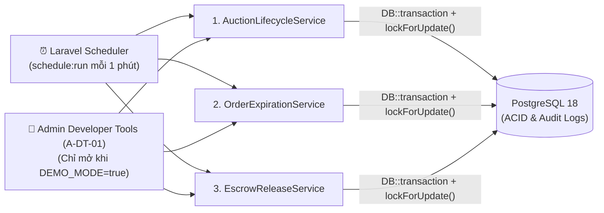

# 03. BACKGROUND JOBS, SCHEDULER & IDEMPOTENT DOMAIN SERVICES – RETRO MARKET (izithrift)

- **Document ID:** `DOC-P404C-CRON-JOBS-WORKERS`
- **Version:** `1.0.0 (COMPLETE BACKGROUND WORKER SPECIFICATION)`
- **Status:** `SELF-VERIFIED & READY FOR PO REVIEW`
- **Project Codename:** `RETRO MARKET`
- **Application Brand Name:** `izithrift`
- **Phase:** `Phase 04 – System Architecture, Database Design & API Specification`
- **Compliance Ref:** `ADR-04..06`, `BR-AU-01..07`, `BR-OR-05`, `BR-FN-04..07`, `BR-DP-02`, `BR-AD-01..02`, `DEC-02`, `DEC-04`, `DEC-07`

---

## Chương 1. Kiến Trúc Tác Vụ Nền Kép: Tự Động Qua Scheduler & Kích Hoạt Tức Thì Qua Demo Mode (`Dual-Trigger Idempotent Worker Architecture`)

Để vừa vận hành chuẩn xác trong môi trường thực tế (`Production Mode`), vừa cho phép trình diễn trực tiếp toàn bộ vòng đời Đấu giá – Đơn hàng – Giải ngân Escrow ngay trong buổi bảo vệ đồ án mà không phải ngồi chờ 24 giờ (`Demo Mode` – `ADR-05`), hệ thống tách biệt **Lớp Điều Phối (`Scheduler / DevTools Controller`)** và **Lớp Nghiệp Vụ Lũy Đẳng (`Idempotent Domain Services`)**:



**Nguyên tắc Vàng về Tính Lũy Đẳng (`Idempotency Guarantee – BR-AD-01`):**
Dù `schedule:run` đang chạy ngầm mỗi phút và đồng thời Admin nhấn nút kích hoạt thủ công trên màn hình `A-DT-01` 5 lần liên tiếp, mỗi bản ghi đủ điều kiện cũng **chỉ được chuyển trạng thái và sinh bút toán tài chính đúng 1 lần duy nhất** nhờ cơ chế kiểm tra trạng thái bên trong khóa dòng `SELECT ... FOR UPDATE SKIP LOCKED`.

---

## Chương 2. Đặc Tả Kỹ Thuật 4 Tiến Trình Tự Động Cốt Lõi (`4 Core Scheduled Jobs`)

### 2.1. Job 1: `OpenScheduledAuctionsJob` (Mở Các Phiên Đấu Giá Tới Giờ)
- **Tần suất chạy:** Mỗi phút (`->everyMinute()->withoutOverlapping()`).
- **Điều kiện quét (`Query Criteria`):**
  ```sql
  SELECT id FROM auctions
  WHERE status = 'SCHEDULED'
    AND auction_starts_at <= CURRENT_TIMESTAMP
  FOR UPDATE SKIP LOCKED;
  ```
- **Chuỗi xử lý nguyên tử (`Atomic Execution Steps`):**
  1. Kiểm tra sản phẩm gắn với phiên vẫn đang có `products.status = 'APPROVED'`.
  2. Cập nhật `auctions.status = 'LIVE'`, `updated_at = CURRENT_TIMESTAMP`.
  3. Gửi thông báo In-App (`notifications`) cho những người dùng đã bấm lưu `auction_watches` rằng phiên đấu giá đã bắt đầu mở nhận giá thầu.

---

### 2.2. Job 2: `CloseExpiredAuctionsJob` (Đóng Phiên Đấu Giá Hết Giờ & Tự Động Tạo Đơn Hàng Cho Người Thắng – `AF-07`, `BR-AU-06..07`, `DEC-04`)
- **Tần suất chạy:** Mỗi phút (`->everyMinute()->withoutOverlapping()`) hoặc kích hoạt tức thì từ **Tác vụ 1 trên `A-DT-01`**.
- **Điều kiện quét (`Query Criteria`):**
  ```sql
  SELECT * FROM auctions
  WHERE status = 'LIVE'
    AND auction_ends_at <= CURRENT_TIMESTAMP
  FOR UPDATE SKIP LOCKED;
  ```
- **Chuỗi xử lý nguyên tử cho từng phiên đấu giá (`DB::transaction()`):**
  - **Nhánh A – Có Người Chiến Thắng Hợp Lệ (`bid_count > 0` VÀ `leading_bidder_id IS NOT NULL` VÀ `current_highest_bid >= COALESCE(reserve_price, starting_price)`):**
    1. Cập nhật bảng `auctions`: `status = 'COMPLETED'`, `winner_id = leading_bidder_id`, `closed_at = CURRENT_TIMESTAMP`.
    2. Cập nhật bảng `products`: `available_quantity = 0`, `status = 'SOLD'`.
    3. **Tính toán chi phí đơn hàng theo `DEC-04`:**
       - `item_subtotal = current_highest_bid`
       - `shipping_fee = 0.00`
       - `buyer_protection_fee = ROUND(item_subtotal * protection_fee_rate) + protection_fixed_fee`
       - `total_amount = item_subtotal + buyer_protection_fee`
       - `seller_net_amount = item_subtotal` *(Seller nhận đủ 100% giá thắng đấu giá)*.
    4. **Tính hạn chót thanh toán (`payment_expires_at` – `BR-AU-07`, `ADR-05`):**
       - Nếu `DEMO_MODE == true`: `CURRENT_TIMESTAMP + INTERVAL '2 minutes'`.
       - Nếu `DEMO_MODE == false`: `CURRENT_TIMESTAMP + INTERVAL '30 minutes'`.
    5. Khởi tạo bản ghi `orders` (`order_source = 'AUCTION'`, `order_status = 'PENDING_PAYMENT'`, `payment_status = 'UNPAID'`, `escrow_status = 'NONE'`), bản chụp `order_items` (`BR-OR-02`) và phiên thanh toán QR `payments`.
    6. Gửi thông báo `AUCTION_WON` cho `winner_id` và thông báo cho `seller_id`.
  - **Nhánh B – Không Có Ai Đặt Giá Hoặc Chưa Đạt Giá Sàn (`bid_count == 0` HOẶC `current_highest_bid < reserve_price`):**
    1. Cập nhật bảng `auctions`: `status = 'ENDED_UNSOLD'`, `closed_at = CURRENT_TIMESTAMP`.
    2. Giữ sản phẩm ở trạng thái cho phép Seller bấm **Đăng lại (`Relist` – `AF-09`)** vào phiên tiếp theo.

---

### 2.3. Job 3: `ExpireUnpaidAuctionOrdersJob` (Hủy Đơn Đấu Giá Quá Hạn Thanh Toán 30 Phút & Xử Lý Bỏ Cọc – `DEC-02`, `AF-09`)
- **Tần suất chạy:** Mỗi phút (`->everyMinute()->withoutOverlapping()`) hoặc kích hoạt tức thì từ **Tác vụ 2 trên `A-DT-01`**.
- **Điều kiện quét (`Query Criteria`):**
  ```sql
  SELECT * FROM orders
  WHERE order_status = 'PENDING_PAYMENT'
    AND payment_status = 'UNPAID'
    AND payment_expires_at <= CURRENT_TIMESTAMP
  FOR UPDATE SKIP LOCKED;
  ```
- **Chuỗi xử lý nguyên tử (`DB::transaction()`):**
  1. Cập nhật bảng `orders`: `order_status = 'CANCELLED'`, `payment_status = 'EXPIRED'`, `cancelled_by_role = 'SYSTEM'`, `cancel_reason = 'Quá thời hạn thanh toán quy định'`, `cancelled_at = CURRENT_TIMESTAMP`.
  2. Cập nhật các bản ghi `payments` đang `'PENDING'` của đơn đó sang `'EXPIRED'`.
  3. **Nếu `order_source === 'AUCTION'` (`DEC-02`):**
     - Cập nhật bảng `auctions`: `status = 'WINNER_DEFAULTED'` (Đánh dấu người thắng bỏ cọc).
     - Tăng bộ đếm vi phạm `seller_profiles.auction_default_count = auction_default_count + 1` đối với `buyer_id` (để hiển thị cảnh báo gian lận cho Admin tại `A-AC-03` và `A-US-02`).
     - Khôi phục `products.available_quantity = 1` để Seller có thể bấm **`[🔄 Đăng lại vào phiên đấu giá mới]`** trên `M-SL-02`.
  4. **Nếu `order_source === 'FIXED_PRICE'`:**
     - Khôi phục `products.available_quantity = available_quantity + order_item.quantity` và chuyển `products.status = 'APPROVED'`.

---

### 2.4. Job 4: `AutoCompleteDeliveredOrdersJob` (Tự Động Hoàn Tất Đơn Đã Giao Sau 24 Giờ & Giải Ngân 100% Tiền Hàng Cho Seller – `BR-OR-05`, `BR-FN-04`, `BR-DP-02`, `DEC-04`)
- **Tần suất chạy:** Mỗi phút (`->everyMinute()->withoutOverlapping()`) hoặc kích hoạt tức thì từ **Tác vụ 3 trên `A-DT-01`**.
- **Điều kiện quét nghiêm ngặt (`Strict Query Criteria`):**
  ```sql
  SELECT * FROM orders
  WHERE order_status = 'DELIVERED'
    AND payment_status = 'PAID'
    AND escrow_status = 'HELD'
    AND dispute_status = 'NONE'
    AND escrow_frozen_at IS NULL
    AND auto_complete_at <= CURRENT_TIMESTAMP
  FOR UPDATE SKIP LOCKED;
  ```
  *(Lưu ý: Nếu đơn hàng đã bị Buyer mở Khiếu nại ở trạng thái `SHIPPED` hoặc `DELIVERED` theo `DEC-03`, cột `dispute_status` sẽ khác `'NONE'` và `escrow_frozen_at` khác `NULL`, nên câu lệnh SQL trên sẽ bỏ qua tuyệt đối 100%, không bao giờ giải ngân nhầm đơn đang tranh chấp).*
- **Chuỗi hạch toán giải ngân nguyên tử trong `EscrowReleaseService::releaseToSeller()`:**
  1. Kiểm tra lũy đẳng: Nếu đã tồn tại bản ghi `wallet_transactions` với `order_id` này thì thoát ngay lập tức.
  2. Khóa dòng `seller_profiles` của `seller_id` (`SELECT * FROM seller_profiles WHERE user_id = :seller_id FOR UPDATE`).
  3. Cập nhật bảng `orders`: `order_status = 'COMPLETED'`, `escrow_status = 'RELEASED'`, `completed_at = CURRENT_TIMESTAMP`.
  4. Ghi bút toán **`RELEASE`** vào bảng `escrow_transactions`:
     - `gross_amount = order.total_amount`
     - `seller_released_amount = order.item_subtotal` *(Giải ngân đủ 100% tiền hàng – `DEC-04`)*
     - `buyer_refunded_amount = 0.00`
     - `platform_fee_retained = order.buyer_protection_fee`.
  5. Ghi bút toán **`CREDIT`** vào bảng `wallet_transactions`:
     - `amount = order.item_subtotal`
     - `balance_before = seller_profile.wallet_balance`
     - `balance_after = seller_profile.wallet_balance + order.item_subtotal`.
  6. Cập nhật bảng `seller_profiles`:
     - `wallet_balance = wallet_balance + order.item_subtotal`
     - `escrow_held_balance = GREATEST(0, escrow_held_balance - order.item_subtotal)`
     - `completed_orders_count = completed_orders_count + 1`.
  7. Gửi thông báo đã giải ngân thành công tới `seller_id` và nhắc `buyer_id` đánh giá 1–5 sao (`M-RV-01`).