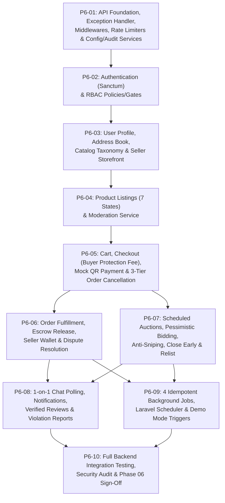

# PHASE 06 MASTER IMPLEMENTATION PLAN – BACKEND DOMAIN SERVICES & REST API DEVELOPMENT

- **Document ID:** `DOC-P600-MASTER-PLAN`
- **Version:** `1.0.0`
- **Status:** DONE / APPROVED
- **Project Codename:** `RETRO MARKET`
- **Application Brand Name:** `izithrift`
- **Technology Stack:** `Laravel 13.x | PHP 8.4 | PostgreSQL 18.x | Redis 7.4 | Laravel Sanctum | Laravel Queue`
- **Phase:** `Phase 06 – Backend Domain Services & REST API Development (P6-01 -> P6-10)`

---

## Chương 1. Tổng Quan Giai Đoạn & Ranh Giới Phạm Vi (`Phase Overview & Scope Boundary`)

### 1.1. Mục Tiêu Cốt Lõi Của Phase 06
Phase 06 hiện thực hóa toàn bộ tầng **Domain Services**, **Policies/Gates**, **FormRequest Validators**, **API Resources**, **RESTful Controllers (`/api/v1/*`)**, và **4 Background Jobs & Scheduler** trên nền tảng cơ sở dữ liệu PostgreSQL 18 đã được kiểm chứng ở Phase 05.

### 1.2. Ranh Giới Phạm Vi Nghiêm Ngặt (`Strict Scope Boundary`)
- **Thuộc phạm vi Phase 06 (`IN SCOPE`):**
  1. Toàn bộ REST API Endpoints `/api/v1/*` phục vụ ứng dụng di động Flutter (`izithrift`).
  2. Toàn bộ **Domain Services dùng chung** (bao gồm cả các dịch vụ kiểm duyệt sản phẩm, phân xử khiếu nại, hủy phiên đấu giá, khóa tài khoản, ghi nhật ký kiểm toán `AuditLogService` mà Admin Dashboard sẽ tái sử dụng ở Phase 08).
  3. Toàn bộ **Authorization Policies & RBAC Middleware** thực thi ma trận 61 quyền (`03_ACTOR_PERMISSION_MATRIX.md`).
  4. **4 Scheduled Background Jobs lũy đẳng** (`OpenScheduledAuctionsJob`, `CloseExpiredAuctionsJob`, `ExpireUnpaidAuctionOrdersJob`, `AutoCompleteDeliveredOrdersJob`).
  5. Bộ **Unit Tests, Feature Tests, Authorization Tests, Negative Tests & Concurrency Tests** cho từng phân hệ.
- **Không thuộc phạm vi Phase 06 (`OUT OF SCOPE`):**
  - Giao diện ứng dụng di động Flutter (`Phase 07`).
  - Giao diện Web Server-Side Rendering Laravel Blade Admin Dashboard `/admin/*` (`Phase 08` — sẽ gọi trực tiếp vào các Domain Services và Policies đã xây dựng hoàn chỉnh ở Phase 06).

---

## Chương 2. Danh Mục Tài Liệu Nguồn Tham Chiếu (`Source Document Inventory`)

| Giai Đoạn | Tài Liệu Nguồn Bắt Buộc Đối Chiếu | Vai Trò Đối Với Phase 06 |
| :---: | :--- | :--- |
| **Phase 01** | `03_ACTOR_PERMISSION_MATRIX.md` `04_FUNCTIONAL_REQUIREMENTS.md` `05_NON_FUNCTIONAL_REQUIREMENTS.md` `06_BUSINESS_RULES.md` `08_ASSUMPTIONS_AND_DECISIONS.md` | Khóa cứng 61 quyền RBAC, công thức `Buyer Protection Fee` (`DEC-04`), hoàn tiền 100% (`DEC-07`), hủy đơn 3 cấp (`DEC-06`), khóa giải ngân khi khiếu nại (`DEC-03`), đăng lại đấu giá (`DEC-02`). |
| **Phase 02** | `01_SITEMAP_AND_NAVIGATION.md` `02..05_*_FLOW.md` `06_SCREEN_INVENTORY.md` | Đảm bảo mọi luồng chuyển trạng thái (`State Transitions`) và mọi nút hành động trên màn hình đều có Service & API tương ứng. |
| **Phase 03** | `DESIGN_TOKENS.md` `MOBILE_SCREENS_SPEC.md` `PROTOTYPE_SCOPE.md` | Xác định chính xác các trường dữ liệu (`fields`, `badges`, `counters`, `server_time`, `timers`) mà API Resources cần trả về cho từng màn hình. |
| **Phase 04** | `SYSTEM_ARCHITECTURE.md` `DB_01..03_*_SCHEMA.md` & `ERD_RELATIONSHIPS.md` `REST_API_GUIDELINES.md` & `API_ENDPOINTS_LIST.md` `CRON_JOBS_WORKERS.md` | Hợp đồng REST API (`/api/v1/*`), cấu trúc JSON Envelope, từ điển `error_code` (`401`, `403`, `404`, `409`, `422`, `429`) và đặc tả 4 Background Jobs. |
| **Phase 05** | `P5_01..P5_06` & `PHASE_05_SIGN_OFF.md` | Nền tảng 34 bảng PostgreSQL 18, 32 Eloquent Models, 9 PHP Backed Enums, Trait `ImmutableLedgerRecord` và bộ Seeders lũy đẳng. |

---

## Chương 3. Đối Soát Cơ Sở Dữ Liệu & Kiến Trúc (`Database & Architecture Reconciliation`)

1. **Giải trình chính thức `30 Thiết kế` vs `34 Bảng Vật lý` vs `32 Eloquent Models`:**
   - **34 Bảng Vật lý trên PostgreSQL 18:** Gồm đúng 18 bảng từ `DB_01_CORE_SCHEMA.md` + 4 bảng từ `DB_02_AUCTION_SCHEMA.md` + 12 bảng từ `DB_03_ORDER_ESCROW_SCHEMA.md` ($18 + 4 + 12 = 34$). Con số 30 ở bảng tóm tắt Phase 04 là do `DB_03` đánh số thứ tự nối tiếp từ 19..30 sau `DB_01` (1..18) mà quên cộng 4 bảng của `DB_02`.
   - **32 Eloquent Models trong `app/Models/`:** Tương ứng 1:1 với 32 bảng nghiệp vụ. Hai bảng còn lại (`personal_access_tokens` và `password_reset_tokens`) do Laravel Sanctum và Laravel Password Broker quản lý trực tiếp.
2. **Xác nhận Kiến trúc Phân lớp (`Layered Domain Architecture`):**
   - `Routes (/api/v1/*)` $\rightarrow$ `Middleware (Sanctum, Active Status, RBAC, Throttle)` $\rightarrow$ `FormRequest (Input Validation)` $\rightarrow$ `Controller (Thin Orchestration)` $\rightarrow$ `Policy (Resource Authorization)` $\rightarrow$ `Domain Service (DB Transaction + Pessimistic Lock + Business Logic + Audit/Notification)` $\rightarrow$ `API Resource + ApiResponse (Standardized JSON Envelope with server_time)`.

---

## Chương 4. Cấu Trúc Phân Rã Công Việc (`Work Breakdown Structure: P6-01 -> P6-10`)

| Mã Gói | Tên Gói Công Việc (`Work Package`) | Phụ Thuộc (`Dependencies`) | Trọng Tâm Nghiệp Vụ, Domain Services & Endpoints | Trạng Thái |
| :---: | :--- | :---: | :--- | :---: |
| **`P6-01`** | **Backend Architecture & API Foundation** | `Phase 05` | - Chuẩn hóa Exception Handler trả JSON Envelope cho mọi lỗi (`401`, `403`, `404`, `409`, `422`, `429`, `500`). - Xây dựng hệ thống Domain Exceptions (`DomainException`, `ConflictStateException`, `SelfTransactionForbiddenException`). - Middlewares nền tảng (`OptionalSanctumAuth`, `EnsureUserIsActive`, `EnsureInternalRole`, `EnsureDemoModeEnabled`), Rate Limiters (`auth`, `transactional`, `polling`), `AuditLogService`, `PlatformConfigService`, và `GET /api/v1/bootstrap`. | `DONE` ✅ |
| **`P6-02`** | **Authentication & Authorization** | `P6-01` | - `AuthService` (`register` tạo nguyên tử User + Profile + SellerProfile + Cart, `login`, `logout`, `forgotPassword`, `resetPassword`). - Kiểm tra `users.status === 'ACTIVE'` & tự động thu hồi token khi bị khóa (`BR-AC-04`). - Hệ thống `Policies` & `Gates` thực thi `03_ACTOR_PERMISSION_MATRIX.md`. | `DONE` ✅ |
| **`P6-03`** | **User, Profile & Category Services** | `P6-02` | - `ProfileService`, `AddressBookService`, `CatalogTaxonomyService`, `SellerStorefrontService`. - Endpoints `/api/v1/profile/*`, `/api/v1/profile/addresses/*`, `/api/v1/catalog/taxonomy`, `/api/v1/sellers/{id}`, `/api/v1/home`. | `DONE` ✅ |
| **`P6-04`** | **Product & Listing Services (incl. Moderation Domain)** | `P6-03` | - `ProductListingService` (CRUD 7 trạng thái, kiểm tra `condition` + `defect_info` `BR-PR-03`, upload ảnh `<= 5MB` `NFR-SEC-05`, khóa sửa khi có giao dịch `BR-PR-05`, gửi duyệt lại `Resubmit` `DEC-05`). - `ProductModerationService` (Duyệt/Từ chối bắt buộc có lý do `DEC-05`, gán `verification_level`). - Endpoints `/api/v1/products/*` và `/api/v1/seller/products/*`. | DONE ✅ |
| **`P6-05`** | **Cart, Order & Payment Services** | `P6-04` | - `CartService` (Gom nhóm theo Seller `BR-OR-01`, chặn tự thêm hàng của mình `BR-AC-02`). - `CheckoutService` (Tính `Buyer Protection Fee` tại Server `DEC-04` & `NFR-SEC-03`, khóa dòng `products` `FOR UPDATE` chống Overselling `OF-02`, đóng băng `order_items` & `shipping_address_snapshot` `BR-OR-02`). - `MockQrPaymentService` (Thanh toán QR lũy đẳng `BR-FN-03`, ghi bút toán `HOLD` vào `escrow_transactions`, tăng `escrow_held_balance`). - `OrderCancellationService` (Hủy đơn 3 cấp `DEC-06` & Hoàn trả 100% `total_amount` `DEC-07`). | DONE ✅ |
| **`P6-06`** | **Escrow, Shipping & Dispute Services** | `P6-05` | - `OrderFulfillmentService` (`prepare`, `ship` tạo vận đơn `shipments`, `deliver` đóng băng `auto_complete_at` `BR-OR-05`). - `EscrowReleaseService` (Buyer xác nhận nhận hàng `confirm-delivery` giải ngân 100% `item_subtotal` vào `wallet_balance` `DEC-04`, ghi `wallet_transactions`). - `DisputeService` (Mở khiếu nại ở `SHIPPED`/`DELIVERED` khóa cứng giải ngân `DEC-03` & `BR-DP-02`, tải bằng chứng, và hàm phân xử 3 phán quyết tài chính của Admin `APPROVE_BUYER_REFUND`, `RELEASE_TO_SELLER`, `PARTIAL_REFUND` `DEC-07` & `BR-FN-06`). | DONE ✅ |
| **`P6-07`** | **Auction Domain Services** | `P6-05` | - `AuctionQueryService` (Hub tabs, Watchlist, Participating, Won). - `AuctionBiddingService` (`DB::transaction` + `lockForUpdate()`, chặn tự đặt giá `BR-AC-02`, kiểm tra bước giá, trả `409 AUCTION_OUTBID_CONFLICT` kèm `latest_state`, tự động gia hạn **Anti-Sniping** `BR-AU-04`, thông báo `AUCTION_OUTBID`). - `AuctionLifecycleService` (Chốt phiên sớm `closeEarly` `BR-AU-05`, đăng lại `relist` `DEC-02`, mở/đóng phiên tự động). | DONE ✅ |
| **`P6-08`** | **Chat, Notification, Review & Engagement Services** | `P6-06` `P6-07` | - `ConversationChatService` (Chuẩn hóa `user_one_id < user_two_id`, gửi tin nhắn kèm ngữ cảnh sản phẩm/đơn hàng, HTTP Polling `?after_id=` `ADR-08`). - `NotificationService` (Tạo & đọc thông báo Deep-Linking). - `ReviewService` (Đánh giá 1–5 sao xác thực từ đơn `COMPLETED` `BR-RV-01`, cập nhật `average_rating`). - `ViolationReportService` (`reports` + chặn chat). | `DONE ✅` |
| **`P6-09`** | **Background Jobs & Scheduler** | `P6-06` `P6-07` | - Hiện thực hóa 4 Jobs lũy đẳng (`FOR UPDATE SKIP LOCKED`): `OpenScheduledAuctionsJob`, `CloseExpiredAuctionsJob`, `ExpireUnpaidAuctionOrdersJob`, `AutoCompleteDeliveredOrdersJob`. - Cấu hình `routes/console.php` (Scheduler mỗi phút) & `SystemDevToolsService` (Kích hoạt thủ công trong Demo Mode `ADR-05`). | `DONE ✅` |
| **`P6-10`** | **Backend Integration, E2E API Testing & Phase 06 Sign-Off** | `P6-01..09` | - Kiểm thử tích hợp toàn tuyến (End-to-End API Journeys), kiểm toán lại sổ cái sau hàng loạt giao dịch test, rà soát bảo mật/phân quyền, đóng gói Postman/OpenAPI documentation và ký nghiệm thu `PHASE_06_SIGN_OFF.md`. | `**NEXT** 🚀` |

---

## Chương 5. Sơ Đồ Phụ Thuộc Giữa Các Phân Hệ (`Module Dependency Graph`)

---

## Chương 6. Chiến Lược Phát Triển API, Bảo Mật & Kiểm Thử (`API, Security & Testing Strategy`)

1. **Chuẩn Hóa Phản Hồi & Mã Lỗi (`API Contract Enforcement`):**
   - Toàn bộ phản hồi từ `/api/v1/*` đều đi qua `App\Support\ApiResponse` và `JsonResource`, đảm bảo luôn có `"success"`, `"message"`, `"server_time"` (ISO-8601 `+07:00`) và `"data"` / `"meta"` / `"error_code"`.
   - Không bao giờ để Laravel trả về HTML Error Page hay cấu trúc mặc định thiếu `error_code` và `server_time` khi gọi vào `/api/v1/*`.
2. **Chiến Lược Bảo Mật Đa Tầng (`Defense-in-Depth Security`):**
   - **Tầng 1 (Rate Limiting):** Chống Brute-force (`5 req/min` cho Auth), chống Spam giao dịch (`30 req/min` cho Bid/Checkout/Payment), kiểm soát Polling (`60 req/min`).
   - **Tầng 2 (Authentication & Account Status):** `EnsureUserIsActive` chặn tức thì tài khoản `SUSPENDED` / `BANNED` (`403 ACCOUNT_SUSPENDED`).
   - **Tầng 3 (Authorization Policies):** Kiểm tra quyền sở hữu tài nguyên và phân tách rạch ròi quyền giữa `admin`, `moderator`, `support` và `registered_user`.
   - **Tầng 4 (Server-Authoritative Financial Math):** Không bao giờ nhận giá tiền hoặc phí từ request của Client (`NFR-SEC-03`).
3. **Chiến Lược Kiểm Thử (`Comprehensive Testing Strategy`):**
   - Mỗi gói `P6-01` $\rightarrow$ `P6-09` đều đi kèm một file Feature/Unit Test riêng biệt chạy trực tiếp trên PostgreSQL 18 (bọc trong Transaction/Savepoint để bảo toàn dữ liệu mẫu).
   - Không chuyển sang gói tiếp theo nếu bộ test của gói hiện tại hoặc các gói trước đó (`Regression Suite`) có bất kỳ bài test nào `FAIL`.

---

## Chương 7. Tiêu Chí Nghiệm Thu Tổng Thể Phase 06 (`Phase 06 Exit Criteria`)

- [ ] Toàn bộ 10 gói công việc (`P6-01` đến `P6-10`) hoàn thành 100% mã nguồn và tài liệu đặc tả.
- [ ] 100% REST API Endpoints trong `API_ENDPOINTS_LIST.md` hoạt động đúng hợp đồng dữ liệu.
- [ ] Toàn bộ các quy tắc nghiệp vụ cốt lõi (`BR-AC-01..04`, `BR-PR-01..05`, `BR-AU-01..07`, `BR-OR-01..05`, `BR-FN-01..07`, `DEC-01..07`) được bảo vệ bởi cả Domain Services và PostgreSQL Constraints.
- [ ] 100% bài kiểm thử PHPUnit (Foundation + P6-01..P6-10) đạt `PASS` với `0 failures, 0 errors`.