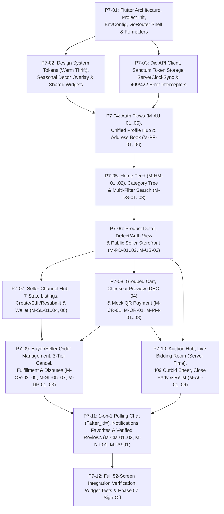

# PHASE 07 MASTER IMPLEMENTATION PLAN – FLUTTER MOBILE APPLICATION DEVELOPMENT (`izithrift`)

- **Document ID:** `DOC-P700-MASTER-PLAN`
- **Version:** `1.0.0`
- **Status:** `PROPOSED FOR PO APPROVAL`
- **Project Codename:** `RETRO MARKET`
- **Application Brand Name:** `izithrift`
- **Target Client Stack:** `Flutter 3.x (Dart 3.x) | Riverpod | GoRouter | Dio | FlutterSecureStorage`
- **Backend API Target:** `Laravel 13 REST API (/api/v1/*) | PostgreSQL 18 | Redis 7.4`
- **Phase:** `Phase 07 – Flutter Mobile Application Development (P7-01 -> P7-12)`

---

## Chương 1. Tổng Quan Giai Đoạn, Triết Lý Tích Hợp & Ranh Giới Phạm Vi (`Phase Overview & Integration Philosophy`)

### 1.1. Mục Tiêu Cốt Lõi Của Phase 07
Xây dựng hoàn chỉnh ứng dụng di động **Flutter (`mobile/`)** cho nền tảng mua bán và đấu giá đồ secondhand **izithrift (`Retro Market`)**, hiện thực hóa trọn vẹn **52 màn hình Mobile (`M-*`)** đã được phê duyệt ở Phase 02 và Phase 03, đồng thời tích hợp trực tiếp với hệ thống REST API `/api/v1/*` của Phase 06.

### 1.2. Nguyên Tắc Bắt Buộc: Phân Biệt `Backend API Tested` vs `Flutter Client Integrated`
Trong suốt Phase 07, mọi gói công việc (`P7-01` $\rightarrow$ `P7-12`) phải tuân thủ nguyên tắc kiểm chứng hai đầu:
1. **`API Backend Tested (Phase 06)`:** Chỉ có nghĩa là Endpoint đã phản hồi đúng trong môi trường PHPUnit.
2. **`Flutter Client Integrated (Phase 07)`:** Một tính năng chỉ được coi là hoàn thành khi tầng Flutter thực hiện trọn vẹn:
   - Parse an toàn mọi kiểu dữ liệu từ JSON Envelope của Laravel (đặc biệt là cột `decimal:2` từ PostgreSQL 18 trả về dưới dạng chuỗi `"400000.00"` hoặc số, cột `TIMESTAMPTZ` ISO-8601, và cấu trúc phân trang `meta`).
   - Đồng bộ độ lệch thời gian (`ServerClockOffset = server_time - device_time`) từ mọi response để hiển thị đồng hồ đếm ngược chính xác tuyệt đối (`BR-AU-01`).
   - Bắt và hiển thị đúng thông điệp/hành vi UI cho từng mã lỗi nghiệp vụ: `401 UNAUTHENTICATED`, `403 ACCOUNT_SUSPENDED`, `403 SELF_TRANSACTION_FORBIDDEN`, `404 RESOURCE_NOT_AVAILABLE`, `409 AUCTION_OUTBID_CONFLICT` (cập nhật ngay `latest_state` lên Bottom Sheet), `409 PRODUCT_OUT_OF_STOCK`, `409 INVALID_STATE_TRANSITION`, `422 VALIDATION_ERROR`, `429 TOO_MANY_REQUESTS`.
   - Quản lý đầy đủ 4 trạng thái giao diện trên mọi màn hình: `Loading (Skeleton/Shimmer)`, `Content`, `Empty State`, và `Error State (with Retry)`.

---

## Chương 2. Danh Mục Tài Liệu Nguồn Tham Chiếu (`Mandatory Source Inventory`)

| Giai Đoạn | Tài Liệu Nguồn Đối Chiếu | Vai Trò Đối Với Thiết Kế & Lập Trình Flutter (Phase 07) |
| :---: | :--- | :--- |
| **Phase 01** | `03_ACTOR_PERMISSION_MATRIX.md`<br>`06_BUSINESS_RULES.md`<br>`08_ASSUMPTIONS_AND_DECISIONS.md` | Quy tắc ẩn/khóa nút Mua & Đặt giá khi `is_owner == true` (`BR-AC-02`), công thức hiển thị `Buyer Protection Fee` (`DEC-04`), luồng hủy đơn 3 cấp (`DEC-06`), hoàn tiền 100% (`DEC-07`), đăng lại đấu giá (`DEC-02`). |
| **Phase 02** | `01_SITEMAP_AND_NAVIGATION.md`<br>`02..05_*_FLOW.md`<br>`06_SCREEN_INVENTORY.md` | Cấu trúc **5-Tab Bottom Navigation Bar** (`Home`, `Discover`, `Auctions`, `Messages`, `Profile`), luồng chuyển màn hình (`GoRouter`) và danh mục 52 màn hình Mobile. |
| **Phase 03** | `DESIGN_TOKENS.md`<br>`COMPONENT_LIBRARY.md`<br>`MOBILE_SCREENS_SPEC.md` | Bảng màu `Warm Thrift Palette` (Kem cổ điển `#FBF8F3`, Đất nung `#C85A32`, Xanh lá thông `#2D5A3C`, Vàng đồng `#D4AF37`), Typography, huy hiệu `ConditionBadge`, `VerificationBadge`, và `SeasonalDecorOverlay` (`NFR-UX-02`). |
| **Phase 04 & 06** | `REST_API_GUIDELINES.md`<br>`API_ENDPOINTS_LIST.md`<br>`P6_01..P6_10` & `backend/routes/api.php` | Hợp đồng REST API thực tế, danh sách 58+ endpoints `/api/v1/*`, cấu trúc `ApiResponse` và các `JsonResource` trong `backend/app/Http/Resources/Api/V1/`. |

---

## Chương 3. Kiến Trúc Kỹ Thuật Ứng Dụng Flutter (`Flutter Technical Architecture`)

### 3.1. Lựa Chọn Công Nghệ & Thư Viện Chuẩn Hóa (`Approved Flutter Tech Stack`)
- **Framework & Ngôn ngữ:** `Flutter 3.x` / `Dart 3.x` (Null-safety nghiêm ngặt).
- **Quản lý Trạng thái & Dependency Injection (`State Management`):** `flutter_riverpod` (`Notifier` / `AsyncNotifier` / `FutureProvider`) — đảm bảo tách biệt hoàn toàn UI (`Widget`) khỏi Logic gọi API (`Repository` / `Controller`) và dễ dàng viết Unit/Widget Tests.
- **Định tuyến & Deep-Linking (`Routing`):** `go_router` — hỗ trợ `StatefulShellRoute.indexedStack` cho 5 tab chính, Auth Guard tự động chuyển hướng khi chưa đăng nhập hoặc bị khóa tài khoản, và điều hướng Deep-Link từ thông báo (`deep_link_route` trong bảng `notifications`).
- **Tầng Mạng (`Networking`):** `dio` với hệ thống 4 Interceptors chuyên biệt:
  1. `AuthBearerInterceptor`: Tự động đính kèm Sanctum Bearer Token từ `FlutterSecureStorage`.
  2. `ServerClockSyncInterceptor`: Đọc trường `"server_time"` trong mọi JSON response của Backend để cập nhật `ServerTimeService` (`offset = serverTime.difference(DateTime.now())`), phục vụ đồng hồ đếm ngược phiên đấu giá và hạn thanh toán 30 phút (`BR-AU-01`).
  3. `ApiEnvelopeErrorInterceptor`: Chuyển đổi mọi lỗi HTTP (`401`, `403`, `404`, `409`, `422`, `429`) thành đối tượng `ApiException` có cấu trúc gồm `errorCode`, `message`, `fieldErrors` và `latestState`. Nếu gặp `401 UNAUTHENTICATED` hoặc `403 ACCOUNT_SUSPENDED`, tự động xóa token và đưa người dùng về màn hình Đăng nhập kèm thông báo lý do.
  4. `LoggingInterceptor` (chỉ bật ở chế độ Debug).
- **Cơ chế HTTP Short-Polling Có Kiểm Soát (`Lifecycle-Aware Polling – ADR-08, NFR-PER-03`):**
  - Xây dựng `LifecyclePollingMixin` / `PollingTimerController` kết hợp `WidgetsBindingObserver`:
  - Trong Phòng Đấu Giá (`M-AC-03`): Poll mỗi `3–5 giây` chỉ khi màn hình đang hiển thị (`AppLifecycleState.resumed`); tự động dừng (`cancel()`) ngay khi thoát màn hình hoặc hạ ứng dụng xuống nền.
  - Trong Phòng Chat 1-1 (`M-CM-02`): Poll `GET /api/v1/conversations/{id}/messages?after_id={last_id}` mỗi `3–5 giây` khi đang mở phòng chat, chỉ nối thêm tin nhắn mới (`id > last_id`).

### 3.2. Cấu Trúc Thư Mục Phân Lớp Theo Tính Năng (`Feature-First Layered Architecture`)
```text
mobile/
├── pubspec.yaml
├── analysis_options.yaml
├── lib/
│   ├── main.dart
│   ├── app.dart
│   ├── core/
│   │   ├── config/              # EnvConfig (API Base URL cho Android Emulator 10.0.2.2 / Windows / iOS)
│   │   ├── constants/           # ApiEndpoints, StorageKeys, AppConstants
│   │   ├── error/               # ApiException, ErrorCodeEnum, FailureHandler
│   │   ├── network/             # DioClient, AuthInterceptor, ServerClockInterceptor, ApiEnvelopeParser
│   │   ├── router/              # AppRouter (GoRouter + 5-Tab Shell + Auth Redirect Guard)
│   │   ├── services/            # ServerTimeService, SecureTokenStorage, PollingManager
│   │   ├── theme/               # RetroTheme, DesignTokens, AppColors, AppTypography, SeasonalDecorProvider
│   │   ├── utils/               # VndCurrencyFormatter, DateTimeFormatter, SafeDecimalParser
│   │   └── widgets/             # Shared UI Components (ConditionBadge, VerificationBadge, CountdownTimerWidget, PriceBreakdownCard, EmptyErrorStates...)
│   └── features/
│       ├── auth/                # M-AU-01..05 (Splash, Onboarding, Login, Register, Forgot/Reset Password)
│       ├── home/                # M-HM-01..02 (Home Feed, Seasonal Banner, Live Auctions Strip)
│       ├── catalog/             # M-DS-01..04 (Category Tree, Search & Multi-Filter Sheet, Image Zoom)
│       ├── product/             # M-PD-01..02, M-US-03 (Product Detail, Defect/Auth View, Public Seller Storefront)
│       ├── seller/              # M-SL-01..08 (Seller Hub, 7-State Listings, Create/Edit/Resubmit, Seller Orders, Ship, Wallet)
│       ├── cart_checkout/       # M-CR-01, M-OR-01, M-PM-01..02 (Grouped Cart, Checkout Preview DEC-04, Mock QR Payment)
│       ├── orders_disputes/     # M-OR-02..05, M-DP-01..02, M-RV-01 (Purchases, 4-State Detail, 3-Tier Cancel, Disputes, Review)
│       ├── auctions/            # M-AC-01..05 (Auction Hub, My Auctions, Live Bidding Room, Bid Sheet 409 Handler, Close Early)
│       ├── chat_notifications/  # M-CM-01..03, M-NT-01 (Inbox, 1-on-1 Polling Chat, Violation Report, Notifications)
│       └── profile/             # M-PF-01..06 (Unified Profile Hub, Edit Profile, Address Book, Favorites, Settings)
└── test/
    ├── core/                    # Unit tests cho ServerTimeService, SafeDecimalParser, ApiEnvelopeParser, DesignTokens
    └── features/                # Widget & Integration tests cho từng gói P7-01..P7-12
```

---

## Chương 4. Kiểm Kê & Ánh Xạ Toàn Bộ 52 Màn Hình Mobile Vào 12 Gói Công Việc (`52 Mobile Screens to WBS Mapping`)

Để đảm bảo **không bỏ sót bất kỳ màn hình nào** trong `06_SCREEN_INVENTORY.md` (Phase 02) và `MOBILE_SCREENS_SPEC.md` (Phase 03), toàn bộ **52 màn hình/trạng thái giao diện Mobile** được kiểm kê và phân bổ chính xác vào các gói `P7-04` đến `P7-11` (trong khi `P7-01`..`P7-03` là nền tảng kiến trúc và `P7-12` là tích hợp nghiệm thu):

| Gói WBS | Tên Gói Công Việc | Mã Màn Hình (`Screen IDs`) | Số Lượng Màn Hình | Chi Tiết Các Màn Hình & Thành Phần UI Trong Gói |
| :---: | :--- | :--- | :---: | :--- |
| **`P7-01`** | **Flutter Architecture & Foundation** | *Core Infrastructure* | *Nền tảng* | Khởi tạo dự án `mobile/`, cấu hình `pubspec.yaml`, `EnvConfig`, `AppRouter` khung sườn 5-Tab Navigation Shell (`NAV-DEC-01`), Utils định dạng tiền tệ VNĐ & `SafeDecimalParser`. |
| **`P7-02`** | **Design System & UI Components** | *Shared UI Library* | *Thư viện UI* | Hiện thực hóa `DesignTokens` (`Warm Thrift` + `Christmas Seasonal`), `SeasonalDecorOverlay` (`NFR-UX-02`), `ConditionBadge`, `VerificationBadge`, `ServerCountdownTimer`, `PriceBreakdownCard` (`DEC-04`), `ProductCard`, `AuctionCard`, `SkeletonLoader`, `ErrorRetryView`. |
| **`P7-03`** | **API Client & State Management** | *Networking & Sync* | *Tầng mạng* | `DioClient`, `AuthBearerInterceptor`, `ServerClockSyncInterceptor` (`BR-AU-01`), `ApiEnvelopeErrorInterceptor` (`401/403/404/409/422/429`), `SecureTokenStorage`, `LifecyclePollingController` (`ADR-08`). |
| **`P7-04`** | **Authentication & User Profile** | `M-AU-01`..`M-AU-05`<br>`M-PF-01`..`M-PF-04`, `M-PF-06` | **10 màn hình** | 1. `M-AU-01`: Splash & Bootstrap Sync (`/api/v1/bootstrap`)<br>2. `M-AU-02`: Onboarding Walkthrough (3 slides)<br>3. `M-AU-03`: Đăng nhập & Cảnh báo khóa tài khoản (`403 ACCOUNT_SUSPENDED`)<br>4. `M-AU-04`: Đăng ký tài khoản hợp nhất (`BR-AC-01`)<br>5. `M-AU-05`: Quên & Đặt lại mật khẩu<br>6. `M-PF-01`: Trung tâm Cá nhân Hợp nhất (Bộ đếm đơn hàng + Lối vào Kênh Người bán `NAV-DEC-02`)<br>7. `M-PF-02`: Chỉnh sửa hồ sơ & Upload Avatar<br>8. `M-PF-03`: Danh sách Sổ địa chỉ nhận hàng<br>9. `M-PF-04`: Thêm / Sửa địa chỉ nhận hàng (`is_default`)<br>10. `M-PF-06`: Cài đặt ứng dụng (Toggle hiệu ứng Giáng sinh `NFR-UX-02` & Đổi mật khẩu) |
| **`P7-05`** | **Home, Catalog & Search** | `M-HM-01`..`M-HM-02`<br>`M-DS-01`..`M-DS-03` | **5 màn hình** | 11. `M-HM-01`: Trang chủ Khám phá (Seasonal Banner, Danh mục, Đấu giá `LIVE`, Tiệm uy tín, Hàng mới duyệt)<br>12. `M-HM-02`: Danh sách Tiệm đồ si nổi bật / Bộ sưu tập theo mùa<br>13. `M-DS-01`: Cây Danh mục & Thương hiệu (`Categories & Brands`)<br>14. `M-DS-02`: Tìm kiếm từ khóa & Kết quả lọc sản phẩm<br>15. `M-DS-03`: Bottom Sheet Bộ lọc Đa tiêu chí (Độ mới, Khoảng giá `min <= max`, Loại hình bán, Sắp xếp) |
| **`P7-06`** | **Product Detail & Seller Storefront** | `M-PD-01`..`M-PD-02`<br>`M-DS-04`, `M-US-03` | **4 màn hình** | 16. `M-PD-01`: Chi tiết Sản phẩm Giá cố định (Ẩn/Khóa nút Mua nếu `is_owner == true` `BR-AC-02`)<br>17. `M-PD-02`: Hộp thông tin Độ mới, Mô tả vết xước (`defect_info`) & Bằng chứng xác minh<br>18. `M-DS-04`: Trình xem ảnh phóng to toàn màn hình (`Full-Screen Defect & Gallery Image Viewer`)<br>19. `M-US-03`: Trang Cửa hàng Công khai của Tiệm (`Trust Score`, `Follow Toggle`, 3 Tab Sản phẩm & Tab Đánh giá xác thực) |
| **`P7-07`** | **Seller Channel (Listings & Hub)** | `M-SL-01`..`M-SL-04`<br>`M-SL-08` | **5 màn hình** | 20. `M-SL-01`: Bảng điều khiển Kênh Người bán (`Seller Hub`: Số dư Ví, Escrow đang giữ, Bộ đếm việc cần làm)<br>21. `M-SL-02`: Quản lý Sản phẩm của Tiệm theo **7 Trạng thái** (`DRAFT`, `PENDING_REVIEW`, `APPROVED`, `REJECTED`, `SOLD`, `HIDDEN`, `ARCHIVED` + Nút `Relist` `DEC-02`)<br>22. `M-SL-03`: Đăng bán Sản phẩm mới (`FIXED_PRICE` / `AUCTION`, bắt buộc `condition` + `defect_info` `BR-PR-03`, chọn khung giờ phiên, upload ảnh `<= 5MB`)<br>23. `M-SL-04`: Chỉnh sửa & **Gửi duyệt lại (`Resubmit`)** sản phẩm bị từ chối (Ghim hộp lý do từ chối của Moderator ở đầu màn hình `DEC-05`)<br>24. `M-SL-08`: Sổ cái Ví Người bán & Đối soát Escrow Read-Only (`wallet_balance`, `escrow_held_balance`, lịch sử `CREDIT`) |
| **`P7-08`** | **Cart, Checkout & QR Payment** | `M-CR-01`, `M-OR-01`<br>`M-PM-01`..`M-PM-03` | **5 màn hình** | 25. `M-CR-01`: Giỏ hàng gom nhóm theo từng Tiệm (`seller_groups[]` – `BR-OR-01`)<br>26. `M-OR-01`: Xác nhận Đặt hàng & Bảng kê chi phí minh bạch (`item_subtotal`, `shipping_fee = 0`, `buyer_protection_fee = 6% + 7.000đ`, `total_amount` – `DEC-04`)<br>27. `M-PM-01`: Màn hình Quét mã QR Thanh toán mô phỏng kèm đồng hồ đếm ngược & 2 nút Giả lập (`Simulate Success` / `Simulate Failure`)<br>28. `M-PM-02`: Kết quả Thanh toán Thành công (`ESCROW_HELD` Confirmation)<br>29. `M-PM-03`: Kết quả Thanh toán Thất bại / Hết hạn & Cấp lại mã QR mới |
| **`P7-09`** | **Order, Fulfillment & Disputes** | `M-OR-02`..`M-OR-05`<br>`M-SL-05`..`M-SL-07`<br>`M-DP-01`..`M-DP-03` | **10 màn hình** | 30. `M-OR-02`: Danh sách Đơn mua của tôi (7 Tab trạng thái)<br>31. `M-OR-03`: Chi tiết Đơn mua (Hiển thị 4 máy trạng thái `Order / Payment / Escrow / Dispute`, Snapshot sản phẩm, Nút `Đã nhận được hàng` giải ngân 100% tiền hàng)<br>32. `M-OR-04`: Hộp thoại Hủy đơn / Gửi yêu cầu xin hủy 3 cấp (`DEC-06`, `DEC-07`) & Rút lại yêu cầu hủy (`Withdraw Cancel Request`)<br>33. `M-OR-05`: Dòng thời gian Hành trình Vận đơn & Sổ cái Escrow của đơn hàng<br>34. `M-SL-05`: Danh sách Đơn bán của Tiệm (Lọc theo trạng thái cần xử lý)<br>35. `M-SL-06`: Chi tiết Đơn bán cho Chủ tiệm (Nút `Chuẩn bị hàng`, `Đánh dấu đã giao`, và Phê duyệt/Từ chối yêu cầu xin hủy ở `PREPARING` `DEC-06`)<br>36. `M-SL-07`: Biểu mẫu Nhập đơn vị vận chuyển & Mã vận đơn (`Ship Order Modal/Screen`)<br>37. `M-DP-01`: Biểu mẫu Mở Khiếu nại Trả hàng / Hoàn tiền (Chỉ bật ở `SHIPPED` & `DELIVERED` `DEC-03`, khóa cứng giải ngân `BR-DP-02`)<br>38. `M-DP-02`: Chi tiết Hồ sơ Khiếu nại & Dòng thời gian Bằng chứng 2 chiều (`Buyer Proof` vs `Seller Counter-Evidence` vs `Support Note`)<br>39. `M-DP-03`: Biểu mẫu Gửi bổ sung Bằng chứng / Giải trình đối chứng của Người bán |
| **`P7-10`** | **Auction Experience** | `M-AC-01`..`M-AC-06` | **6 màn hình** | 40. `M-AC-01`: Sàn Đấu giá Theo Phiên (`Auction Hub`: 4 Tab `Đang diễn ra`, `Sắp kết thúc`, `Sắp mở`, `Đã kết thúc`)<br>41. `M-AC-02`: Đấu giá của Tôi (`Đang tham gia` kèm huy hiệu `DẪN ĐẦU` / `BỊ VƯỢT GIÁ`, `Đang theo dõi`, `Đã thắng` kèm đếm ngược thanh toán 30 phút)<br>42. `M-AC-03`: Phòng Đấu giá Trực tiếp (`Live Bidding Room`: Đồng hồ đếm ngược đồng bộ `server_time`, huy hiệu **Anti-Sniping `+2 phút`** `BR-AU-04`, lịch sử trả giá Polling)<br>43. `M-AC-04`: Bottom Sheet Đặt Giá Thầu (Gợi ý bước giá tối thiểu, bắt lỗi `409 AUCTION_OUTBID_CONFLICT` tự động cập nhật `latest_state` ngay trên Sheet)<br>44. `M-AC-05`: Hộp thoại Chủ tiệm Chốt Phiên Sớm (`Seller Close Early Confirmation` – `BR-AU-05`)<br>45. `M-AC-06`: Biểu mẫu Đăng lại Sản phẩm Đấu giá (`Seller Relist Auction Modal/Screen` sau khi `ENDED_UNSOLD` hoặc `WINNER_DEFAULTED` – `DEC-02`) |
| **`P7-11`** | **Chat, Notifications & Engagement** | `M-CM-01`..`M-CM-03`<br>`M-NT-01`, `M-PF-05`<br>`M-RV-01`..`M-RV-02` | **7 màn hình** | 46. `M-CM-01`: Hộp thư Tin nhắn (`Conversation Inbox` kèm số tin chưa đọc)<br>47. `M-CM-02`: Phòng Chat 1-1 (Ghim thẻ ngữ cảnh Sản phẩm/Đơn hàng, HTTP Polling `?after_id=`, trạng thái bị chặn `blocked`)<br>48. `M-CM-03`: Biểu mẫu Báo cáo Vi phạm & Chặn người dùng (`Report & Block Modal/Screen`)<br>49. `M-NT-01`: Trung tâm Thông báo In-App (Phân loại Tab, Đánh dấu đã đọc, Điều hướng Deep-Link)<br>50. `M-PF-05`: Danh sách Sản phẩm Yêu thích & Tiệm Đang Theo dõi (`Saved Favorites & Followed Shops`)<br>51. `M-RV-01`: Biểu mẫu Viết Đánh giá 1–5 Sao Xác thực (Chỉ mở từ đơn `COMPLETED` – `BR-RV-01`)<br>52. `M-RV-02`: Danh sách Đánh giá của Tiệm (Lọc theo số sao `1..5`) |
| **`P7-12`** | **Integration & Mobile Sign-Off** | *E2E Verification* | *Tổng: **52*** | Kiểm thử tích hợp toàn bộ 52 màn hình với Backend `/api/v1/*`, kiểm tra xử lý lỗi mạng/xung đột, chạy `flutter analyze` & `flutter test`, nghiệm thu bàn giao Phase 07. |

---

## Chương 5. Sơ Đồ Phụ Thuộc Giữa 12 Gói Công Việc (`P7-01` $\rightarrow$ `P7-12`)



---

## Chương 6. Ma Trận Đồng Bộ Hợp Đồng Dữ Liệu Giữa Laravel Backend (Phase 06) và Flutter (Phase 07)

Để ngăn ngừa lỗi lệch kiểu dữ liệu (`Type Cast Exception`) khi Flutter kết nối với Laravel 13 + PostgreSQL 18, mọi Model trong Flutter bắt buộc sử dụng bộ parser an toàn (`SafeJsonParser`):

| Trường Dữ Liệu Từ Laravel `/api/v1/*` | Định Dạng Thực Tế Trong JSON Response | Quy Tắc Parse Bắt Buộc Trong Dart (`Flutter Model`) |
| :--- | :--- | :--- |
| **Tiền tệ & Tỷ lệ (`NUMERIC(15,2)`, `decimal:2`)** | Chuỗi `"400000.00"` hoặc số `400000` | Luôn dùng `SafeDecimalParser.toDouble(json['price'])` (chấp nhận cả `String`, `int`, `double`, `null`) để không bao giờ bị lỗi `type 'String' is not a subtype of type 'num'`. |
| **Thời gian (`TIMESTAMPTZ` ISO-8601)** | `"2026-11-14T18:30:00+07:00"` | Dùng `DateTime.tryParse(json['...'])?.toLocal()`. Khi tính thời gian đếm ngược (`remainingSeconds`), luôn so sánh `targetTime` với **`ServerTimeService.now()`** thay vì `DateTime.now()` của máy điện thoại (`BR-AU-01`). |
| **Xung đột Đặt giá (`409 AUCTION_OUTBID_CONFLICT`)** | `{"success": false, "error_code": "AUCTION_OUTBID_CONFLICT", "latest_state": {...}}` | Khi `DioException` trả về `409` với `error_code == 'AUCTION_OUTBID_CONFLICT'`, đọc ngay `latest_state` để cập nhật `current_highest_bid`, `minimum_next_bid`, `auction_ends_at`, `extended_count` ngay trên Bottom Sheet `M-AC-04` mà không bắt người dùng tải lại toàn trang. |
| **Upload Ảnh Multipart (`avatar`, `images[]`, `files[]`)** | `POST` hoặc `PUT` (với `_method: PUT`) | Khi gửi request cập nhật có kèm file (`UpdateProfile`, `UpdateProduct`), dùng `POST` kèm `FormData.fromMap({'_method': 'PUT', ...})` để PHP/Laravel luôn nhận đầy đủ cả text fields lẫn files. |

---

## Chương 7. Tiêu Chí Nghiệm Thu Tổng Thể Phase 07 (`Phase 07 Exit Criteria`)

- [ ] Toàn bộ 12 gói công việc (`P7-01` đến `P7-12`) và **52 màn hình Mobile** được hiện thực hóa đầy đủ trong `mobile/`.
- [ ] `flutter analyze` báo **0 issues (0 errors, 0 warnings)**.
- [ ] `flutter test` đạt **100% PASS** cho toàn bộ Unit Tests và Widget Tests của từng gói.
- [ ] Kiểm chứng kết nối thực tế giữa ứng dụng Flutter và Backend `/api/v1/*` trên toàn bộ các luồng nghiệp vụ trọng yếu (`Auth`, `Product Search`, `Seller Listing & Resubmit`, `Cart & Checkout DEC-04`, `Mock QR Escrow Hold`, `3-Tier Cancel DEC-06/07`, `Confirm Delivery 100% Release`, `Dispute Freeze`, `Live Bidding & Anti-Sniping`, `1-on-1 Chat Polling`).